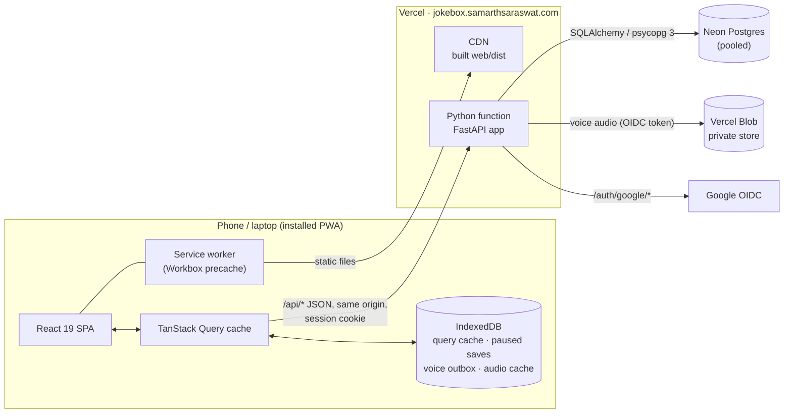
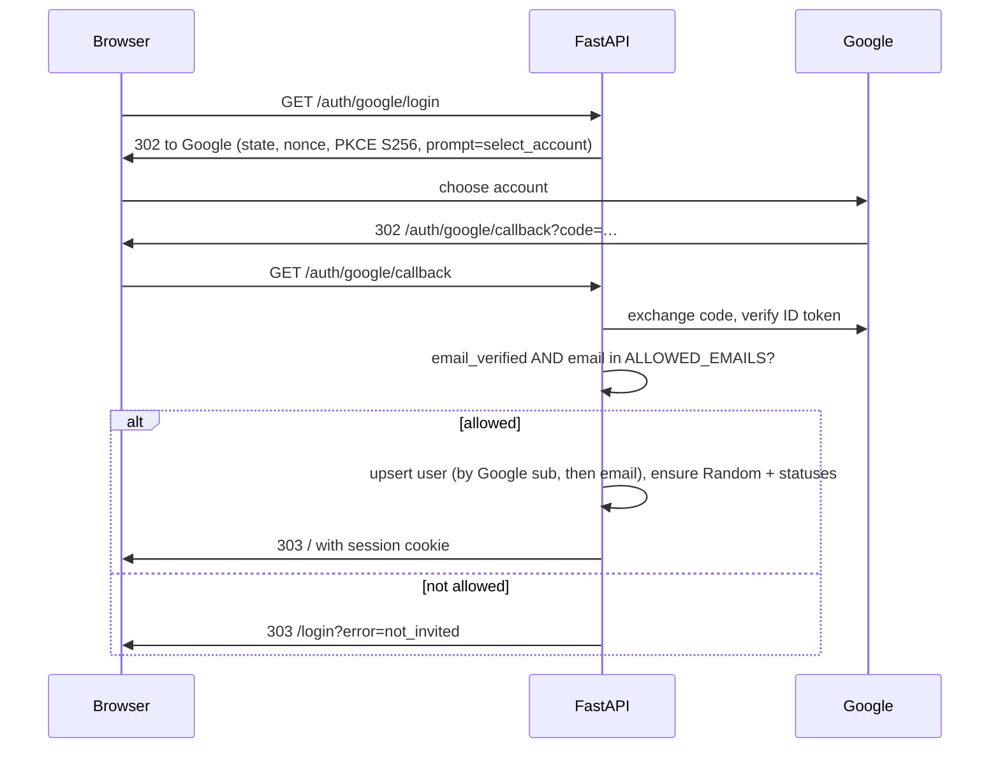
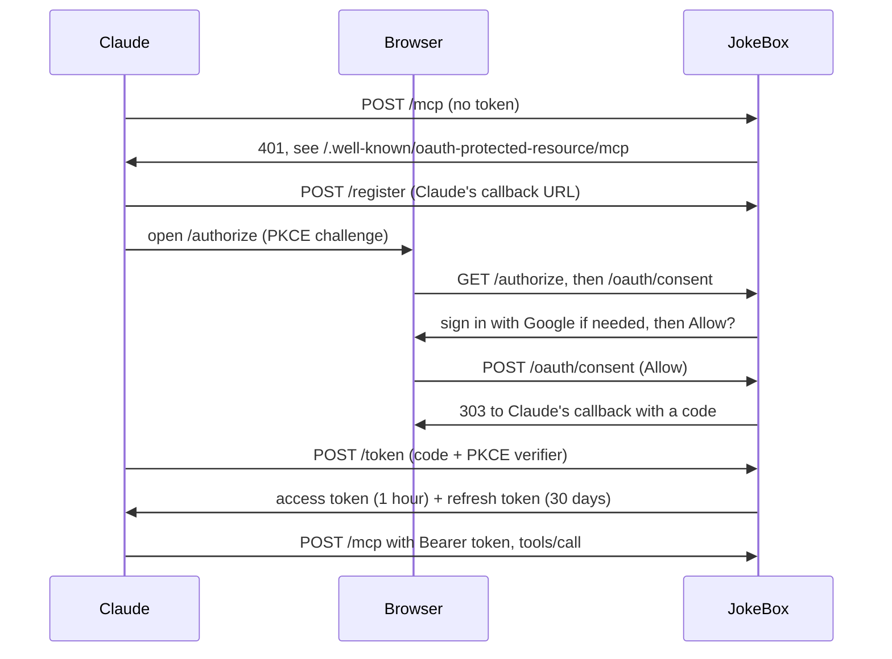
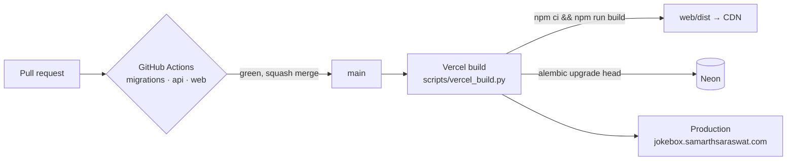

# System design

How JokeBox is built and why. For the tables see [data-model.md](data-model.md), and for the
endpoints [api.md](api.md).

## At a glance



**One origin.** The React app and the API are served from the same domain. That means there's no
CORS, the session is a plain HttpOnly cookie, and CSRF protection is one header check.

## Stack

| Layer | Choice | Why |
|---|---|---|
| API | **FastAPI** on Python 3.12, Pydantic v2 | Typed request and response schemas; the owner is strongest in Python |
| ORM and migrations | **SQLAlchemy 2.0** and **Alembic** | Explicit transactions for many-row changes; append-only migrations checked by CI |
| Database | **Postgres** on Neon (production and CI), **SQLite** locally | Zero-setup local development; only Production has a database |
| Files | **Vercel Blob** (private) | Voice recordings, without managing a bucket or keys |
| Auth | **Authlib** (Google OIDC with PKCE) and Starlette's signed session cookie | No passwords to store; an allowlist decides who gets in |
| Frontend | **React 19**, **TypeScript** (strict), **Vite 8**, **React Router 8** | |
| Styling | **Tailwind CSS v4** with tokens in `@theme` | See [design-system.md](design-system.md) |
| Server state | **TanStack Query v5**, persisted to IndexedDB (`idb-keyval`) | Caching, optimistic updates, offline replay |
| UI behaviour | **Radix** (Dialog, Dropdown, Context Menu, Slider), **dnd-kit**, **lucide-react** | Accessible primitives; drag and drop that works on touch |
| PWA | **vite-plugin-pwa** (Workbox) | Precached app shell, manifest, update prompt |
| Hosting | **Vercel**: the FastAPI preset plus the CDN for static files | Push to `main` deploys |
| Quality | ruff, mypy (strict), pytest; oxlint, tsc, Vitest; GitHub Actions | |

## Repository layout

```
app/                    FastAPI application
  main.py               app factory: middleware, routers, SPA fallback
  config.py             settings from env; refuses unsafe production config
  db.py                 engine (SQLite locally, NullPool Postgres on Vercel), session dependency
  auth/                 Google sign-in, dev sign-in, current_user, get_owned / find_owned
  models/               SQLAlchemy tables, one file per area
  schemas/              Pydantic request/response models
  routers/              one router per resource, all under /api
  services/             logic that spans tables (joke save, topic delete, audio store)
  connector/            the MCP server Claude reads JokeBox through (see api.md)
  seed/                 demo data, Bit Vault importer
alembic/versions/       migrations 0001-0031 (append-only)
tests/                  pytest, against SQLite locally and Postgres in CI
scripts/                vercel_build.py, export_firestore.py, make_icons.py
web/                    the React app (Vite)
  src/api/              fetch client, query keys, one hooks file per resource
  src/components/ui/    design-system primitives
  src/layout/           app frame, nav, sync light, update prompt
  src/features/<area>/  one folder per screen area
  src/lib/              pure helpers: durations, IST dates, CSV, joke display rules
docs/                   this documentation
```

Every source file stays under 200 lines; a screen is a folder of small components.

## A request, end to end

1. **The browser** calls `api('/api/jokes/<id>', 'PUT', body)` ([client.ts](../web/src/api/client.ts)).
   That's `fetch` with `credentials: 'same-origin'` and the header `X-Requested-With: jokebox`.
2. **The CSRF middleware** ([main.py](../app/main.py)) rejects any `/api/*` request that isn't GET,
   HEAD or OPTIONS and lacks that header (403). Another site can't add a custom header without a
   CORS preflight, which is never allowed. Together with `SameSite=Lax` cookies, that blocks CSRF.
3. **The session middleware** reads the signed `jokebox_session` cookie (30 days, HttpOnly,
   Secure outside local). The cookie holds `user_id` and the day it was last renewed.
4. **The `current_user` dependency** loads the user, or answers 401. On the first request each
   day it marks the day in the session, so the cookie is sent again with a fresh 30 days: a
   sign-in only runs out after 30 days without opening the app.
5. **The router** loads rows with `get_owned` / `find_owned`, which filter by `user_id`. Another
   user's row is a 404, never a 403, so ids can't be probed.
6. **The service layer** does multi-row work in one transaction (for example, deleting a topic moves
   its jokes and premises to Random and re-points show links, then commits once).
7. **The response** goes out as a Pydantic schema. On the client, TanStack Query updates the cache
   and invalidates the related keys.

## Authentication



- **Every request** checks the allowlist again (`invited` in
  [auth/deps.py](../app/auth/deps.py)): the signed cookie can't be taken back, so taking an
  email off `ALLOWED_EMAILS` is what signs that person out, and their connector with them.
- **Local development** has `/auth/dev-login`. It answers 404 unless `APP_ENV=local`.
- **Safety checks:** `Settings.check_production_safety()` refuses to start if `APP_ENV=local` while
  running on Vercel (that would expose the dev sign-in). It also refuses a secret shorter than 32
  characters (or the default one), and a SQLite database, outside local.
- **API docs** (`/api/docs`) exist only locally.
- **The Claude connector** has its own sign-in: JokeBox is an OAuth server for it, and the
  consent page uses the Google sign-in above, so the same allowlist decides who can connect.
  Claude gets a read-only token for one person's JokeBox. Details in [api.md](api.md).



## Data isolation

Every user-owned table inherits `OwnedMixin` (UUID `id`, `user_id`, `created_at`, `updated_at`).
All reads go through queries filtered by `user_id`; writes check ownership of every referenced id
(for example, `check_all_owned` for the jokes in a set, and `check_placement` for a joke's topic
and subtopic). The tests cover cross-user access per resource.

Every response also carries browser hardening headers from [vercel.json](../vercel.json): no framing
by other sites (`X-Frame-Options: DENY` and `frame-ancestors 'none'`, against clickjacking),
`nosniff`, a `strict-origin-when-cross-origin` referrer policy, and a permissions policy that allows
only the microphone (for voice notes). Vercel adds HSTS.

The Content Security Policy lets the page run scripts and load fonts, audio, workers and data only
from JokeBox itself, so injected markup can't run code or send your material elsewhere. The
exceptions: inline styles (Radix and the connector's consent page use them), `data:` and `blob:`
images and audio (recordings play from blobs), and Google avatar images
(`*.googleusercontent.com`). It sets no `form-action`, because the consent page's Allow redirects
to Claude, which Chrome would count against it. Adding a new outside source (a font CDN,
analytics) means adding it here, or the browser blocks it.

## Frontend, voice notes and PWA

Server state, the offline queue, autosave, the voice notes pipeline and the service worker are
in [frontend.md](frontend.md).

## Deployment



- **Build:** Vercel detects FastAPI from `app/main.py`. `[tool.vercel.scripts] build` runs
  [vercel_build.py](../scripts/vercel_build.py), which builds the React app and then migrates the
  database if `DATABASE_URL` is Postgres. `[tool.vercel.fastapi.static] cdn = true` serves
  `web/dist` from the CDN even though the app has middleware.
- **Page addresses:** [vercel.json](../vercel.json) rewrites every path that isn't a real file and
  doesn't start with `/api/`, `/auth/`, `/health` or `/assets/` (or one of the connector's:
  `/mcp`, `/authorize`, `/token`, `/register`, `/revoke`, `/oauth/`, `/.well-known/`) to
  `/index.html` on the CDN. The service worker leaves the connector's pages to the server too. React
  Router then shows the right screen. Without it, opening `/shows` directly in a fresh browser
  reached the Python function, which has no copy of the built frontend, and answered 404.
  Locally, `app.frontend(..., fallback="index.html")` does the same job. Missing files under
  `/assets/` still 404, so a stale code chunk fails loudly instead of loading HTML.
- **Only `main` deploys:** `git.deploymentEnabled` in [vercel.json](../vercel.json) turns off
  every other branch's deployment. A preview has no database and refuses to start, yet each one
  kept a full copy of the server (about 38 MB of Python libraries) against the free plan's 10 GB
  Functions Storage. 75 previews in two weeks were 2.9 GB of copies that never served a request.
  The key is `**`, not `*`: branch names like `feat/premises` have a slash, which `*` doesn't match.
- **Database connections:** each serverless invocation opens a connection through Neon's pooler
  (`NullPool`, `pool_pre_ping`) instead of keeping its own pool.
- **Health:** `GET /health` runs `SELECT 1` and returns `{status, env, version}`.

### CI ([ci.yml](../.github/workflows/ci.yml))

| Job | Checks |
|---|---|
| `migrations` | On a PR, fails if any migration already on the base branch was modified, deleted or renamed |
| `api` | `ruff check`, `ruff format --check`, `mypy app`; Alembic upgrade → downgrade → upgrade on Postgres 16; `pytest` |
| `web` | `tsc -b`, `oxlint --deny-warnings`, `vitest run`, `vite build` |

[backup.yml](../.github/workflows/backup.yml) runs the nightly encrypted backup
([backups.md](backups.md)), and [move-database.yml](../.github/workflows/move-database.yml) the
one-off copy for a move to another region ([move-region.md](move-region.md)).

## Decisions and trade-offs

| Decision | Trade-off |
|---|---|
| Serverless on Vercel instead of a VM with Docker | No servers to patch; in exchange, cold starts, a request size cap (hence the 4 MB voice limit), and a copy of the server kept per deployment against the free plan's 10 GB |
| No preview deployments; PRs are checked by CI only | Previews would need their own database to be any use, and each cost ~38 MB of Functions Storage. Rejected: keeping them with a short retention policy (still a build and a copy per push, for a page that can't load) |
| SQLite locally, Postgres in deployment | Instant setup; JSON columns and case-insensitive unique indexes are written to work on both, and CI runs migrations on real Postgres |
| Filtering and totals in the browser | Works offline and feels instant; fine at one comedian's scale (thousands of rows), revisit if lists grow large |
| Alternate punches are a list on the joke (`alt_punchlines`), left out of a save by an app too old to know them | They are the joke's own words, so they travel with it through autosave, the offline queue, the Trash and backups with no new endpoint. A save without the field keeps what the server has (like `voice_note_ids`), so a phone still on last week's build never wipes them. Rejected: rewrite versions (whole snapshots against a timer, not endings side by side) and a table of their own (a second save to queue and order) |
| Hashtags, tag lines and brainstorm links as JSON lists | Simple and portable. A link to a deleted joke just drops out of view instead of blocking the delete |
| Joke types exist only while used | Matches how comics think ("a type is what my jokes are"); a rename onto an existing name merges them |
| Type colours kept by name in their own table | A type that is pruned and used again keeps its colour, and a new type can be coloured before its joke saves |
| A joke names one joke it follows (`jokes.follows_id`) | Each joke has one line back to the start of its chain while many can follow it, so chains branch into trees without a separate links table; adding a joke to a set walks that line and brings the earlier jokes |
| Edits on two devices: a version check on everything you write (jokes, sets, sessions, Craft notes, observations, premises), not merging | One comic, a phone and an iPad: clashes are rare, so the losing edit is shown, not merged. Only a save that changes something moves the version on, so Save pressed with no edit never makes the other device's waiting edit clash. Most clashes wait in Couldn't sync with Keep mine; a brainstorm session is kept as a copy, since handwriting can't be redone. Rejected: last save wins (silently lost a set's change or a session's pages, as before `0030` and `0031`), merging strokes from both devices (pages drawn over each other) and Keep mine for sessions (throws away handwriting) |
| Handwriting stored as strokes, not images | Small, sharp at any size, and editable; costs a canvas renderer |
| One allowlisted Google sign-in | No password handling at all; adding a user means editing an environment variable |
| On iPad, Jokes and Premises give the list the whole screen until something is open; Map and Web are a List / Map / Web switch, not a pane, and the rail drops to icons below 1280 px | The iPad in landscape (1024–1279 px) was split three ways (rail, list, map), so nothing had room. In exchange the map is one tap away instead of always on screen there. Rejected: keeping three columns with a narrower list (jokes wrap after a few words), and a map drawer over the list (two things competing for the same space) |
| On a phone, Premises and Observations share one **Ideas** tab that opens on the one used last, with a switch at the top of both | Both are raw material before a joke, and the bar has one slot right of the +. Each is one tap from anywhere; the other is one more. Rejected: Observations taking the Premises slot (Premises two taps away), a sixth slot (labels cut off at 320 px), and Home-only shortcuts (logging gets easier, browsing doesn't). Home's Jokes / Premises / Observations tiles came from that last option |
| An observation has a joke topic and a kind, not its own topic list | Observations show beside the premises and jokes on the same topic, and "Set ideas" or "Questions" stay a separate axis. Rejected: two topic lists to keep in step. The old observation topics became kinds, and the columns kept their names (`topic_id` holds the kind): renaming them would break the live deployment while a new one migrates |
| What came from an observation is two id lists on the observation, changed through their own link endpoint | Jokes and premises stay untouched, so no joke or premise save can drop a link. A link isn't the observation's words, so it doesn't move its version or ride in a save carrying stale words from another device; PUT and DELETE are safe to replay from the offline queue. Rejected: an `observation_id` on jokes and premises (one source only, and a change to the busiest table) |
