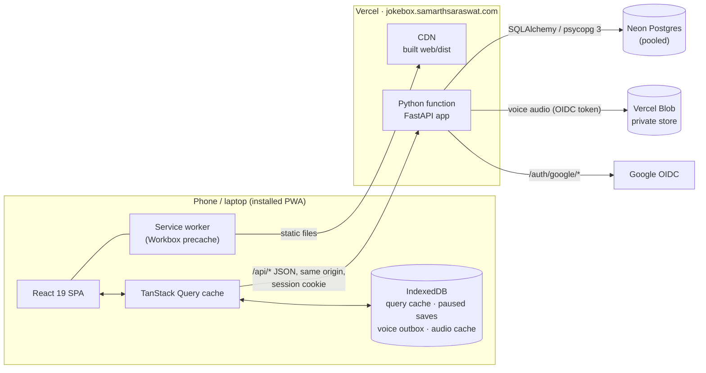
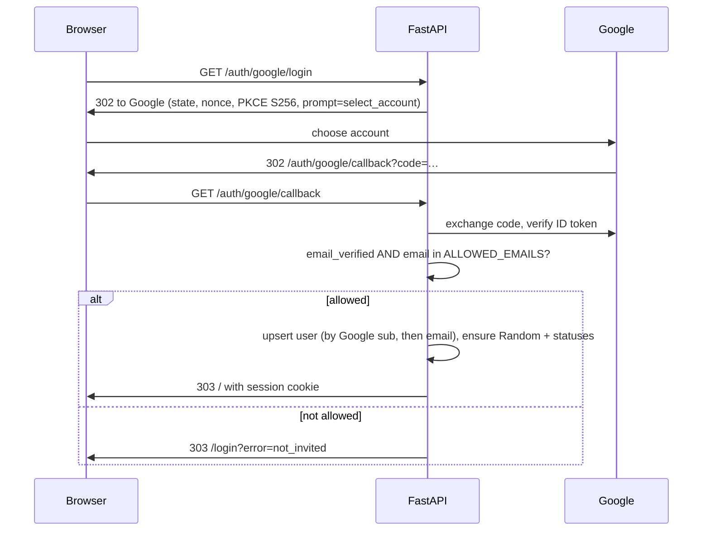
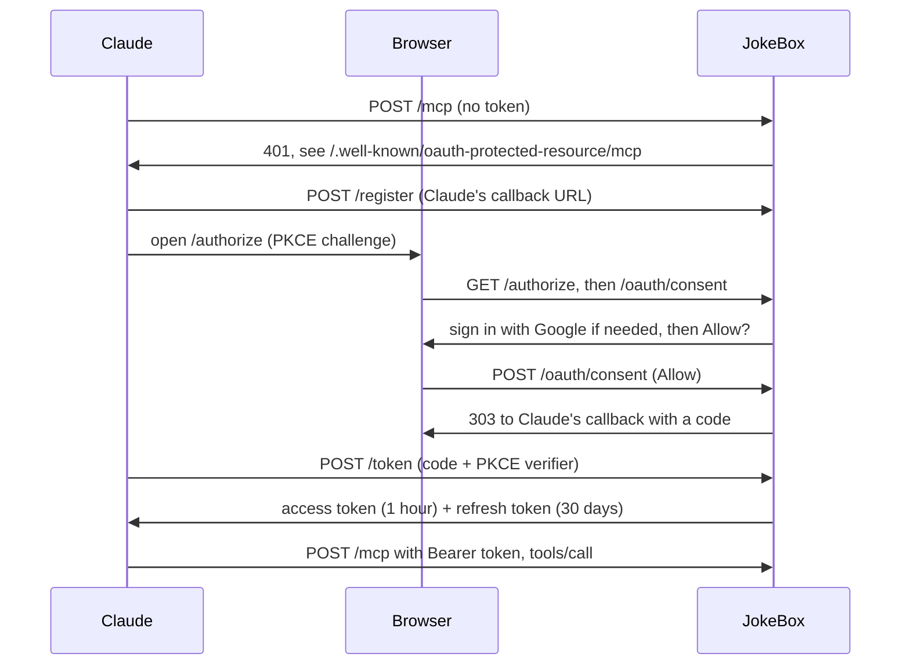
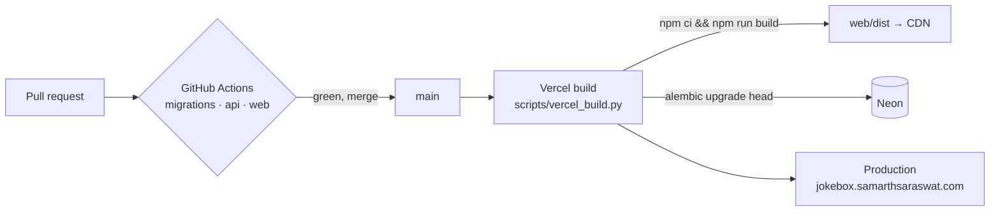

# System design

How JokeBox is built and why. For the tables see [data-model.md](data-model.md), and for the
endpoints [api.md](api.md).

## At a glance



**One origin.** The React app and the API are served from the same domain. That means there's no
CORS, the session is a plain HttpOnly cookie, and CSRF protection is one header check.

## Stack

| Layer | Choice | Why |
|---|---|---|
| API | **FastAPI** on Python 3.12, Pydantic v2 | Typed request and response schemas; the owner is strongest in Python |
| ORM and migrations | **SQLAlchemy 2.1** and **Alembic** | Explicit transactions for many-row changes; append-only migrations checked by CI |
| Database | **Postgres 18** on Neon in production (and a throwaway Postgres 18 in CI), **SQLite** locally | Zero-setup local development; only Production has a database |
| Files | **Vercel Blob** (private) | Voice recordings, without managing a bucket or keys |
| Auth | **Authlib** (Google OIDC with PKCE) and Starlette's signed session cookie | No passwords to store; an allowlist decides who gets in |
| Frontend | **React 19**, **TypeScript** (strict), **Vite 8**, **React Router 8** | |
| Styling | **Tailwind CSS v4** with tokens in `@theme` | See [design-system.md](design-system.md) |
| Server state | **TanStack Query v5**, persisted to IndexedDB (`idb-keyval`) | Caching, optimistic updates, offline replay |
| UI behaviour | **Radix** (Dialog, Dropdown, Context Menu, Slider), **dnd-kit**, **lucide-react** | Accessible primitives; drag and drop that works on touch |
| PWA | **vite-plugin-pwa** (Workbox) | Precached app shell, manifest, update prompt |
| Hosting | **Vercel**: the FastAPI preset plus the CDN for static files | Push to `main` deploys |
| Quality | ruff, mypy (strict), pytest; oxlint, tsc, Vitest; GitHub Actions | |

## Repository layout

```
app/                    FastAPI application
  main.py               app factory: middleware, routers, SPA fallback
  config.py             settings from env; refuses unsafe production config
  db.py                 engine (SQLite locally, NullPool Postgres on Vercel), session dependency
  auth/                 Google sign-in, dev sign-in, current_user, get_owned / find_owned
  models/               SQLAlchemy tables, one file per area
  schemas/              Pydantic request/response models
  routers/              one router per resource, all under /api
  services/             logic that spans tables (joke save, topic delete, audio store)
  connector/            the MCP server Claude reads JokeBox through (see api.md)
  seed/                 demo data, Bit Vault importer
alembic/versions/       migrations 0001-0047 (append-only)
tests/                  pytest, against SQLite locally and Postgres in CI
scripts/                vercel_build.py, backup_audio.py, restore_audio.py, backup_verify.py,
                        export_firestore.py, make_icons.py, screenshot_demo.py, screenshot_extras.py
web/                    the React app (Vite)
  src/api/              fetch client, query keys, one hooks file per resource
  src/components/ui/    design-system primitives
  src/layout/           app frame, nav, sync light, update prompt
  src/features/<area>/  one folder per screen area
  src/lib/              pure helpers: durations, IST dates, CSV, joke display rules
docs/                   this documentation
```

Every source file stays under 200 lines; a screen is a folder of small components.

## A request, end to end

1. **The browser** calls `api('/api/jokes/<id>', 'PUT', body)` ([client.ts](../web/src/api/client.ts)).
   That's `fetch` with `credentials: 'same-origin'` and the header `X-Requested-With: jokebox`.
2. **The CSRF middleware** ([main.py](../app/main.py)) rejects any `/api/*` request that isn't GET,
   HEAD or OPTIONS and lacks that header (403). Another site can't add a custom header without a
   CORS preflight, which is never allowed. Together with `SameSite=Lax` cookies, that blocks CSRF.
3. **The session middleware** reads the signed `jokebox_session` cookie (30 days, HttpOnly,
   Secure outside local). The cookie holds `user_id` and the day it was last renewed.
4. **The `current_user` dependency** loads the user, or answers 401. On the first request each
   day it marks the day in the session, so the cookie is sent again with a fresh 30 days: a
   sign-in only runs out after 30 days without opening the app.
5. **The router** loads rows with `get_owned` / `find_owned`, which filter by `user_id`. Another
   user's row is a 404, never a 403, so ids can't be probed.
6. **The service layer** does multi-row work in one transaction (for example, deleting a topic moves
   its jokes and premises to Random and re-points show links, then commits once).
7. **The response** goes out as a Pydantic schema. On the client, TanStack Query updates the cache
   and invalidates the related keys.

## Authentication



- **Every request** checks the allowlist again (`invited` in
  [auth/deps.py](../app/auth/deps.py)): the signed cookie can't be taken back, so taking an
  email off `ALLOWED_EMAILS` is what signs that person out, and their connector with them.
- **Local development** has `/auth/dev-login`. It answers 404 unless `APP_ENV=local`.
- **Safety checks:** `Settings.check_production_safety()` refuses to start if `APP_ENV=local` while
  running on Vercel (that would expose the dev sign-in). It also refuses a secret shorter than 32
  characters (or the default one), and a SQLite database, outside local.
- **API docs** (`/api/docs`) exist only locally.
- **The Claude connector** has its own sign-in: JokeBox is an OAuth server for it, and the
  consent page uses the Google sign-in above, so the same allowlist decides who can connect.
  Claude gets a read-only token for one person's JokeBox. Details in [api.md](api.md).



## Data isolation

Every user-owned table inherits `OwnedMixin` (UUID `id`, `user_id`, `created_at`, `updated_at`).
All reads go through queries filtered by `user_id`; writes check ownership of every referenced id
(for example, `check_all_owned` for the jokes in a set, and `check_placement` for a joke's topic
and subtopic). The tests cover cross-user access per resource.

Every response also carries browser hardening headers from [vercel.json](../vercel.json): no framing
by other sites (`X-Frame-Options: DENY` and `frame-ancestors 'none'`, against clickjacking),
`nosniff`, a `strict-origin-when-cross-origin` referrer policy, and a permissions policy that allows
only the microphone (for voice notes). Vercel adds HSTS.

The Content Security Policy lets the page run scripts and load fonts, audio, workers and data only
from JokeBox itself, so injected markup can't run code or send your material elsewhere. The
exceptions: inline styles (Radix and the connector's consent page use them), `data:` and `blob:`
images and audio (recordings play from blobs), and Google avatar images
(`*.googleusercontent.com`). It sets no `form-action`, because the consent page's Allow redirects
to Claude, which Chrome would count against it. Adding a new outside source (a font CDN,
analytics) means adding it here, or the browser blocks it.

## Frontend, voice notes and PWA

Server state, the offline queue, autosave, the voice notes pipeline and the service worker are
in [frontend.md](frontend.md).

## Deployment



- **Build:** Vercel detects FastAPI from `app/main.py`. `[tool.vercel.scripts] build` runs
  [vercel_build.py](../scripts/vercel_build.py), which builds the React app and then migrates the
  database if `DATABASE_URL` is Postgres. `[tool.vercel.fastapi.static] cdn = true` serves
  `web/dist` from the CDN even though the app has middleware.
- **Page addresses:** [vercel.json](../vercel.json) rewrites every path that isn't a real file and
  doesn't start with `/api/`, `/auth/`, `/health` or `/assets/` (or one of the connector's:
  `/mcp`, `/authorize`, `/token`, `/register`, `/revoke`, `/oauth/`, `/.well-known/`) to
  `/index.html` on the CDN. The service worker leaves the connector's pages to the server too. React
  Router then shows the right screen. Without it, opening `/shows` directly in a fresh browser
  reached the Python function, which has no copy of the built frontend, and answered 404.
  Locally, `app.frontend(..., fallback="index.html")` does the same job. Missing files under
  `/assets/` still 404, so a stale code chunk fails loudly instead of loading HTML.
- **Only `main` deploys:** `git.deploymentEnabled` in [vercel.json](../vercel.json) turns off
  every other branch's deployment. A preview has no database and refuses to start, yet each one
  kept a full copy of the server (about 38 MB of Python libraries) against the free plan's 10 GB
  Functions Storage. 75 previews in two weeks were 2.9 GB of copies that never served a request.
  The key is `**`, not `*`: branch names like `feat/premises` have a slash, which `*` doesn't match.
- **Database connections:** each serverless invocation opens a connection through Neon's pooler
  (`NullPool`, `pool_pre_ping`) instead of keeping its own pool.
- **Health:** `GET /health` returns `{status, env, version}` without touching the database. Anyone can call it, and a query there would keep Neon from scaling to zero.

### CI ([ci.yml](../.github/workflows/ci.yml))

| Job | Checks |
|---|---|
| `migrations` | On a PR, fails if any migration already on the base branch was modified, deleted or renamed |
| `api` | `ruff check`, `ruff format --check`, `mypy app`; exactly one Alembic head (two PRs that each add a migration would leave two); Alembic upgrade → downgrade → upgrade on Postgres 18 (the version Neon runs); `alembic check` (the models and migrations agree); `pytest` |
| `web` | `tsc -b`, `oxlint --deny-warnings`, `vitest run`, `vite build` |

Each job has a time limit (migrations 5 minutes, api 20, web 15), so a hung step fails instead of
holding a runner for six hours. Vercel deploys `main` whether or not CI passed on it, so merge
only a green PR.

[backup.yml](../.github/workflows/backup.yml) runs the nightly encrypted backup
([backups.md](backups.md)), and [move-database.yml](../.github/workflows/move-database.yml) the
one-off copy for a move to another region ([move-region.md](move-region.md)).

## Decisions and trade-offs

| Decision | Trade-off |
|---|---|
| Serverless on Vercel instead of a VM with Docker | No servers to patch; in exchange, cold starts, a request size cap (hence the 4 MB voice limit), and a copy of the server kept per deployment against the free plan's 10 GB |
| No preview deployments; PRs are checked by CI only | Previews would need their own database to be any use, and each cost ~38 MB of Functions Storage. Rejected: keeping them with a short retention policy (still a build and a copy per push, for a page that can't load) |
| SQLite locally, Postgres in deployment | Instant setup; JSON columns and case-insensitive unique indexes are written to work on both, and CI runs migrations on real Postgres |
| Filtering and totals in the browser | Works offline and feels instant; fine at one comedian's scale (thousands of rows), revisit if lists grow large |
| Alternate punches are a list on the joke (`alt_punchlines`), left out of a save by an app too old to know them | They are the joke's own words, so they travel with it through autosave, the offline queue, the Trash and backups with no new endpoint. A save without the field keeps what the server has (like `voice_note_ids`), so a phone still on last week's build never wipes them. Rejected: rewrite versions (whole snapshots against a timer, not endings side by side) and a table of their own (a second save to queue and order) |
| Versions of one joke in a cluster (`clusters`, `jokes.cluster_id`), each a whole joke (24 Nov 2026) | Each version keeps its own status, sets and show record, so the stage decides which works; the list stacks them into one row and the cluster compares them side by side. Joining or leaving rides the joke's own save, so it queues offline like any edit. The lead is stored on the cluster, and the server puts it right after every change (a discarded or trashed lead hands on and doesn't take it back); the browser works it out by the same rule so the list is right offline. A cluster never goes to the Trash: dissolving deletes nothing, and one with no jokes left goes by itself. New versions start on the lead's premise and observations, but not its place in a chain (Follows and Followed by stay blank: chains of versions get messy). Rejected: alternate punches (same setup, other endings: the opposite of versions, where the punch stays and the setup changes), premises (an idea holds many different jokes), rewrites (scratch work that never goes on stage), suggested clusters found by Claude or embeddings (more to review than to write; the comic groups them) and roles beyond lead (act-out, tag; maybe later) |
| A cluster lives where its lead is filed: Add to a cluster offers only clusters in the joke's topic and subtopic (24 Nov 2026) | Versions of one joke sit together, so the list stays a handful even with hundreds of clusters. Worked out from the lead in the browser, no column: moving the lead moves the cluster. To join one filed elsewhere, refile the joke first. Rejected: a cluster topic of its own (one more thing to keep in step with the lead) and a "Search all clusters" way out (the clutter it was meant to remove) |
| Linking opens a sheet with the tab's own filters, not a search box (24 Nov 2026) | Finding a premise or observation by where it's filed beats remembering its words. One sheet ([pickers/](../web/src/features/pickers/)) wears each tab's filters, so every link looks and works the same. Rejected: keeping the three-match search box with a "Browse" link beside it (two ways in) |
| Hashtags, tag lines and brainstorm links as JSON lists | Simple and portable. A link to a deleted joke just drops out of view instead of blocking the delete |
| Joke types exist only while used | Matches how comics think ("a type is what my jokes are"); a rename onto an existing name merges them |
| Type colours kept by name in their own table | A type that is pruned and used again keeps its colour, and a new type can be coloured before its joke saves |
| A joke names one joke it follows (`jokes.follows_id`) | Each joke has one line back to the start of its chain while many can follow it, so chains branch into trees without a separate links table; adding a joke to a set walks that line and brings the earlier jokes |
| Edits on two devices: a version check on everything you write (jokes, sets, sessions, Craft notes, observations, premises), not merging | One comic, a phone and an iPad: clashes are rare, so the losing edit is shown, not merged. Only a save that changes something moves the version on, so Save pressed with no edit never makes the other device's waiting edit clash. Most clashes wait in Couldn't sync with Keep mine; a brainstorm session is kept as a copy, since handwriting can't be redone. Rejected: last save wins (silently lost a set's change or a session's pages, as before `0030` and `0031`), merging strokes from both devices (pages drawn over each other) and Keep mine for sessions (throws away handwriting) |
| A premise's status is a fixed four (Draft, Work in Progress, Stage Ready, Discarded; Work in Progress was Testing until 25 Nov 2026) in a checked column, not named statuses like jokes' (24 Nov 2026). Observations got the same four on 25 Nov 2026, so an idea reads the same at either stage | A premise moves through few stages, and fixed names let the list hide Discarded ones and Claude filter by them without guessing at spellings. Rejected: sharing the jokes' `statuses` table, which ties the two together (a Discarded premise is not a discarded joke) and would put joke-only names like Need Tags on premises |
| What you learned at a show is a field on the show (`learned`), not a Craft note (22 Nov 2026) | It's a comment on that night, like the remarks; as Craft notes, show lessons piled up in the Stage area, and Craft is for general lessons. Rejected: keeping Craft notes and hiding linked ones from Craft (two places to look, and the Stage screen would still show them). Existing ones moved over in `0039` and went to the Trash. Turning a show lesson into a general one is a fresh Craft note |
| Streak milestone confetti hand-written ([confetti.ts](../web/src/lib/confetti.ts)), what's been celebrated kept on the device | About 80 lines instead of a dependency: `canvas-confetti` is clean, but npm has had malicious look-alike confetti packages (`confetti-rebuilds`, `react-confetti-modern`), and a burst is little code. Timed by the clock, not by frames, so a phone in Low Power Mode doesn't play it in slow motion. Celebrated milestones live in `localStorage`, so each device celebrates once (and again after site data is cleared); a server table for a three-second flourish wasn't worth it |
| Craft notes are put in order by dragging, in their own **Arrange** window with one request per drop (`PUT /api/craft-areas/{id}/notes/order`); an area's cards are numbered and laid out in rows (23 Nov 2026) | Reading order matters in Craft (an area reads like a short book), and before this the only way to change it was editing each note's `position`. A drop sends one request whatever the area's size, not a save per note, which matters for the Hobby plan's CPU allowance. A reorder leaves versions alone: a note's place isn't an edit, so an edit made on another device never clashes with it. Rows leave some blank space under short cards, but 01 and 02 sit side by side; masonry would run 01–06 down one column first. Rejected: the order inside Edit area (one window with two ways of saving: drop-to-save and a Save button), and up/down arrows (one step per tap; the folders' Arrange window now drags too) |
| Joke statuses are managed in a **Statuses** sheet like Topics and Types: rename (onto an existing name: merge), delete, drag to order. Draft is the protected default, as Random is for topics; a deleted status's jokes go to Draft (24 Nov 2026) | Statuses are the comic's own names, so they need the same upkeep as topics and types. Moving jokes doesn't touch their `updated_at`, so the writing pulse doesn't count a rename as work on them. Rejected: leaving a deleted status's jokes with none (the `SET NULL`), which only shows as Draft in the app and leaves Claude reading a null status |
| Discarded jokes are hidden by matching the status name "Discarded", with a Show/Hide on the Jokes count line, hidden by default (24 Nov 2026) | Statuses are the comic's own names, so there is no built-in discarded flag; matching the name keeps it a pure list filter with no migration. Renaming the status turns the switch off. On the count line, like Todoist's "Show completed", because it says what's hidden right where you count jokes and adds no chip to a crowded row. Rejected: a toggle chip in the filter row (more clutter) and relying on the Status menu alone (it picks one status, it can't leave one out) |
| Handwriting stored as strokes, not images | Small, sharp at any size, and editable; costs a canvas renderer |
| One allowlisted Google sign-in | No password handling at all; adding a user means editing an environment variable |
| On iPad, Jokes and Premises give the list the whole screen until something is open; Map and Web are a List / Map / Web switch, not a pane, and the rail drops to icons below 1280 px | The iPad in landscape (1024–1279 px) was split three ways (rail, list, map), so nothing had room. In exchange the map is one tap away instead of always on screen there. Rejected: keeping three columns with a narrower list (jokes wrap after a few words), and a map drawer over the list (two things competing for the same space) |
| On a phone, Premises and Observations share one **Ideas** tab that opens on the one used last, with a switch at the top of both | Both are raw material before a joke, and the bar has one slot right of the +. Each is one tap from anywhere; the other is one more. Rejected: Observations taking the Premises slot (Premises two taps away), a sixth slot (labels cut off at 320 px), and Home-only shortcuts (logging gets easier, browsing doesn't). Home's Jokes / Premises / Observations tiles came from that last option |
| An observation has a joke topic and a kind, not its own topic list | Observations show beside the premises and jokes on the same topic, and "Set ideas" or "Questions" stay a separate axis. Rejected: two topic lists to keep in step. The old observation topics became kinds, and the columns kept their names (`topic_id` holds the kind): renaming them would break the live deployment while a new one migrates |
| What came from an observation is two id lists on the observation, changed through their own link endpoint | Jokes and premises stay untouched, so no joke or premise save can drop a link. A link isn't the observation's words, so it doesn't move its version or ride in a save carrying stale words from another device; PUT and DELETE are safe to replay from the offline queue. Rejected: an `observation_id` on jokes and premises (one source only, and a change to the busiest table) |
| The writing pulse is worked out twice: in the browser for Activity, on the server for Claude's `writing_pulse` tool | The screen keeps working offline and Claude gets ready numbers, not thousands of rows to count. The cost is two copies of the rules, held together by the same cases in `pulse.test.ts` and `test_connector_pulse.py`. Rejected: one `/api` endpoint the screen calls (nothing to show offline), and leaving Claude to count from its search tools (25 rows a call, and no dates on jokes) |
| Activity is one page to read, not to write (24 Nov 2026): no joke box, no nudge, no lists of the day's pieces, and the stage on the same calendar as the writing (a gold dot per show, the month's stage time big with its shows as tally marks) | The comic writes from Home; Activity is where they see how it's going, and counts were enough there. One calendar shows writing and stage nights together, which is the point of looking. Tally marks say "shows" at a glance without another number in a crowded header. Rejected: keeping the separate show calendar (two calendars of one month), and a stage row under each day (no room on a phone) |
| The pulse's month on month counts each month by what was written that month (a cohort), and fades months that ended under 30 days ago (24 Nov 2026) | No history of statuses or links is kept, so "how many were Stage Ready in August" can't be known; "of August's jokes, how many are Stage Ready now" can. Young months look worse until their ideas have had time, so they're marked as settling and the arrow compares settled months only. Rejected: a monthly snapshot table (a migration and a job for a chart), and comparing the current month (always looks like a slump) |
| Highlights and the year review are worked out in the browser only, not for Claude (24 Nov 2026) | They're for looking at, from the lists the app already holds, so they cost no server time and work offline. Claude has the pulse and its search tools for questions. The year is "so far" until 31 December is over, in the same cards, so it can be read any time; the full wrap is the same cards for a year that's ended |
| The year review takes one of three looks per year, in turn (wall, flyer, marquee), each card filled to its edges with a chart or grid, and counts shows by your ratings, not LPM (25 Nov 2026) | Plain dark cards read as bland and left empty wall on a phone; a look per year makes each year its own poster, and three that rotate keep it fresh without a design per year. Ratings are what the comic tracks on every show, and laugh counts are often missing. Rejected: one look for every year (the years blur together), and a neon-only theme (too thin to fill a card) |
| Lists stay fresh for 5 minutes in the browser (`staleTime`), not 30 seconds | Every switch back to the app used to reload every list on screen, and each reload is a server call against the Hobby plan's 4 hours of CPU a month. In exchange, a change made on another device can take up to 5 minutes after coming back to show; your own saves still refresh at once. Rejected: never refetching on focus (another device's edits would wait for a screen change or a reload) |
| Pull to refresh everywhere (touch, and a trackpad swipe on laptops), with no button | With lists fresh for 5 minutes, you need a way to see another device's (or Claude's) change now, and an installed app has no reload button. A refresh you ask for costs one round of calls, only when wanted. Rejected: a Refresh button (clutter on every screen); going back to 30 seconds (about 10–20 more minutes of CPU a month, spent whether or not anything changed) |
| The nightly backup holds the database; recordings go in only on the 1st of each month (or a run by hand) | Each recording downloaded is a Vercel Blob operation. Downloading all of them every night (about 450 in November 2026) came to about 13,500 a month, over the Hobby plan's 10,000, and an exhausted Blob limit stops playback for up to 30 days. In exchange, a recording made since the last monthly backup isn't backed up yet. Rejected: weekly (about four times the cost, close to the limit as recordings grow) and incremental downloads of new recordings only (each backup would no longer restore on its own, and GitHub deletes old artifacts) |
| A long Craft note or analysis reaches Claude in 20,000-character parts, with `body_length` and `more_from_char` | Notes can be as long as the comic likes, and Claude can tell it hasn't read the whole of one. Before this, bodies were cut at 20,000 characters with only a "…" to show it: a 36,000-character About me note lost its last 16,000 characters, including the section another note pointed to, and Claude never knew. Rejected: no limit (ten long notes in one call is more than Claude's tool results can carry) and a higher fixed cut (the same silent loss, just later) |
| A premise's Notes box is a new `extra_notes` field, not the existing `notes` | `notes` already hold why the take is true ("Why it's true"), and the premise guide and Claude read them that way; mixing in asides would blur that. Observations use the same name, so the app and Claude call the box one thing. A save that leaves it out keeps what's stored, so an offline save queued by an older app can't wipe it. Rejected: reusing `notes` (two meanings in one field), and a separate notes table (a join for one text field) |
| Shows have no title; set-review logs topics by name and the lesson with the show (20 Nov 2026; the lesson moved from a linked Craft note onto the show on 22 Nov) | The comic files shows by venue and topic and never used titles; set-review was logging the night's name as a title and leaving topics empty. Topics are named by the comic (refused if none match, so typos don't make topics), defaulting to Random; the lesson goes where the app's "What did you learn?" puts it. The column stays, cleared on save, because migrations only add. Rejected: creating unknown topics from the connector (the comic makes topics in JokeBox) and dropping the column now (an older deployment would still read it) |
| The connector gains one write, `log_show`, behind a `shows` scope only set-review asks for | set-review (the comic's own engine, on their Mac) logs a reviewed show with its laugh timeline straight from a chat, through the same save code as the app, and Claude's own connection stays read-only. Rejected: a separate API token for the engine (a second way into the account, more to build) and letting Claude's connection write (the timeline would pass through the chat, and every connection could change data) |
