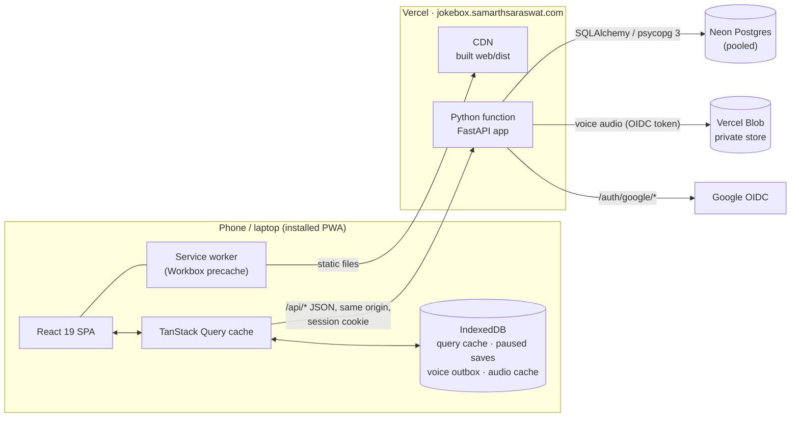
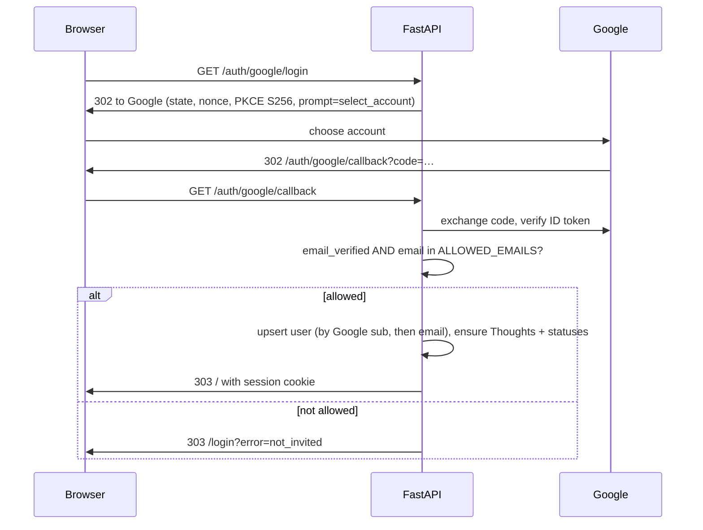
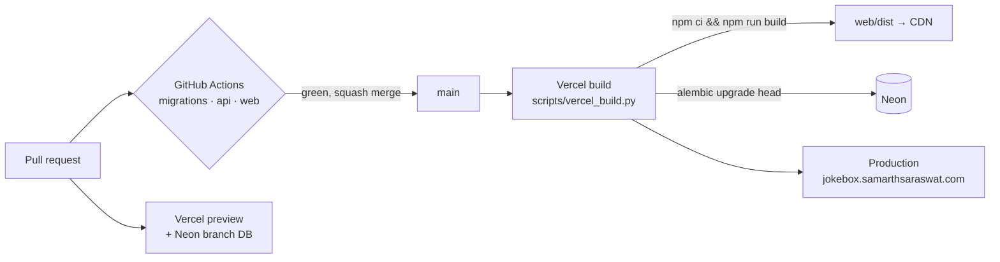

# System design

How JokeBox is built and why. For the tables see [data-model.md](data-model.md), and for the
endpoints [api.md](api.md).

## At a glance



**One origin.** The React app and the API are served from the same domain. That means there's no
CORS, the session is a plain HttpOnly cookie, and CSRF protection is one header check.

## Stack

| Layer | Choice | Why |
|---|---|---|
| API | **FastAPI** on Python 3.12, Pydantic v2 | Typed request and response schemas; the owner is strongest in Python |
| ORM and migrations | **SQLAlchemy 2.0** and **Alembic** | Explicit transactions for many-row changes; append-only migrations checked by CI |
| Database | **Postgres** on Neon (production and CI), **SQLite** locally | Zero-setup local development; Neon gives each preview deployment its own branch database |
| Files | **Vercel Blob** (private) | Voice recordings, without managing a bucket or keys |
| Auth | **Authlib** (Google OIDC with PKCE) and Starlette's signed session cookie | No passwords to store; an allowlist decides who gets in |
| Frontend | **React 19**, **TypeScript** (strict), **Vite 8**, **React Router 8** | |
| Styling | **Tailwind CSS v4** with tokens in `@theme` | See [design-system.md](design-system.md) |
| Server state | **TanStack Query v5**, persisted to IndexedDB (`idb-keyval`) | Caching, optimistic updates, offline replay |
| UI behaviour | **Radix** (Dialog, Dropdown, Context Menu, Slider), **dnd-kit**, **lucide-react** | Accessible primitives; drag and drop that works on touch |
| PWA | **vite-plugin-pwa** (Workbox) | Precached app shell, manifest, update prompt |
| Hosting | **Vercel**: the FastAPI preset plus the CDN for static files | Push to `main` deploys |
| Quality | ruff, mypy (strict), pytest; oxlint, tsc, Vitest; GitHub Actions | |

## Repository layout

```
app/                    FastAPI application
  main.py               app factory: middleware, routers, SPA fallback
  config.py             settings from env; refuses unsafe production config
  db.py                 engine (SQLite locally, NullPool Postgres on Vercel), session dependency
  auth/                 Google sign-in, dev sign-in, current_user, get_owned / find_owned
  models/               SQLAlchemy tables, one file per area
  schemas/              Pydantic request/response models
  routers/              one router per resource, all under /api
  services/             logic that spans tables (joke save, topic delete, audio store)
  seed/                 demo data, Bit Vault importer, watchlist dossier
alembic/versions/       migrations 0001-0011 (append-only)
tests/                  pytest, against SQLite locally and Postgres in CI
scripts/                vercel_build.py, export_firestore.py, make_icons.py
web/                    the React app (Vite)
  src/api/              fetch client, query keys, one hooks file per resource
  src/components/ui/    design-system primitives
  src/layout/           app frame, nav, sync light, update prompt
  src/features/<area>/  one folder per screen area
  src/lib/              pure helpers: durations, IST dates, CSV, joke display rules
docs/                   this documentation
```

Every source file stays under 200 lines; a screen is a folder of small components.

## A request, end to end

1. **The browser** calls `api('/api/jokes/<id>', 'PUT', body)` ([client.ts](../web/src/api/client.ts)).
   That's `fetch` with `credentials: 'same-origin'` and the header `X-Requested-With: jokebox`.
2. **The CSRF middleware** ([main.py](../app/main.py)) rejects any `/api/*` request that isn't GET,
   HEAD or OPTIONS and lacks that header (403). Another site can't add a custom header without a
   CORS preflight, which is never allowed. Together with `SameSite=Lax` cookies, that blocks CSRF.
3. **The session middleware** reads the signed `jokebox_session` cookie (30 days, HttpOnly,
   Secure outside local). The cookie holds only `user_id`.
4. **The `current_user` dependency** loads the user, or answers 401.
5. **The router** loads rows with `get_owned` / `find_owned`, which filter by `user_id`. Another
   user's row is a 404, never a 403, so ids can't be probed.
6. **The service layer** does multi-row work in one transaction (for example, deleting a topic moves
   its jokes to Thoughts and re-points show links, then commits once).
7. **The response** goes out as a Pydantic schema. On the client, TanStack Query updates the cache
   and invalidates the related keys.

## Authentication



- **Local development** has `/auth/dev-login`. It answers 404 unless `APP_ENV=local`.
- **Safety checks:** `Settings.check_production_safety()` refuses to start if `APP_ENV=local` while
  running on Vercel (that would expose the dev sign-in). It also refuses a secret shorter than 32
  characters (or the default one), and a SQLite database, outside local.
- **API docs** (`/api/docs`) exist only locally.

## Data isolation

Every user-owned table inherits `OwnedMixin` (UUID `id`, `user_id`, `created_at`, `updated_at`).
All reads go through queries filtered by `user_id`; writes check ownership of every referenced id
(for example, `check_all_owned` for the jokes in a set, and `check_placement` for a joke's topic
and subtopic). The tests cover cross-user access per resource.

Every response also carries browser hardening headers from [vercel.json](../vercel.json): no framing
by other sites (`X-Frame-Options: DENY` and `frame-ancestors 'none'`, against clickjacking),
`nosniff`, a `strict-origin-when-cross-origin` referrer policy, and a permissions policy that allows
only the microphone (for voice notes). Vercel adds HSTS.

## Frontend, voice notes and PWA

Server state, the offline queue, autosave, the voice notes pipeline and the service worker are
in [frontend.md](frontend.md).

## Deployment



- **Build:** Vercel detects FastAPI from `app/main.py`. `[tool.vercel.scripts] build` runs
  [vercel_build.py](../scripts/vercel_build.py), which builds the React app and then migrates the
  database if `DATABASE_URL` is Postgres. `[tool.vercel.fastapi.static] cdn = true` serves
  `web/dist` from the CDN even though the app has middleware.
- **Page addresses:** [vercel.json](../vercel.json) rewrites every path that isn't a real file and
  doesn't start with `/api/`, `/auth/`, `/health` or `/assets/` to `/index.html` on the CDN. React
  Router then shows the right screen. Without it, opening `/shows` directly in a fresh browser
  reached the Python function, which has no copy of the built frontend, and answered 404.
  Locally, `app.frontend(..., fallback="index.html")` does the same job. Missing files under
  `/assets/` still 404, so a stale code chunk fails loudly instead of loading HTML.
- **Database connections:** each serverless invocation opens a connection through Neon's pooler
  (`NullPool`, `pool_pre_ping`) instead of keeping its own pool.
- **Health:** `GET /health` runs `SELECT 1` and returns `{status, env, version}`.

### CI ([ci.yml](../.github/workflows/ci.yml))

| Job | Checks |
|---|---|
| `migrations` | On a PR, fails if any migration already on the base branch was modified, deleted or renamed |
| `api` | `ruff check`, `ruff format --check`, `mypy app`; Alembic upgrade → downgrade → upgrade on Postgres 16; `pytest` |
| `web` | `tsc -b`, `oxlint --deny-warnings`, `vitest run`, `vite build` |

[neon-preview-cleanup.yml](../.github/workflows/neon-preview-cleanup.yml) deletes a PR's Neon
preview branch when the PR closes, and sweeps up stale ones weekly. Each preview deployment gets
its own `preview/<git branch>` database branch, and Neon's free plan allows only 10 per project.

## Decisions and trade-offs

| Decision | Trade-off |
|---|---|
| Serverless on Vercel instead of a VM with Docker | No servers to patch, and previews for free; in exchange, cold starts and a request size cap (hence the 4 MB voice limit) |
| SQLite locally, Postgres in deployment | Instant setup; JSON columns and case-insensitive unique indexes are written to work on both, and CI runs migrations on real Postgres |
| Filtering and totals in the browser | Works offline and feels instant; fine at one comedian's scale (thousands of rows), revisit if lists grow large |
| Hashtags, tag lines and brainstorm links as JSON lists | Simple and portable. A link to a deleted joke just drops out of view instead of blocking the delete |
| Joke types exist only while used | Matches how comics think ("a type is what my jokes are"); a rename onto an existing name merges them |
| Type colours kept by name in their own table | A type that is pruned and used again keeps its colour, and a new type can be coloured before its joke saves |
| A joke names one joke it follows (`jokes.follows_id`) | Each joke has one line back to the start of its chain while many can follow it, so chains branch into trees without a separate links table; adding a joke to a set walks that line and brings the earlier jokes |
| Handwriting stored as strokes, not images | Small, sharp at any size, and editable; costs a canvas renderer |
| One allowlisted Google sign-in | No password handling at all; adding a user means editing an environment variable |
