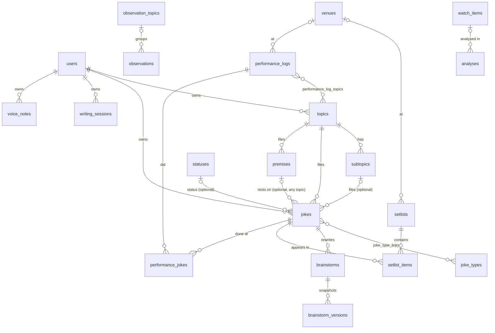

# Data model

The models are defined in [app/models/](../app/models/), and the schema changes in
[alembic/versions/](../alembic/versions/).

## Conventions

- **Primary keys** are UUIDs and may be generated by the client, which makes offline saves safe
  to retry.
- **Timestamps:** every table has `created_at` and `updated_at`, stored as timezone-aware UTC and
  shown in IST. Every timestamp column uses `UTCDateTime` ([base.py](../app/models/base.py)): times
  are converted to UTC on the way in and always come back tagged UTC, so local SQLite (which can't
  store a zone) behaves exactly like Postgres. The browser then formats everything in
  `Asia/Kolkata`, whatever the device's own zone, and "today" (for the daily joke and the
  calendars) is the IST date, rolling over at midnight IST even with the app left open.
- **Ownership:** every table except `users`, `setlist_items`, `brainstorm_versions` and the two link
  tables has `user_id → users.id ON DELETE CASCADE` (`OwnedMixin`), and every query filters by it.
- **Unique names** are case-insensitive per user: unique indexes on `(user_id, lower(name))`.
- **Lists** (hashtags, tag lines, handwriting strokes, linked ids) are JSON columns. That keeps
  them portable between SQLite and Postgres.
- **Constraint names** follow one naming convention (in `models/base.py`), so migrations behave the
  same on both databases.

## Diagram

## Tables

### Library

| Table | Columns | Rules |
|---|---|---|
| `users` | `google_sub` (unique), `email` (unique, lowercase), `display_name`, `avatar_url`, `plan` (default "Pro"), `last_login_at` | Created on first sign-in |
| `topics` | `name`, `position`, `is_system` | One `is_system` topic per user, named `Random` and shown as **Thoughts**. It can't be deleted; deleting another topic moves its jokes there. `position` is the order you drag them into (new ones go last) |
| `subtopics` | `topic_id → topics` (cascade), `name`, `position` | Unique per topic, in the order you drag them into. Deleting one clears it from its jokes |
| `premises` | `topic_id → topics` (cascade), `take`, `notes`, `position` | The idea under a group of jokes: your take and the reasoning behind it. Filed under a topic, but a joke from any topic can rest on it. Upserted by client id, like jokes |
| `joke_types` | `name` | Pruned whenever no joke uses it. Renaming onto an existing name merges the two |
| `type_colors` | `name` (unique per user, any case), `color` (`#rrggbb`) | The colour of a type's dot. Kept by name in its own table, so a type that's pruned and used again keeps its colour |
| `joke_type_links` | `joke_id`, `type_id` (both cascade) | Many-to-many |
| `statuses` | `name`, `position` | Six defaults made on first sign-in; new ones are created by name when a joke uses them. A joke saved with no status (or the retired "Status Unknown") gets Draft |
| `jokes` | `topic_id` (required), `subtopic_id` (set null), `premise_id` (set null, any topic), `follows_id → jokes` (set null: the joke this one continues from; many can follow one, so chains branch), `status_id` (set null), `setup`, `punchline`, `strength` 1–5 or null (unrated; new jokes start that way), `duration_seconds`, `hashtags` JSON, `tag_lines` JSON, `clean_rating` (clean / mild / dirty / null), `language`, `comments`, `version` (up by one per save) | Check constraints on strength and clean rating. The API sends types and status as names. `version` catches edits made on two devices |

### Connector sign-in

| Table | Columns | Rules |
|---|---|---|
| `connector_clients` | `client_id` (unique), `info` JSON (the registration: name, redirect URLs, secret, auth method), `signed_in_at` (when it first got tokens) | An app that registered itself to connect (Claude). It reaches no one's data until that person allows it. Anyone can register, so one that hasn't signed in a week after registering is deleted at the next registration |
| `connector_tokens` | `user_id` (cascade), `client_id → connector_clients.client_id` (cascade), `kind` (code / access / refresh), `token_hash` (unique, SHA-256), `scopes` JSON, `expires_at`, `details` JSON (a code's PKCE challenge, redirect URL and resource) | Values are never stored, only their hashes. A code is deleted as it's used; a used refresh token expires 60 seconds later (time to retry a lost reply); expired ones are cleared at the next sign-in; disconnecting deletes all of that app's tokens for you |

### Writing

| Table | Columns | Rules |
|---|---|---|
| `brainstorms` | `joke_id → jokes` (cascade), `title`, `content`, `timer_seconds` | A **Rewrite** session on one joke |
| `brainstorm_versions` | `brainstorm_id` (cascade), `title`, `content`, `saved_at` | One row appended per save |
| `observation_topics` | `name`, `position` | Separate from joke topics, in the order you drag them into |
| `observations` | `text`, `topic_id` (set null) | Deleting the topic keeps the observation |
| `writing_sessions` | `title`, `content`, `ink` JSON (strokes: colour, size, page, `[x, y, pressure]` points; deferred, so it's loaded only when read), `ink_strokes` (how many, kept on every save so lists never load the ink), `ink_pages` (1–20), `timer_seconds`, `joke_ids` JSON, `observation_ids` JSON, `technique_id → craft_notes` (set null) | A free **Brainstorm** session. Links are id lists; deleted targets just drop out of view. Deleting the technique keeps the session |
| `voice_notes` | `label`, `hashtags` JSON, `duration_seconds`, `content_type`, `size_bytes`, `audio_path` | `audio_path` stays empty until the upload lands. The audio itself lives in Blob storage |

### Performing

| Table | Columns | Rules |
|---|---|---|
| `venues` | `name` | Created by name when a set or show uses one; "Unidentified Venue" is the default |
| `setlists` | `name`, `show_date` (no longer shown or set by the app), `target_seconds` (default 900), `venue_id` (set null), `rating` (1–5 or null) | Saved whole: `PUT` replaces the items and tags in one transaction |
| `set_tags` | `name` (unique per user, any case), `position` | Your labels for sets (In progress, Weak, Opener set...). Everyone got eight to start, once; deleting them all sticks |
| `setlist_tag_links` | `setlist_id`, `tag_id` (both cascade) | Many-to-many. Deleting a tag takes it off its sets |
| `setlist_items` | `setlist_id` (cascade), `joke_id` (cascade), `position`, `duration_seconds`, `optional` | A set refers to its jokes: their words, strength and runtime are always read from the joke (`duration_seconds` here is only a fallback). Opener and closer are the first and last positions, not stored. An optional joke is one to cut if time is short; it doesn't count towards the slot |
| `performance_logs` | `venue_id` (set null), `performed_at` (timestamptz), `duration_seconds`, `audience_size`, `rating` 1–5, `notes`, `laughs` JSON (five counts, for laughs scored 1–5 points; null if not counted) | LPM is worked out in the browser from `laughs` and the time on stage |
| `performance_log_topics` | `log_id`, `topic_id` (both cascade) | "Topics you did". Deleting a topic re-points its links to Thoughts |
| `performance_jokes` | `log_id` (cascade), `joke_id` (cascade), `position`, `result` (`bombed` / `ok` / `killed`, or null if not rated), `note` (a comment, empty if none); unique (`log_id`, `joke_id`) | The jokes done at a show, in running order. Owned through the show. A joke in the Trash keeps its place but isn't listed; a show in the Trash doesn't count towards a joke's record (worked out in the browser for the joke page, and in the connector's `get_jokes`) |

### Study

| Table | Columns | Rules |
|---|---|---|
| `watch_items` | `title`, `comedian`, `category`, `description`, `url`, `position`, `contrast`, `logic_density`, `has_a_point` (0–10, nullable), `watched` | Routines you add to study |
| `craft_areas` | `name` (unique per user, any case), `description`, `color` (one of 12 presets, or any `#rrggbb`; colours can repeat), `screens` JSON (any of rewrite / sets / stage), `position` | Folders for craft notes. Everyone gets seven to start (at sign-in, or the first time areas are listed) and can add, rename, recolour, reorder and delete them. Deleting one moves its notes to another area; the last one can't be deleted |
| `craft_kinds` | `name` (unique per user, any case), `behaviour` (checklist / technique / reference / path), `position` | Kinds of craft note. Everyone gets Checklist, Technique, Reference and Path to start and can add, rename and delete them. The behaviour is the only fixed part: it's how the app uses the kind's notes. Deleting one moves its notes to another kind; the last can't go |
| `craft_notes` | `title`, `body`, `kind_id → craft_kinds`, `area_id → craft_areas`, `hashtags` JSON, `source`, `url`, `position`, `performance_log_id → performance_logs` (set null), `analysis_id → analyses` (set null) | The API sends each note's `behaviour` with it, from its kind. The two links say which show or analysis a lesson came from; deleting either keeps the note. An area's `screens` decide which notes Rewrite, the set builder and Stage show. The body is plain text with light formatting (`#` headings, `-` lists, `- [ ]` tick boxes, `**bold**`, `| a | b |` tables, `> ` callouts, `---` dividers, `[named](https://…)` links, and a lone line of short steps joined by `→` drawn as a flow) |
| `analyses` | `title`, `url`, `body`, `watch_item_id` (set null) | Deleting the routine keeps the analysis. One named like a watchlist category is that category's guide. The body uses the craft note format |

## What happens on delete

Jokes, rewrites, premises, observations, brainstorms, voice notes, sets, shows, analyses,
watchlist routines and craft notes go to the **Trash** ([models/trash.py](../app/models/trash.py)): `deleted_at` is set
and the row stays. A filter on every ORM query hides trashed rows, so lists, counts and lookups
never see them; the Trash asks for them explicitly. Bulk updates (moving jokes off a deleted topic,
shows off a deleted venue) still reach them, so they stay restorable. Put back clears
`deleted_at`. After 30 days, or on Delete now / Empty Trash, the row is erased and the effects below
happen. Saving something that's in the Trash answers 410. A voice note's audio file is deleted
only after the database change is committed, so a failed erase never leaves a note without its
sound.

| You delete | Effect |
|---|---|
| A joke | To the Trash with its live rewrites (same `deleted_at`, so they come back together). Its set places stay but are hidden; saving a set keeps them where they were. Links to it from shows' lessons and brainstorms stay. Erased: its rewrites, versions and set places go (cascade) |
| A rewrite, observation, brainstorm, show, analysis, routine or craft note | To the Trash. Links to it (a lesson's show or analysis, an analysis's routine, a brainstorm's technique) stay while it's there and clear when it's erased |
| A topic | Its jokes and premises move to Thoughts, the jokes with no subtopic; its show links move to Thoughts; its subtopics go |
| A premise | To the Trash. Its jokes (live or in the Trash) stay, on no premise, and `trashed_joke_ids` remembers them: put back, it takes back those still on no premise (one moved to another premise meanwhile stays there). A joke saved later (offline) still pointing at it is saved with no premise. Erased: nothing else changes |
| A subtopic | Its jokes keep their topic and lose the subtopic |
| A type | Removed from every joke; a joke left with none shows as "Undefined" |
| An observation topic | Its observations stay, with no topic |
| A set | To the Trash with its items and tags, and comes back as it was. Erased: its items go; the jokes stay |
| A watchlist routine | Analyses of it stay, unlinked |
| A voice note | To the Trash; the audio file stays until it's erased. One whose recording hasn't uploaded yet is erased at once (the sound was only on the phone). Deleting twice is fine (a replayed delete) |

All of these run in one transaction ([services/topics.py](../app/services/topics.py)).

## Migrations

| Revision | Adds |
|---|---|
| `0001` | Initial schema: users, library, studio, setlists, venues, logs |
| `0002` | Observations and observation topics |
| `0003` | Brainstorm (writing) sessions |
| `0004` | Handwriting page count (`ink_pages`) |
| `0005` | Voice notes |
| `0006` | Watchlist and analyses |
| `0007` | Craft notes |
| `0008` | A brainstorm session's technique (a craft note) |
| `0009` | Lessons from shows and analyses (craft notes linked to them), and the laugh tally on shows |
| `0010` | Craft areas you can add, rename, recolour, reorder and delete |
| `0011` | Craft kinds you can name |
| `0012` | Imported jokes count as last edited when they were written, not on the day of the bulk tidy |
| `0013` | `version` on each joke, to catch edits made on two devices |
| `0014` | The Trash: `deleted_at` on every kind that can go there |
| `0015` | Set ratings, your own set tags (`set_tags`, `setlist_tag_links`) and optional jokes in a set |
| `0016` | Topics, subtopics and observation topics keep the order you drag them into |
| `0017` | `type_colors`: a colour you choose for each type |
| `0018` | `jokes.follows_id`: a joke can follow another, so chains form |
| `0019` | Bits become jokes in every table, column, index and constraint (names only; rows stay) |
| `0020` | `board_spots`: where you put a joke on the joke board |
| `0021` | Every joke has a status: Draft by default, Need Tags added, "Status Unknown" gone |
| `0022` | Watchlist scores become Contrast, Logic Density and Has a Point |
| `0023` | `premises`, and `jokes.premise_id` |
| `0024` | Connector sign-in: `connector_clients` and `connector_tokens` |
| `0025` | Sets and premises go to the Trash (`deleted_at`, `premises.trashed_joke_ids`); `writing_sessions.ink_strokes`, counted from the ink already there; `connector_clients.signed_in_at` (apps already registered count as signed in) |
| `0026` | `performance_jokes`: which jokes were done at a show, in running order, and how each went |
| `0027` | `performance_jokes.note`: a comment on how a joke went |
| `0028` | `jokes.strength` can be null: unrated. New jokes start unrated; existing ratings stay |
| `0029` | `board_spots` dropped, with the joke board |

Merged migrations are shared history. CI fails a PR that edits, deletes or renames one; fix
forward with a new revision. CI also runs upgrade → downgrade → upgrade on Postgres 16, so every
migration needs a working `downgrade()`.

## Importing the old Bit Vault

[app/seed/loader.py](../app/seed/loader.py) reads the old Firestore export shape (the demo data
uses the same shape):

- The export keeps Bit Vault's own names (`bits`, `bitId`), so they stay as they are here.
- Type strings or arrays become type links.
- `"Xm YYs"` becomes seconds.
- `tags` become hashtags.
- `"Tags: …"` typed into a punchline is split out into tag lines.
- Alternative punchlines become tag lines.
- A joke's old versions are appended to its notes under "Earlier versions". Brainstorms keep
  their versions.
- Venues and topic links are rebuilt for logs.
- Brainstorms of deleted jokes are skipped and listed in the report.

Loading replaces everything in that account; `--dry-run` reports the counts and then rolls back.
