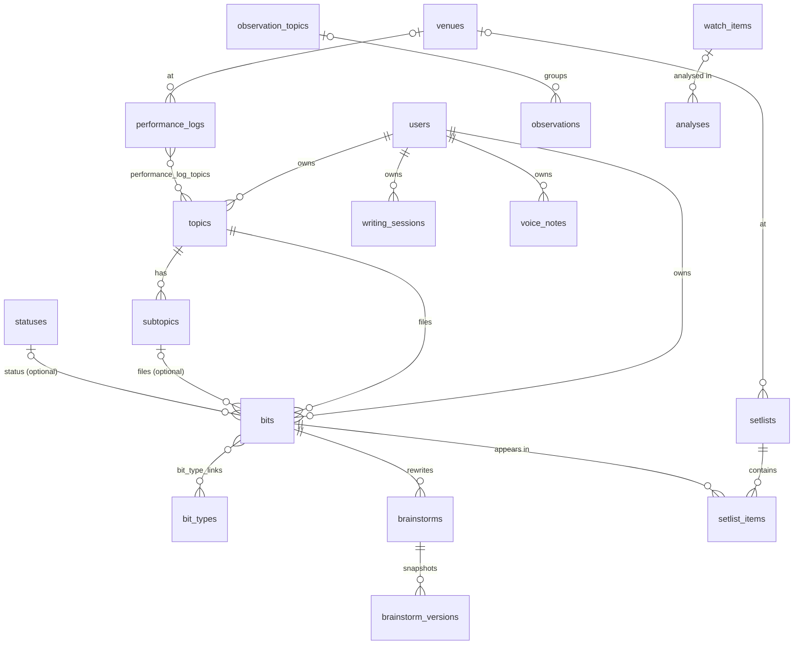

# Data model

The models are defined in [app/models/](../app/models/), and the schema changes in
[alembic/versions/](../alembic/versions/).

## Conventions

- **Primary keys** are UUIDs and may be generated by the client, which makes offline saves safe
  to retry.
- **Timestamps:** every table has `created_at` and `updated_at`, stored as timezone-aware UTC and
  shown in IST. Every timestamp column uses `UTCDateTime` ([base.py](../app/models/base.py)): times
  are converted to UTC on the way in and always come back tagged UTC, so local SQLite (which can't
  store a zone) behaves exactly like Postgres. The browser then formats everything in
  `Asia/Kolkata`, whatever the device's own zone, and "today" (for the daily joke and the
  calendars) is the IST date, rolling over at midnight IST even with the app left open.
- **Ownership:** every table except `users`, `setlist_items`, `brainstorm_versions` and the two link
  tables has `user_id → users.id ON DELETE CASCADE` (`OwnedMixin`), and every query filters by it.
- **Unique names** are case-insensitive per user: unique indexes on `(user_id, lower(name))`.
- **Lists** (hashtags, tag lines, handwriting strokes, linked ids) are JSON columns. That keeps
  them portable between SQLite and Postgres.
- **Constraint names** follow one naming convention (in `models/base.py`), so migrations behave the
  same on both databases.

## Diagram

## Tables

### Library

| Table | Columns | Rules |
|---|---|---|
| `users` | `google_sub` (unique), `email` (unique, lowercase), `display_name`, `avatar_url`, `plan` (default "Pro"), `last_login_at` | Created on first sign-in |
| `topics` | `name`, `position`, `is_system` | One `is_system` topic per user, named `Random` and shown as **Thoughts**. It can't be deleted; deleting another topic moves its jokes there |
| `subtopics` | `topic_id → topics` (cascade), `name` | Unique per topic. Deleting one clears it from its jokes |
| `bit_types` | `name` | Pruned whenever no joke uses it. Renaming onto an existing name merges the two |
| `bit_type_links` | `bit_id`, `type_id` (both cascade) | Many-to-many |
| `statuses` | `name`, `position` | Six defaults made on first sign-in; new ones are created by name when a joke uses them |
| `bits` | `topic_id` (required), `subtopic_id` (set null), `status_id` (set null), `setup`, `punchline`, `strength` 1–5, `duration_seconds`, `hashtags` JSON, `tag_lines` JSON, `clean_rating` (clean / mild / dirty / null), `language`, `comments`, `version` (up by one per save) | Check constraints on strength and clean rating. The API sends types and status as names. `version` catches edits made on two devices |

### Writing

| Table | Columns | Rules |
|---|---|---|
| `brainstorms` | `bit_id → bits` (cascade), `title`, `content`, `timer_seconds` | A **Rewrite** session on one joke |
| `brainstorm_versions` | `brainstorm_id` (cascade), `title`, `content`, `saved_at` | One row appended per save |
| `observation_topics` | `name` | Separate from joke topics |
| `observations` | `text`, `topic_id` (set null) | Deleting the topic keeps the observation |
| `writing_sessions` | `title`, `content`, `ink` JSON (strokes: colour, size, page, `[x, y, pressure]` points), `ink_pages` (1–20), `timer_seconds`, `bit_ids` JSON, `observation_ids` JSON, `technique_id → craft_notes` (set null) | A free **Brainstorm** session. Links are id lists; deleted targets just drop out of view. Deleting the technique keeps the session |
| `voice_notes` | `label`, `hashtags` JSON, `duration_seconds`, `content_type`, `size_bytes`, `audio_path` | `audio_path` stays empty until the upload lands. The audio itself lives in Blob storage |

### Performing

| Table | Columns | Rules |
|---|---|---|
| `venues` | `name` | Created by name when a set or show uses one; "Unidentified Venue" is the default |
| `setlists` | `name`, `show_date`, `target_seconds` (default 900), `venue_id` (set null) | Saved whole: `PUT` replaces the items in one transaction |
| `setlist_items` | `setlist_id` (cascade), `bit_id` (cascade), `position`, `duration_seconds` | Opener and closer are the first and last positions, not stored |
| `performance_logs` | `venue_id` (set null), `performed_at` (timestamptz), `duration_seconds`, `audience_size`, `rating` 1–5, `notes`, `laughs` JSON (five counts, for laughs scored 1–5 points; null if not counted) | LPM is worked out in the browser from `laughs` and the time on stage |
| `performance_log_topics` | `log_id`, `topic_id` (both cascade) | "Topics you did". Deleting a topic re-points its links to Thoughts |

### Study

| Table | Columns | Rules |
|---|---|---|
| `watch_items` | `title`, `comedian`, `category`, `description`, `url`, `position`, `schemer_index`, `logic_density`, `dark_pragmatism` (0–10, nullable), `watched` | The dossier is imported once and matched on title and comedian, so a re-import adds only new routines |
| `craft_areas` | `name` (unique per user, any case), `description`, `color` (one of 12 presets, or any `#rrggbb`; colours can repeat), `screens` JSON (any of rewrite / sets / stage), `position` | Folders for craft notes. Everyone gets seven to start (at sign-in, or the first time areas are listed) and can add, rename, recolour, reorder and delete them. Deleting one moves its notes to another area; the last one can't be deleted |
| `craft_kinds` | `name` (unique per user, any case), `behaviour` (checklist / technique / reference / path), `position` | Kinds of craft note. Everyone gets Checklist, Technique, Reference and Path to start and can add, rename and delete them. The behaviour is the only fixed part: it's how the app uses the kind's notes. Deleting one moves its notes to another kind; the last can't go |
| `craft_notes` | `title`, `body`, `kind_id → craft_kinds`, `area_id → craft_areas`, `hashtags` JSON, `source`, `url`, `position`, `performance_log_id → performance_logs` (set null), `analysis_id → analyses` (set null) | The API sends each note's `behaviour` with it, from its kind. The two links say which show or analysis a lesson came from; deleting either keeps the note. An area's `screens` decide which notes Rewrite, the set builder and Stage show. The body is plain text with light formatting (`#` headings, `-` lists, `- [ ]` tick boxes, `**bold**`) |
| `analyses` | `title`, `url`, `body`, `watch_item_id` (set null) | Deleting the routine keeps the analysis |

## What happens on delete

| You delete | Effect |
|---|---|
| A joke | Its rewrites and versions go; it's removed from every set (cascade). Brainstorm links to it drop out of view |
| A topic | Its jokes move to Thoughts with no subtopic; its show links move to Thoughts; its subtopics go |
| A subtopic | Its jokes keep their topic and lose the subtopic |
| A type | Removed from every joke; a joke left with none shows as "Undefined" |
| An observation topic | Its observations stay, with no topic |
| A set | Its items go; the jokes stay |
| A watchlist routine | Analyses of it stay, unlinked |
| A voice note | The row and its audio file go. Deleting twice is fine (a replayed delete) |

All of these run in one transaction ([services/topics.py](../app/services/topics.py)).

## Migrations

| Revision | Adds |
|---|---|
| `0001` | Initial schema: users, library, studio, setlists, venues, logs |
| `0002` | Observations and observation topics |
| `0003` | Brainstorm (writing) sessions |
| `0004` | Handwriting page count (`ink_pages`) |
| `0005` | Voice notes |
| `0006` | Watchlist and analyses |

Merged migrations are shared history. CI fails a PR that edits, deletes or renames one; fix
forward with a new revision. CI also runs upgrade → downgrade → upgrade on Postgres 16, so every
migration needs a working `downgrade()`.

## Importing the old Bit Vault

[app/seed/loader.py](../app/seed/loader.py) reads the old Firestore export shape (the demo data
uses the same shape):

- Type strings or arrays become type links.
- `"Xm YYs"` becomes seconds.
- `tags` become hashtags.
- `"Tags: …"` typed into a punchline is split out into tag lines.
- Alternative punchlines become tag lines.
- A joke's old versions are appended to its notes under "Earlier versions". Brainstorms keep
  their versions.
- Venues and topic links are rebuilt for logs.
- Brainstorms of deleted jokes are skipped and listed in the report.

Loading replaces everything in that account; `--dry-run` reports the counts and then rolls back.
