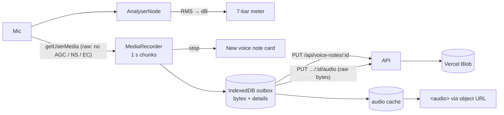

# Frontend architecture

How the React app handles server data, offline saves, voice recording and the service worker.
The overall system is in [architecture.md](architecture.md).

## Server state vs UI state
Data from the API lives in TanStack Query ([queryClient.ts](../web/src/api/queryClient.ts)), never
in `useState`. Each resource has a hooks file (`api/library.ts`, `api/shows.ts`, ...) exposing
`useBits()`, `useSaveSetlist()` and so on. `useState` is only for UI: whether a sheet is open, or
a draft being typed.

## Client-generated ids and upserts
New rows get their UUID in the browser (`crypto.randomUUID()`) and are saved with
`PUT /api/<resource>/<id>`, which creates or updates. A save retried after a dropped connection
therefore never makes a duplicate. That's what makes the offline queue safe.

## Optimistic updates and the offline queue
Saving and deleting jokes, observations, brainstorm sessions, watchlist routines, analyses and craft notes are
registered as **mutation defaults** under fixed keys (`setMutationDefaults`).

- **Saving updates the screen at once:** `onMutate` writes the change into the cached list before
  the server answers.
- **Offline, the save pauses:** TanStack Query marks it paused, and the persister writes it to
  IndexedDB with the rest of the cache.
- **On restart, saved changes replay:** `PersistQueryClientProvider.onSuccess` runs
  `resumePausedMutations()`. Because the mutation function is registered by key rather than held in
  a closure, a save made before a reload can still run.
- **Afterwards, the data refreshes:** `onSettled` invalidates the related keys, so the server's
  version wins.

The cache (with `gcTime` and `maxAge` of a week) is what lets the app open offline.
`RequireAuth` uses the cached profile when the network is down.

## Autosave
Joke pages, sets and brainstorm sessions keep a local draft and save after a short pause and on
unmount (`useAutosaveBit`, `useAutosaveSet`, `useSessionAutosave`). A ref holds the newest
values, so a delayed save writes what's on screen now.

## URL as state
The filters for Jokes (`?topic&sub&type&status&q&sort`) and Observations (`?topic`) live in the
query string, so back, refresh and shared links keep your place. `/shows?log=1` opens the Log a
show sheet, which is how Home links to it, and `/shows?view=timeline|insights` picks the Shows view. Filtering, sorting and totals run in the browser, over the cached lists.

## Charts
The Timeline and Insights charts ([features/shows/insights](../web/src/features/shows/insights)) are
hand-written SVG and HTML, not a chart library: a handful of chart types didn't justify the
dependency, at the cost of more code per new chart type.
- **Pure maths, separate from drawing:** `insightMath.ts`, `timelineMath.ts` and `formMath.ts` turn
  shows into numbers and have unit tests; the components only lay them out.
- **Measured width:** `useWidth` (a `ResizeObserver`) gives SVG charts their pixel width, so lines
  stay crisp and labels thin out instead of colliding on a phone.
- **Readouts:** `useTip` gives every mark the same readout on hover and on keyboard focus;
  values that matter are also written beside the marks, so the readout only adds detail.
- **Colours** ([vizColors.ts](../web/src/features/shows/insights/vizColors.ts)) were checked for
  colour-blind safety against the dark surface: a one-hue gold ramp for ratings, and gold against
  blue at equal lightness for better or worse than your usual.

## Navigation config
[nav.ts](../web/src/layout/nav.ts) is the single list of screens. The desktop rail renders `NAV`;
the phone bar renders `BAR_LEFT`, the + button, `BAR_RIGHT` and More (`MORE_GROUPS`).

## Voice notes pipeline

- **Format:** WebM/Opus where the browser records it reliably (Chrome, Edge, Firefox), MP4/AAC on
  Safari. A format that once produced an empty file is remembered and skipped. Opus is recorded
  at 48 kbps and AAC at 64 kbps.
- **Raw microphone:** echo cancellation, noise suppression and auto gain are all off. They're built
  for calls: auto gain pumped up the room hiss in pauses, and noise suppression made voices warble.
- **Level meter:** the RMS of each frame mapped to decibels, from -60 dB (silence) to -18 dB
  (full). It's sampled every animation frame but re-rendered only every 70 ms, with a fast attack
  and a gentle 0.85 decay.
- **Size cap:** recording stops itself at about 4 MB, under the server's 4 MiB limit (itself under
  Vercel's request size cap). That's about 11 minutes of Opus or 8 of AAC.
- **Outbox:** every recording is saved on the device first. The details and the audio upload as two
  calls, and retry when back online. A permanent refusal (too large, say) marks the note as failed,
  so you can delete it.
- **Playback:** notes are fetched as a Blob and played from an object URL rather than by pointing
  `<audio>` at the API. Safari only streams from servers that answer byte-range requests, and this
  also keeps the cookie on the request and works offline. A note just recorded plays straight from
  the cache.
- **Storage:** paths are always built by the server (`voice/<user_id>/<note_id>.<ext>`), never taken
  from the request. `AudioStore` is a protocol: `BlobAudioStore` on Vercel (it authenticates with
  the per-request OIDC token, so there's no key to manage), `LocalAudioStore` locally and in tests.

## PWA and the service worker

- **Manifest:** JokeBox, standalone, portrait, ink background. Icons at 192 px, 512 px and maskable
  512 px, plus iOS splash screens and a touch icon.
- **Precache:** all JS, CSS, HTML, SVG, PNG and WOFF2. Page URLs fall back to `index.html`;
  `/api`, `/auth` and `/health` always go to the network.
- **`registerType: 'prompt'`:** a new version installs in the background and waits, so the open
  app never changes under you. The update banner switches to it with one tap.

