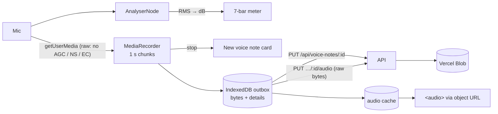

# Frontend architecture

How the React app handles server data, offline saves, voice recording and the service worker.
The overall system is in [architecture.md](architecture.md).

## Server state vs UI state
Data from the API lives in TanStack Query ([queryClient.ts](../web/src/api/queryClient.ts)), never
in `useState`. Each resource has a hooks file (`api/library.ts`, `api/shows.ts`, ...) exposing
`useJokes()`, `useSaveSetlist()` and so on. `useState` is only for UI: whether a sheet is open, or
a draft being typed.

## Client-generated ids and upserts
New rows get their UUID in the browser (`crypto.randomUUID()`) and are saved with
`PUT /api/<resource>/<id>`, which creates or updates. A save retried after a dropped connection
therefore never makes a duplicate. That's what makes the offline queue safe.

## Optimistic updates and the offline queue
Saving and deleting jokes, observations, brainstorm sessions, shows, sets, rewrites, voice note
details, watchlist routines, analyses and craft notes are registered as **mutation defaults**
under fixed keys (`setMutationDefaults`), each spreading the shared `QUEUED` options from
[sync.ts](../web/src/api/sync.ts).

- **Saving updates the screen at once:** `onMutate` writes the change into the cached list before
  the server answers. Sheets close straight away, signal or not; a save the server later refuses
  shows a "Not saved" toast (screens use `mutateAsync().catch`, which still fires after the
  sheet has closed).
- **Offline, the save pauses:** `networkMode: 'online'` makes TanStack Query hold it, and the
  persister writes it to IndexedDB with the rest of the cache (`throttleTime` 300 ms).
- **Saved before the phone puts the app away:** iOS often skips `pagehide` when you switch apps
  or lock the phone, so every editor (joke, set, premise, brainstorm session) also sends its
  waiting change on `visibilitychange` to hidden (`onHide` in
  [saveOnHide.ts](../web/src/lib/saveOnHide.ts)), and the saved copy is then written straight to
  IndexedDB (`saveNow` in [persist.ts](../web/src/api/persist.ts)), not after the throttle, which
  may still be waiting when the app is frozen.
- **One at a time, in order:** every queued save shares `scope: { id: 'sync' }`, so they reach the
  server in the order you made them. A show arrives before the lesson that points at it, and two
  quick edits to one joke can't land the wrong way round.
- **One waiting copy per brainstorm session:** a session autosaves its whole self (text and
  handwriting) at every pause, so offline each pause used to queue another full copy. Its save
  now drops that session's older saves that haven't been sent yet (`dropOlderWaiting` in
  sync.ts): the newest copy holds everything they did. A save already on its way is left alone.
- **Brainstorm sessions in pieces:** the list (`session-list`) comes without ink; each session's
  ink is its own query (`['session-detail', id]`, never garbage-collected) so it stays on the
  phone. `keepOnDevice` in [sessions.ts](../web/src/api/sessions.ts) downloads, one at a time,
  each session whose `updated_at` moved on, but never while saves are waiting (it would fetch
  the server's older copy). An open session isn't refetched while its own save waits either, and
  once saved the copy kept is what was saved, with the server's time
  ([sessionSaves.ts](../web/src/api/sessionSaves.ts)): stamping that time on whatever copy was
  there let an older one pass for current. A session listed but not on this device yet opens to
  "This session isn't on this device yet" rather than an empty editor, whose autosave would wipe
  its pages.
- **Sessions the server would refuse:** [sessionLimits.ts](../web/src/api/sessionLimits.ts)
  splits a stroke longer than 5,000 points into joined pieces, and a session over 10,000 strokes
  (or a title over 200 characters) is refused before it's sent, with a note on the session page.
  `api()` refuses any body over the host's 4.5 MB the same way, without uploading it. Before,
  each autosave sent it again and Couldn't sync kept a full copy of the ink per try; now that list
  keeps one entry per thing saved.
- **Retries:** a save that never reached the server is retried (pausing while offline, which
  costs no tries) up to 20 times while the server answers `/health`, so one stuck request can't
  hold up the queue forever. A 5xx, 408 or 429 gets three more tries. A 401 (the sign-in ran out)
  waits, retrying each minute, until you sign in again. Any other refusal stops.
- **Nothing refused is lost:** a queued save that fails for good goes, with its variables, to the
  **Couldn't sync** list ([unsynced.ts](../web/src/api/unsynced.ts), its own IndexedDB key) via
  the `MutationCache` `onError`. A strip above every page opens it, with Retry, Copy and Discard.
- **Written-at times:** new jokes, observations, voice notes and craft notes send `created_at`, so
  something written offline keeps the time it was written; the server keeps it on create only and
  caps it at now.
- **Edits on two devices (jokes):** every joke has a `version`. A save sends the version it was
  edited from as `base_version`: the input carries it (`toInput` keeps the version of the joke the
  editor opened), not the cached list, which a refresh moves on to the other device's edit while
  the editor still shows the old text. Only this device's own answers move it on (the chain of
  own versions in [jokeSaves.ts](../web/src/api/jokeSaves.ts), kept with the cache), so a run of
  autosaves never clashes with itself. If the joke moved on elsewhere and the save would change
  it, the server answers 409 and the edit goes to Couldn't sync, where **Keep mine** resends it
  without the check. Resending the very same edit is never a clash, and a save that changes
  nothing (Save with no edit, a word typed and deleted) doesn't move the version on, so it can't
  make another device's waiting edit clash.
- **Sets, Craft notes, observations and premises go the same way** (`sendChecked` in
  ownVersions.ts), each with Couldn't sync and Keep mine. Observation saves live in
  [observationSaves.ts](../web/src/api/observationSaves.ts), not queryClient.ts, which
  ownVersions.ts imports.
- **Brainstorm sessions** send `base_version` the same way, with the chain of
  own versions in [ownVersions.ts](../web/src/api/ownVersions.ts) (one per kind; the joke one
  keeps its old cache key), but a session's clash never throws a version away ([sessionClash.ts](../web/src/api/sessionClash.ts)): the
  refused edit is saved as a new session titled "… (copy, edited on two devices)", and the move is
  remembered per session and opened version, so later autosaves, a retried save and the session
  reopened from this device's copy all go to that copy. The editor shows a notice with **Open the
  copy**. A session started here is checked from its second save (`version` 0 until then).
- **On restart, saved changes replay:** the persister keeps every queued save that hasn't
  finished, including one that was mid-request when the app closed. The saved copy never expires
  (`maxAge: Infinity`; lists still drop a week after last use), and `CACHE_BUSTER` and every
  shipped key are pinned by [queuedKeys.test.ts](../web/src/api/queuedKeys.test.ts), since
  changing either would strand saves waiting on phones. `checkAccount()` runs first: if a different
  account is now signed in, the last one's waiting saves are dropped rather than filed under the
  new one. Then `resumeQueued()` restarts them all. Because the mutation function is registered by key rather than held in a closure, a save
  made before a reload can still run, and since saves are idempotent `PUT`s and deletes, sending
  one twice is harmless. This all runs in the background (`afterRestore` in
  [launch.ts](../web/src/api/launch.ts)): the provider counts the app as loading until its
  `onSuccess` returns, and while it loads no screen fetches and nothing is written back to the
  phone. Returning the replay there held the app that way until every waiting save got through,
  which on a weak signal took minutes and while signed out never ended.
- **Waiting saves show again at launch:** `showWaitingSaves()` reruns each restored save's
  `onMutate`, oldest first. A save can reach the phone before its `onMutate` has shown it (that
  waits a moment for `cancelQueries`), and TanStack doesn't rerun `onMutate` for a restored save,
  so a joke editor would open on the older text and save it back over the newer one. Each
  `onMutate` sets or drops an item, so running it twice is harmless. Writing the saved copy on
  hide or handover also waits a tick so it carries the change, and an open joke editor takes a
  newer copy of its joke while nothing's been typed (`followNewer` in useAutosaveJoke.ts).
- **Afterwards, the data refreshes, once:** `onSettled` calls `refreshWhenSynced(...)`, which
  collects the keys and invalidates them only when the last queued save settles. Refetching
  earlier would show the server's older copy and make a waiting change seem to vanish. On
  reconnect TanStack also resumes saves before it refetches queries.

Anything not queued (renaming a topic, deleting a venue) uses the default
`networkMode: 'always'` with no retries: offline it fails at once with "You're offline" instead
of spinning.

### Knowing when we're offline
[network.ts](../web/src/api/network.ts) drives TanStack's `onlineManager`. It starts from
`navigator.onLine`, so flight mode counts as offline from the first moment. The phone's flag
isn't enough on its own, though: one bar in a basement, or wifi with no internet, says online
while every request fails. So `api()` gives each request 20 seconds (a big upload a second more
per 50 KB, up to two minutes, so a session full of handwriting gets through), and a request that never
reaches the server (`TypeError` or a timeout) calls `lostConnection()`: we count as offline and
ask `/health` every 10 seconds, on the `online` event and when the app comes back to the front,
until it answers. The sync light and the voice outbox follow the same flag.

Wifi with a sign-in page (venues, cafés) answers with its own page until you sign in. So the
`/health` check needs our own JSON `{"status": "ok"}`, and in `api()` a reply redirected to
another origin, a 511, or a 200 that isn't JSON counts as no connection: the save waits.

The cache is what lets the app open offline. `RequireAuth` uses the cached profile when the
network is down, but a 401 beats it: the sign-in ran out, so it goes to sign in (the login page
says how many changes are waiting). Signing out warns when changes haven't synced, then wipes
them with everything else on the phone.

### One tab at a time
Two tabs would keep separate queues and overwrite each other's saved copy.
[oneTab.ts](../web/src/lib/oneTab.ts): the open tab holds a Web Lock. A new tab that finds it
held posts a claim on a BroadcastChannel; the open tab sends every editor's waiting change
(`flushAll`), writes the saved copy straight away (`saveNow`: the throttled persister could
return before writing), answers, and reloads into "Open in another tab" with **Use it here**.
Only then does the new tab restore the cache and start the voice outbox (`startOutbox`), so it
can't take a recording still going in the other tab. From the answer on, the old tab is handed
over (`handedOver()`): it writes nothing more to the saved copy and sends nothing, so a late write
can't land over the new tab's. A tab the browser froze can't answer; the new tab takes the lock
after 2 seconds, and when the frozen one wakes it finds the lock gone and steps aside the same way.

**Several tabs** (account menu, or **Keep both open** on that screen) turns this off for one
browser (`localStorage`). Each tab then holds the lock shared, only so a new tab knows it isn't
alone: it skips recovering cut-off recordings, which may still be recording elsewhere. Uploads
from the voice outbox take a `jokebox-outbox` lock, so two tabs never send the same note at once.
Tabs still overwrite each other's saved copy, so a tab with unsynced saves asks before closing
(`useCloseWarning`). Switching it off claims the lock again and the other tabs step aside.

### Honest save messages
[announce.ts](../web/src/lib/announce.ts) waits up to 1.5 s for the server before saying "Show
logged". On one bar the phone says online while the save is really waiting, so slower than that
(or offline) it says "Saved offline, will sync".

## Autosave
Joke pages, sets and brainstorm sessions keep a local draft and save after a short pause and on
unmount (`useAutosaveJoke`, `useAutosaveSet`, `useSessionAutosave`). A ref holds the newest
values, so a delayed save writes what's on screen now.

A joke's save leaves out rows still empty (`toSend`): a tag line or alternate punch just added
and not typed in yet. The server drops blank rows, and the copy it sent back used to replace the
draft about three seconds later, taking the empty row (and the cursor) away mid-thought.

## URL as state
The filters for Jokes (`?topic&sub&type&status&q&sort`) and Observations (`?topic`) live in the
query string, so back, refresh and shared links keep your place. `/shows?log=1` opens the Log a
show sheet, which is how Home links to it, and `/shows?view=timeline|insights` picks the Shows view. Filtering, sorting and totals run in the browser, over the cached lists.

## Charts
The Timeline and Insights charts ([features/shows/insights](../web/src/features/shows/insights)) are
hand-written SVG and HTML, not a chart library: a handful of chart types didn't justify the
dependency, at the cost of more code per new chart type.
- **Pure maths, separate from drawing:** `insightMath.ts`, `timelineMath.ts` and `formMath.ts` turn
  shows into numbers and have unit tests; the components only lay them out.
- **Measured width:** `useWidth` (a `ResizeObserver`) gives SVG charts their pixel width, so lines
  stay crisp and labels thin out instead of colliding on a phone.
- **Readouts:** `useTip` gives every mark the same readout on hover and on keyboard focus;
  values that matter are also written beside the marks, so the readout only adds detail.
- **Colours** ([vizColors.ts](../web/src/features/shows/insights/vizColors.ts)) were checked for
  colour-blind safety against the dark surface: a one-hue gold ramp for ratings, and gold against
  blue at equal lightness for better or worse than your usual.

## Month headings and the time scrubber
Observations, Voice notes and Jokes (sorted by a date) group their lists by IST month with
[months.ts](../web/src/lib/months.ts) and render each month as a
[MonthSection](../web/src/components/time/MonthSection.tsx): a section with an id and a heading
that sticks under the phone's top bar. [TimeRail](../web/src/components/time/TimeRail.tsx) is the
scrubber beside them, built as an ARIA slider:
- **Jumping:** pressing or dragging picks the month at that height (months share the rail equally)
  and scrolls only the box the list lives in (the page on phones, the list column for jokes on
  desktop), never both, so the page doesn't shift.
- **Following:** a scroll listener on `window` in the capture phase hears scrolling in any box, and
  marks the last month whose heading has passed the top as current.
- **Keyboard:** arrow keys step a month, Home and End jump to either end.
On phones the lists keep a little room on the right so the scrubber never covers a row's buttons.

## Navigation config
[nav.ts](../web/src/layout/nav.ts) is the single list of screens. The desktop rail renders `NAV`;
the phone bar renders `BAR_LEFT`, the + button, the Ideas tab and More (`MORE_GROUPS`). The Ideas
tab is not in `nav.ts`: it points at Premises or Observations, whichever you used last
([ideas.ts](../web/src/layout/ideas.ts)), a per-device choice kept in `localStorage` (`jokebox.ideas`) like
the brainstorm pen, so it never syncs.

## Adaptive layout

- **Breakpoints:** `md` 768 px (lists go two across), `lg` 1024 px (the rail and side-by-side
  panes), `xl` 1280 px (the full rail, and the map or guide beside the list). Tailwind classes
  carry it all except the rail, whose compact state is JS ([useRail.ts](../web/src/layout/useRail.ts))
  because a per-device choice in `localStorage` can override the width.
- **`SplitView`** ([SplitView.tsx](../web/src/components/ui/SplitView.tsx)) owns the list and
  detail columns for Jokes and Premises, the full-width and close buttons, and the settle-in
  animation. Lists pass `WIDE_LIST` to go two across only while nothing is open. Observations
  uses it too.
- **Page titles size to their column, not the screen.** `PageHead` is a container (`@container`):
  below 22rem wide its title caps at 44 px, below 19.5rem at 38 px. With an item open between
  1024 and 1279 px (iPad landscape), the list column is 22rem and its content 19rem, so screen
  breakpoints alone gave "Observations" 56 px and pushed New into the open item. Phone and laptop
  sizes are unchanged: there the caps match what the screen breakpoints already give.
- **Linking by search:** [LinkSearch.tsx](../web/src/features/observations/LinkSearch.tsx) is the one
  way to link observations with jokes and premises, from either side: type, see the three best
  matches, tap to link. No lists to scroll.
- **View transitions:** links that reshape the screen pass React Router's `viewTransition`; state
  changes go through `withTransition` ([viewTransition.ts](../web/src/lib/viewTransition.ts)).
  Moving between items in an open split doesn't fade, so it stays instant.

## Voice notes pipeline

- **Format:** WebM/Opus where the browser records it reliably (Chrome, Edge, Firefox), MP4/AAC on
  Safari. A format that once produced an empty file is remembered and skipped. Opus is recorded
  at 48 kbps and AAC at 64 kbps.
- **Raw microphone:** echo cancellation, noise suppression and auto gain are all off. They're built
  for calls: auto gain pumped up the room hiss in pauses, and noise suppression made voices warble.
- **Level meter:** the RMS of each frame mapped to decibels, from -60 dB (silence) to -18 dB
  (full). It's sampled every animation frame but re-rendered only every 70 ms, with a fast attack
  and a gentle 0.85 decay.
- **Size cap:** recording stops itself at about 4 MB, under the server's 4 MiB limit (itself under
  Vercel's request size cap). That's about 11 minutes of Opus or 8 of AAC.
- **While recording:** every 1 s chunk is also written to IndexedDB as it arrives
  ([inProgress.ts](../web/src/features/voice/inProgress.ts)), keyed `[note id, chunk number]`,
  and the screen is kept awake (`useWakeLock`, which reports `asking`, `held` or `refused` so
  the recorder only promises what the phone agreed to). If the phone takes the mic (the track ends or the
  recorder errors), what was recorded is filed as if stop was tapped. If the app is killed, the
  next launch puts the chunks back together as "Recovered recording", dated when it started.
- **Uploads time out:** a minute plus time to send at 20 KB/s (at most 15 minutes), so a stalled
  upload can't hold up the recordings behind it; a timeout counts as no connection.
- **Outbox:** every recording is saved on the device first. The details and the audio upload as two
  calls, and retry when back online. A permanent refusal (too large, say) marks the note as failed,
  so you can delete it.
- **Playback:** notes are fetched as a Blob and played from an object URL rather than by pointing
  `<audio>` at the API. Safari only streams from servers that answer byte-range requests, and this
  also keeps the cookie on the request and works offline. A note just recorded plays straight from
  the cache.
- **Storage:** paths are always built by the server (`voice/<user_id>/<note_id>.<ext>`), never taken
  from the request. `AudioStore` is a protocol: `BlobAudioStore` on Vercel (it authenticates with
  the per-request OIDC token, so there's no key to manage), `LocalAudioStore` locally and in tests.

## PWA and the service worker

- **Manifest:** JokeBox, standalone, portrait, ink background. Icons at 192 px, 512 px and maskable
  512 px, plus iOS splash screens and a touch icon.
- **Precache:** all JS, CSS, HTML, SVG, PNG and WOFF2. Page URLs fall back to `index.html`;
  `/api`, `/auth` and `/health` always go to the network.
- **`registerType: 'prompt'`:** a new version installs in the background and waits, so the open
  app never changes under you. The update banner switches to it with one tap. It checks for one
  every hour and each time the app comes back to the front (at most once a minute): an installed
  app on a phone is mostly resumed rather than opened, and the phone pauses the hourly timer.

## When the app crashes

- **An address that isn't a page** ([NotFoundPage.tsx](../web/src/layout/NotFoundPage.tsx)): not a
  crash, but the same rule, say what happened. Any unknown URL shows "Nothing at this address"
  inside the app frame, with **Go to Home** and **Search**. It used to redirect to Home, which
  looked as if an old or mistyped link had worked. Addresses from the first version (`/bits`,
  `/studio`, `/setlist`, `/performance`) still redirect to their new pages.
- **An error screen, not a blank one** ([CrashScreen.tsx](../web/src/layout/CrashScreen.tsx)): an
  error boundary around the whole app. If a component throws while rendering, it shows "Something
  broke" with **Reload**, **Reload a fresh copy**, and the error under "What went wrong" with
  **Copy the details**.
- **An old copy repairs itself** ([recover.ts](../web/src/lib/recover.ts)): an installed app can
  outlive a release and ask for a file the release replaced. When loading a file fails that way,
  the app repairs itself once, showing "Updating JokeBox…": it removes the service worker and its
  cached files, drops the saved lists (keeping saves waiting to sync), and reloads from the
  network. It does this at most once a minute, so a crash that a repair doesn't fix shows the error
  screen instead of looping. Without signal it only reloads, since without the cached files
  there'd be no app to open; and "signal" means `/health` answered, not the phone's own flag,
  which says online on one bar. **Reload a fresh copy** checks the same way and, if the server
  can't be reached, keeps this copy and says so.
