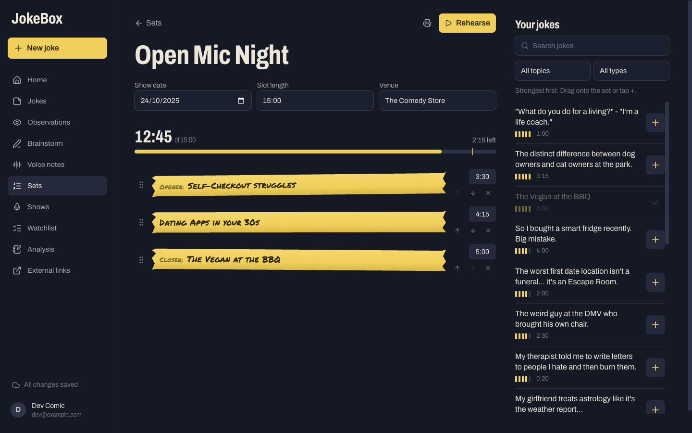
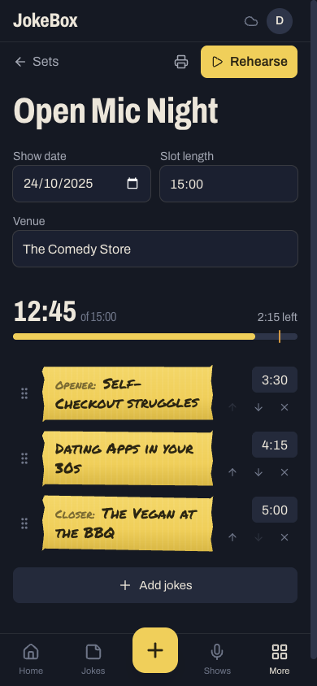
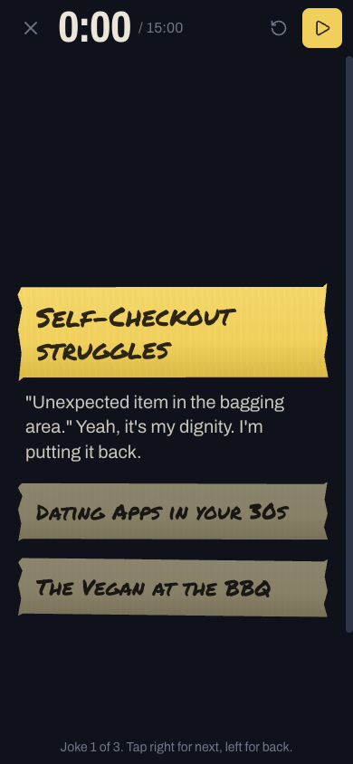
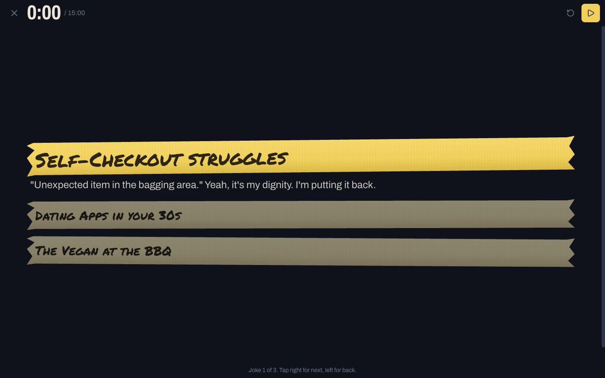
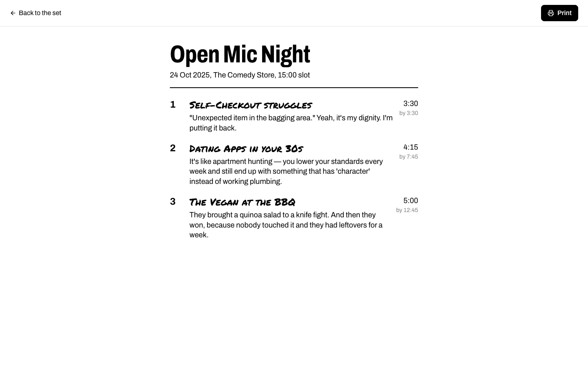
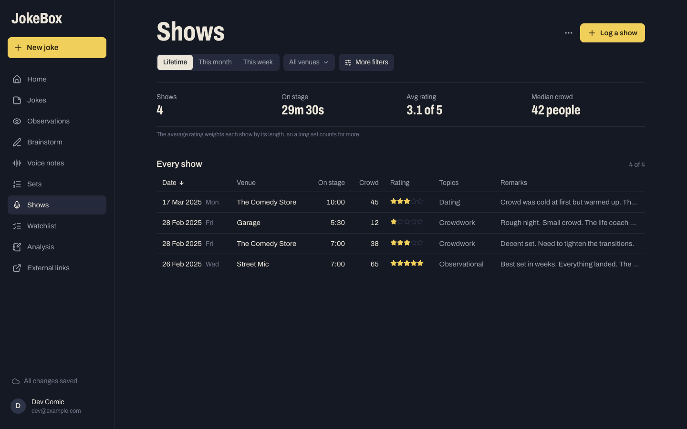
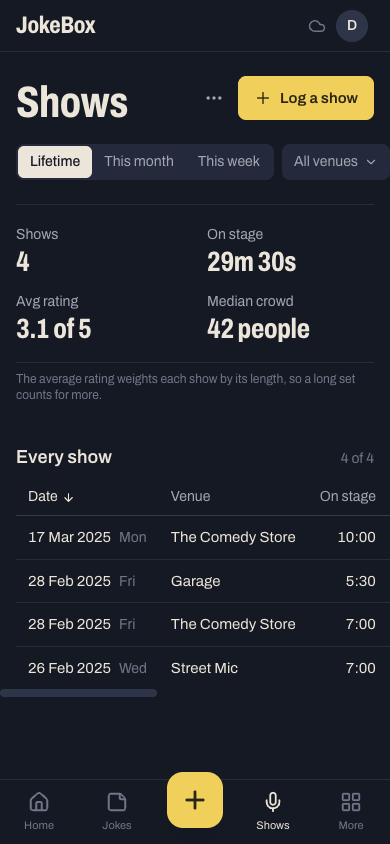
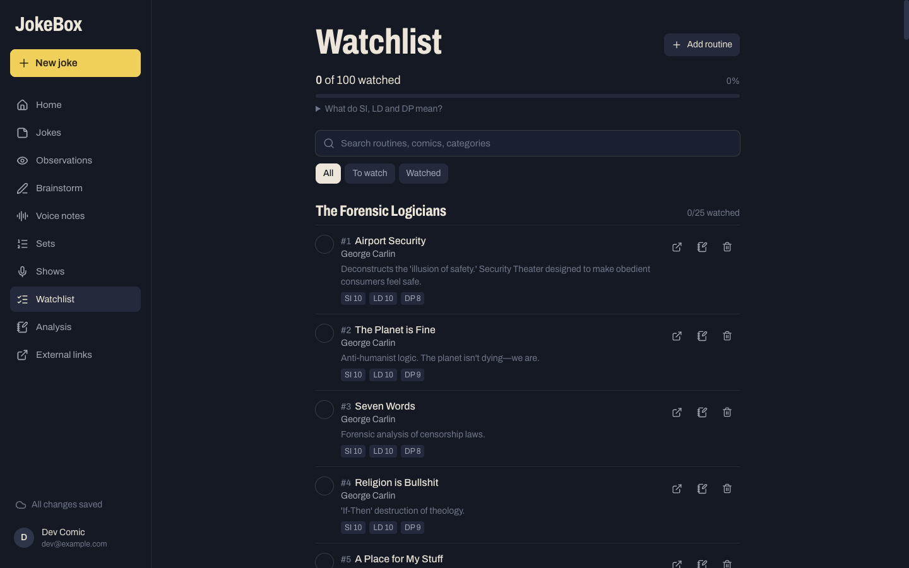
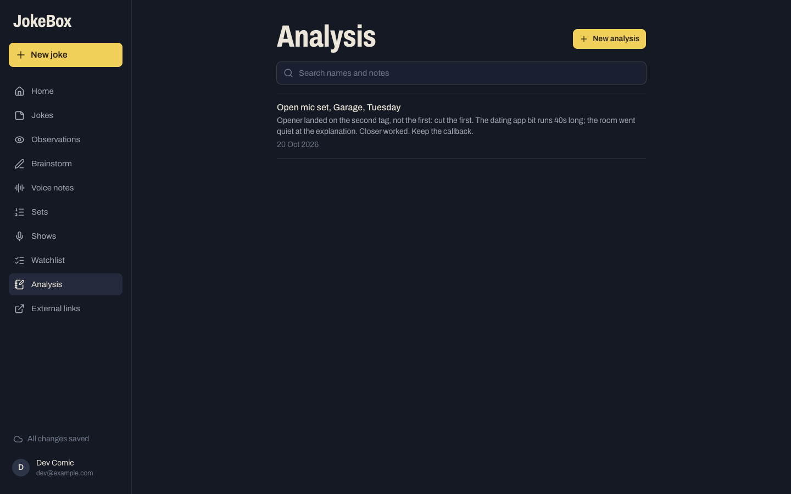

# Screens: perform and study

Sets, stage, print, shows and the study screens. The frame, capture and writing screens are in
[screens.md](screens.md).

## Sets: `/sets` and `/sets/:setId`

[SetsPage.tsx](../web/src/features/sets/SetsPage.tsx), [SetBuilder.tsx](../web/src/features/sets/SetBuilder.tsx),
[TapeRow.tsx](../web/src/features/sets/TapeRow.tsx), [AddBits.tsx](../web/src/features/sets/AddBits.tsx),
[LightBar.tsx](../web/src/features/sets/LightBar.tsx), [setlistMath.ts](../web/src/features/sets/setlistMath.ts),
[useAutosaveSet.ts](../web/src/features/sets/useAutosaveSet.ts), [BitPeek.tsx](../web/src/features/bits/BitPeek.tsx).

- **List:** sets with the soonest show first. Each card shows the date, venue, joke count and light
  bar, with Rehearse and a ⋯ menu (Open set, Print, Delete set). **New set** creates one and
  opens it.
- **Builder:** the set name, then Show date, Slot length and Venue. Below them, the total against the
  slot with "N left", and the light bar. Then one **tape strip** per joke: a drag handle, the premise
  in marker, an editable runtime, up and down arrows, and remove. The opener and closer are labelled
  on their strips.
- **Your jokes:** a column on desktop and a sheet behind **Add jokes** on a phone. It has search,
  topic and type filters, and lists the strongest first; jokes already in the set are dimmed. Tap a
  joke to read it in full (`BitPeek`).
- **Drag and drop** uses dnd-kit, with pointer, touch and keyboard sensors, so it works on phones.
- **Saving:** the set autosaves shortly after each change.

  
  

## Stage: `/sets/:setId/stage`

[StageView.tsx](../web/src/features/sets/StageView.tsx).

A full screen with no frame. It shows the clock against the slot, reset, and play/pause. The
current joke is bright tape with its punch under it; the others are dimmed tape. Tap the right half
of the screen for the next joke and the left half for the previous one. The clock turns amber in
the last minute and red when you're over. The screen wake lock keeps the phone awake.

## Print: `/sets/:setId/print`

[PrintView.tsx](../web/src/features/sets/PrintView.tsx).

A white page. It shows the set name, then date, venue and slot. Below that, the jokes, numbered,
each with its premise in marker, the punch, its runtime and "by m:ss" (the running total). A
**Print** button opens the browser's print dialog.

## Shows: `/shows`

[ShowsPage.tsx](../web/src/features/shows/ShowsPage.tsx), [ShowsToolbar.tsx](../web/src/features/shows/ShowsToolbar.tsx),
[ShowFilters.tsx](../web/src/features/shows/ShowFilters.tsx), [ShowStats.tsx](../web/src/features/shows/ShowStats.tsx),
[ShowsTable.tsx](../web/src/features/shows/ShowsTable.tsx), [ShowDetail.tsx](../web/src/features/shows/ShowDetail.tsx),
[LogShowSheet.tsx](../web/src/features/shows/LogShowSheet.tsx), [logMath.ts](../web/src/features/shows/logMath.ts),
[logStats.ts](../web/src/features/shows/logStats.ts).

- **Toolbar:** Lifetime / This month / This week, a venue picker and **More filters** (date range,
  stars, set length band, crowd band).
- **Totals:** Shows, On stage, Avg rating (weighted by stage time) and Median crowd. They always
  follow the filters.
- **Table:** Date, Venue, On stage, Crowd, Rating, Topics and Remarks. Click a heading to sort and
  click again to flip the order. On a phone the table scrolls sideways with the date pinned.
- **Log a show** (a sheet, also opened by `?log=1`): venue, stars and length up top. Optional: the
  set you did (which fills in the length and topics), date and time, crowd and remarks.
- ⋯ → **Export as CSV**.

## Watchlist: `/watchlist`

[WatchlistPage.tsx](../web/src/features/study/WatchlistPage.tsx), [WatchRow.tsx](../web/src/features/study/WatchRow.tsx),
[AddRoutineSheet.tsx](../web/src/features/study/AddRoutineSheet.tsx), [watchMeta.ts](../web/src/features/study/watchMeta.ts).

The header shows progress ("N of 100 watched"), an explainer for SI, LD and DP, a search box, and
All / To watch / Watched. Routines are grouped by category, each group with its own count. Each
row has a watched circle, its number, title, comedian, description and score chips, plus open,
analyse and delete. **Add routine** adds your own. The dossier loads once with
`POST /api/watchlist/import-dossier`, which skips routines you already have.

## Analysis: `/analysis` and `/analysis/:analysisId`

[AnalysisPage.tsx](../web/src/features/study/AnalysisPage.tsx), [AnalysisEditor.tsx](../web/src/features/study/AnalysisEditor.tsx).

The list is searchable, with the most recently edited first; each row shows the title, a preview
and the link's domain. The editor has a name, a link and the write-up, saved with **Save analysis**
(offline too; it syncs later).
`/analysis/new?watch=<id>` starts one prefilled from a watchlist routine.

## External links: `/links`

[LinksPage.tsx](../web/src/features/study/LinksPage.tsx). Two cards that open in a new tab:
**The Relatable Schemer** (the persona site) and **Comedy Atlas**.
