# Screens: perform and study

Sets, On stage, the cue card, shows and the study screens. The frame, capture and writing screens are in
[screens.md](screens.md).

## Sets: `/sets` and `/sets/:setId`

What a set is made of and why is in [sets.md](sets.md). Files:
[SetsPage.tsx](../web/src/features/sets/SetsPage.tsx), [SetBuilder.tsx](../web/src/features/sets/SetBuilder.tsx),
[Spine.tsx](../web/src/features/sets/Spine.tsx), [BeatEditor.tsx](../web/src/features/sets/BeatEditor.tsx),
[BeatLabels.tsx](../web/src/features/sets/BeatLabels.tsx), [EntryList.tsx](../web/src/features/sets/EntryList.tsx),
[PieceList.tsx](../web/src/features/sets/PieceList.tsx), [CrowdBlock.tsx](../web/src/features/sets/CrowdBlock.tsx),
[SetChecks.tsx](../web/src/features/sets/SetChecks.tsx), [StatusTrack.tsx](../web/src/features/sets/StatusTrack.tsx),
[FieldsSheet.tsx](../web/src/features/sets/FieldsSheet.tsx), [SetPickers.tsx](../web/src/features/sets/SetPickers.tsx),
[SetGuide.tsx](../web/src/features/sets/SetGuide.tsx), [SetMeta.tsx](../web/src/features/sets/SetMeta.tsx),
[SetTagsSheet.tsx](../web/src/features/sets/SetTagsSheet.tsx), [SetJokePicker.tsx](../web/src/features/sets/SetJokePicker.tsx),
[setPicks.ts](../web/src/features/sets/setPicks.ts),
[LightBar.tsx](../web/src/features/sets/LightBar.tsx), [beats.ts](../web/src/features/sets/beats.ts),
[beatEdit.ts](../web/src/features/sets/beatEdit.ts), [useAutosaveSet.ts](../web/src/features/sets/useAutosaveSet.ts),
[JokePeek.tsx](../web/src/features/jokes/JokePeek.tsx).

- **List** ([SetCard.tsx](../web/src/features/sets/SetCard.tsx),
  [SetsGuideStrip.tsx](../web/src/features/sets/SetsGuideStrip.tsx)): the sets you worked on last
  come first, two columns on a laptop and one on an iPad in portrait or a phone. Each card shows the
  show day, venue, slot and stars; the point (or **+ Write your point**); the spine as yellow cue
  strips sized by beat time, each edged with its status colour (green win, blue neutral, amber
  loss, grey Not sure), and what's left of the slot as **to plan**; the checks in a word each
  (shifts with no reason, the longest stretch with no top-up, a persona side no beat drives, beats
  with Not sure), with checks that don't apply yet folded into one grey pill; and the length against the slot (amber in the last minute, red when over), with
  the status and tags. A set from before beats shows its one beat and **Split into beats**. Each
  card has **On stage** and a ⋯ menu (Cue card, Delete set). Chips filter by status (All, Draft,
  Work in Progress, Stage Ready, Discarded, each with a count, kept in `?status=`); All leaves
  Discarded out. Above them, the four steps of a set (on a phone, one line that opens the guide)
  until you hide them with ×. **How sets work** (the ? on a phone) opens the whole guide. **New
  set** creates one and opens it.
- **Builder, top:** the set name, then **The point** (one sentence), Slot length, **Status** (Draft,
  Work in Progress, Stage Ready, Discarded), **Rating** and **Tags** (as before: tap a star again to clear it, and **Edit tags** opens the tags sheet). Below
  them, the beats' total against the slot, with the light bar.
- **Shape:** once there are beats, the **status track** shows your status field across the set by
  beat time. There's a row per option, a tape-yellow line through the beats, and a dotted grey
  line for a Not sure beat at the level before it. A shift with no reason is marked "why?". Next
  to it are the **checks**, each naming the Craft note it comes from. A check that can't apply
  yet (one beat can't shift) is greyed out with **Needs more beats** or **Needs labels** and a
  line on what it needs, never a tick. The top-up limit is edited in place. The track scrolls sideways on a phone.
- **Spine:** the beats in their fixed order, as tape strips. Each strip shows the cue, the time,
  its labels (Not sure outlined), "Why the shift?" in amber when a reason is missing, and what's in
  it (premises, jokes, crowd work). Drag a beat by its grip, or use the up and down arrows, and **Add beat** adds one at
  the end. From 1024px wide, the spine sits beside the open beat. Narrower (phones, iPads in
  portrait), it sits above it, and tapping a beat scrolls to it.
- **The open beat:** the cue on a tape strip (type into it), **Time for this beat** (minutes and seconds boxes, set by
  hand), **What it's for**, and **Labels for this beat, in this set** (one row of options per field,
  plus Not sure). When the status group changes from the beat before, an amber box asks **Why the
  shift?** (Top-up, Planned turn, Clash). Then **The beat, in order**: numbered entries, each with
  a grip, up, down and remove. Dragging one folds every entry to its heading (and a summary line)
  until you drop it. The full rules for dragging and the arrows are in
  [sets.md](sets.md#drag-and-arrows):
  - **Premise:** the take and its reasoning, then its jokes. From the second premise on, a
    **Gate: only if the premise before it landed** toggle (sky blue when on).
  - **No premise:** jokes that aren't under a premise.
  - **Crowd work** (orchid): what it's about, then questions. Each question has **Have a reply**
    (green) or **No reply yet** (amber), and replies as "If they say… → your line". On a phone, a
    reply's two boxes stack.
  - **Jokes** keep their number and show the setup with the punchline under it. Tap one to read it
    whole (`JokePeek`). Each has a grip on the left. Under each joke: **Locked/Loose**
    (yellow/teal), **Gate**, **Follows the lead / Pinned version** for a cluster version, then
    **Move** (a menu: Out of the premise, Into each other block by its number, Under another
    premise…), up, down and remove.
  - **A gate** is a sky-blue box: its joke on top, **If it lands**, the jokes it guards inside (a
    dashed line), then **+ Joke in this gate** and "Guards N jokes. If not, skip to #k." Jokes drag
    in and out; dragging the gate's joke moves the box. A joke inside can open one inner box;
    jokes inside that have no Gate button.
  - Add with **Premise**, **Jokes, no premise**, **Crowd work**, or **+ Joke** under a list.
  - **Adding a premise** opens the premise sheet a joke's "Add to a premise" uses
    ([PremisePickSheet.tsx](../web/src/features/pickers/PremisePickSheet.tsx)): search takes and
    notes, Topic, Status and sort, discarded hidden, rows like the Premises list, one already in
    the beat marked, and **New premise** at the bottom. The joke picker then opens on that
    premise's jokes.
  - **Adding jokes** ([SetJokePicker.tsx](../web/src/features/sets/SetJokePicker.tsx)) uses the
    Jokes tab's search and filter row (Topic, Subtopic, Premise, Type, Status, sort; Recently
    edited first) and rows like its list. A cluster is one row under its name with **N versions**
    and adds the lead (which then follows the lead). **Pick another version** lists its versions
    with the lead crowned; choosing one ticks the row and pins that version. Tick as many as you
    like: **Add N jokes** puts them in in the order you ticked them. The book button reads a joke
    whole first (`JokePeek`, with **Add to set**). Jokes in the set, and clusters with a version
    in it, sit greyed at the bottom. Under a premise, the picker starts on that premise's jokes and
    a joke from another premise says **Moves from: …**. With no premise, it remembers its filters
    for an hour. A joke that follows others brings the ones before it.
  - **Jokes first, premise later:** **Select some for a premise**, under a no-premise list, turns
    its jokes into ticks.
    **Put these N under a premise** opens the premise sheet (starting on their topic when they
    share one, with **New premise**). They move under that premise in the beat, keeping order and
    settings (just above the list, or at the end of that premise if the beat has it), and each
    one rests on that premise in your library. One resting on another premise asks first. A
    toast's **Undo** puts the beat and the jokes back.
- **Edit labels** (beside a beat's labels, or the sliders icon at the top) opens **Label fields**.
  There you rename, add and delete fields and options (tap an option to rename it), say which
  field is the status track (each option is then marked win, neutral or loss) and which is the
  persona. Deleting an option or field in use asks first, with how many beats in how many sets
  (and, for the persona, jokes) turn to Not sure. Saved for every set on Done.
- **Vibe** and **Generic** sit beside each joke's Locked and Gate, and under a premise's take: small
  menus that save on the joke or premise. Vibe reads "Vibe" until set; Generic shows an amber
  **Generic?** until answered.
- **Saving:** the set autosaves shortly after each change, offline too, as before.
- **Notes on building a set** (the cap icon) opens your Craft notes from Building a set.

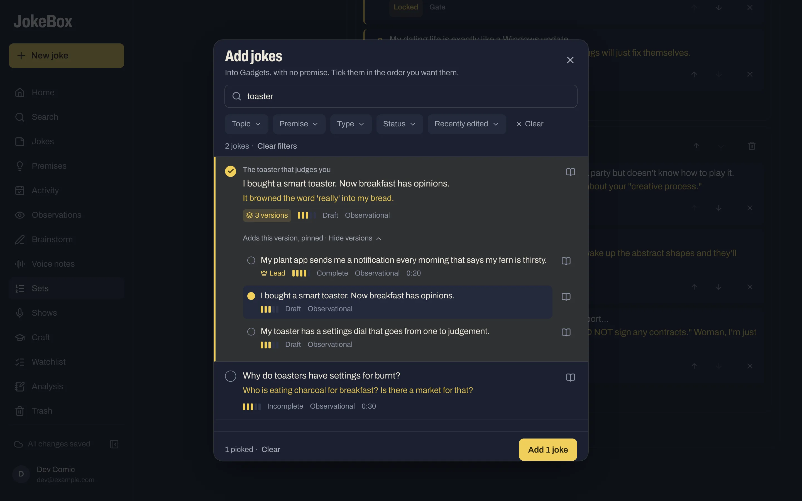

  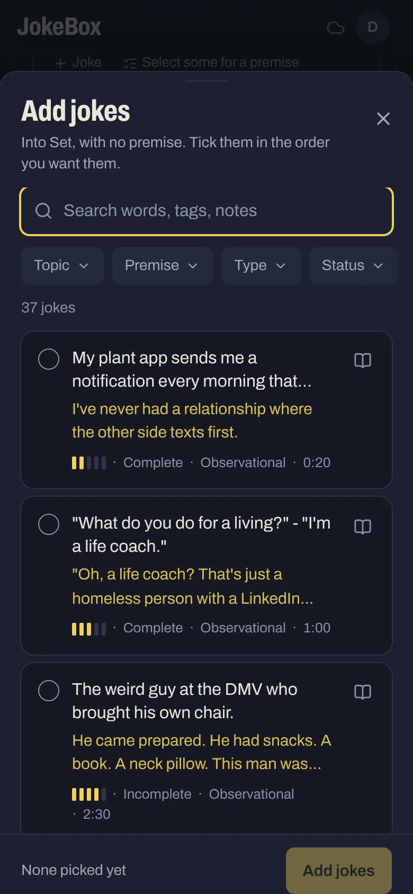
  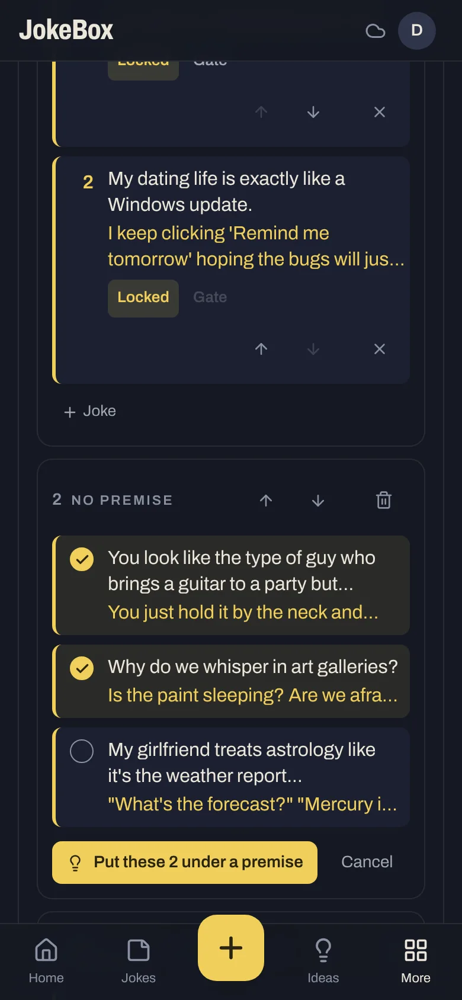
  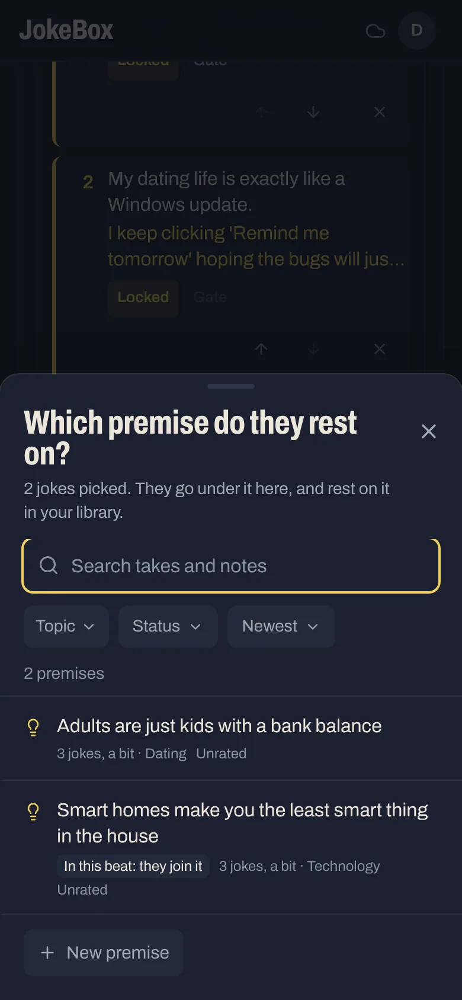

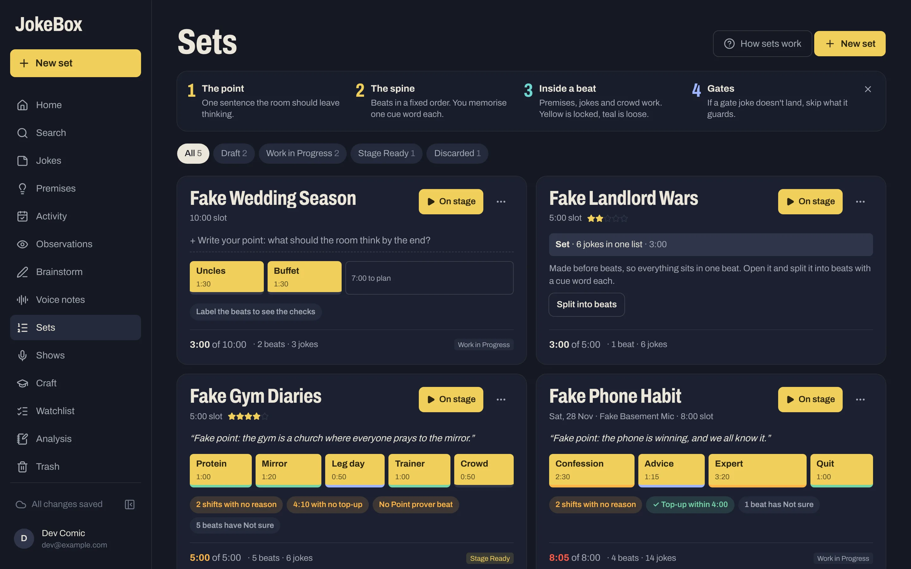

  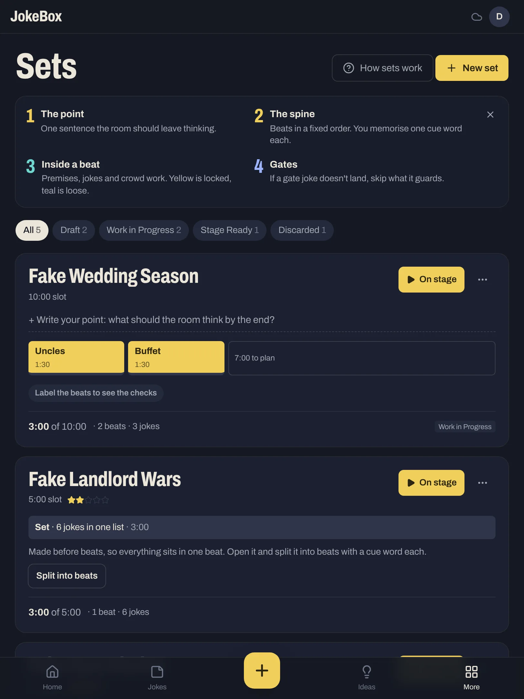
  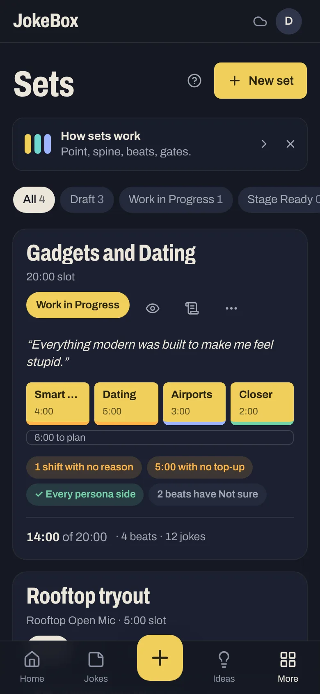

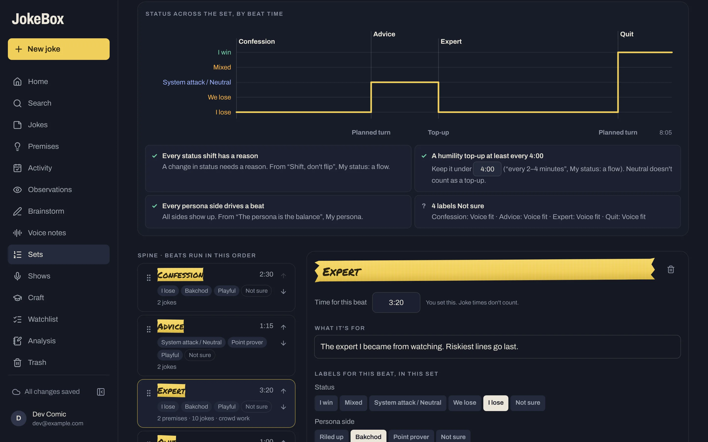
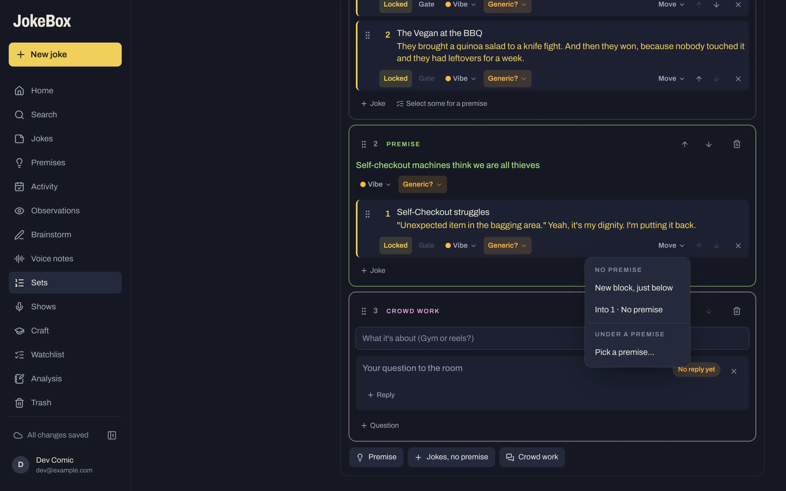
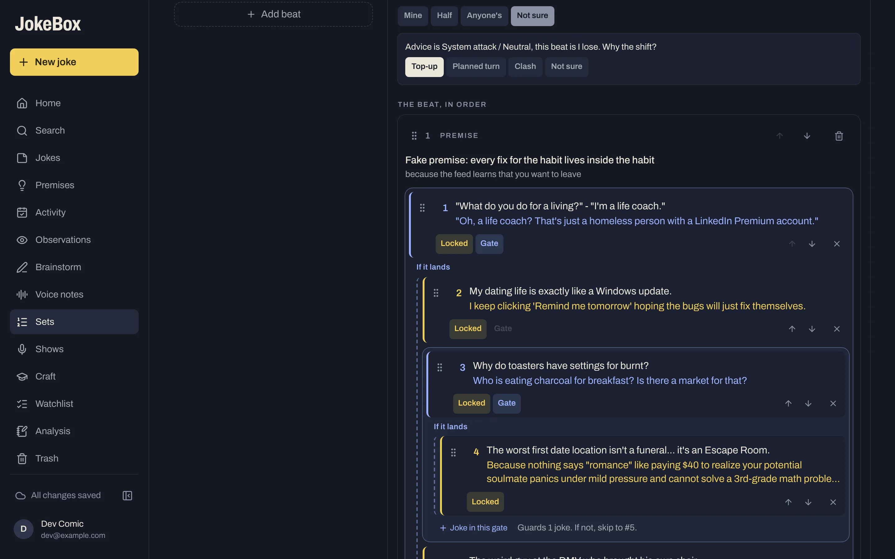
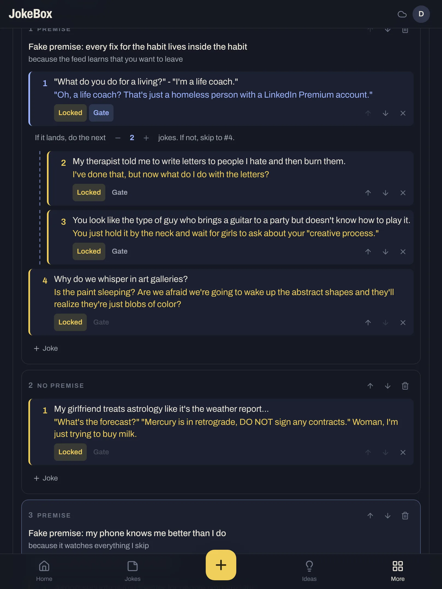

  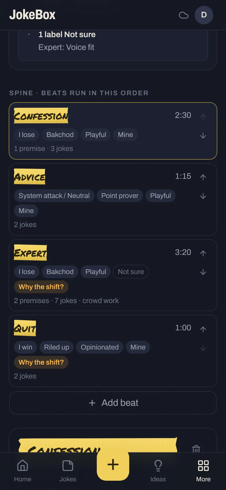
  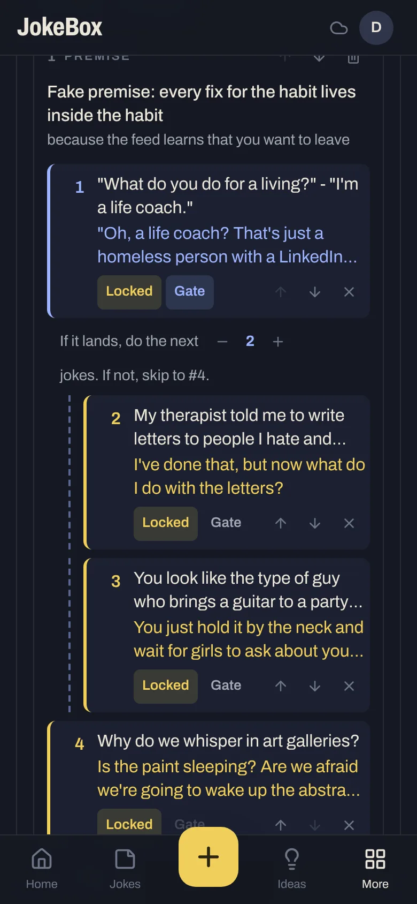
  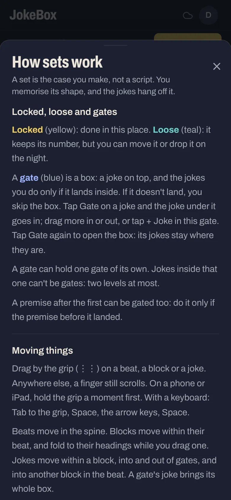

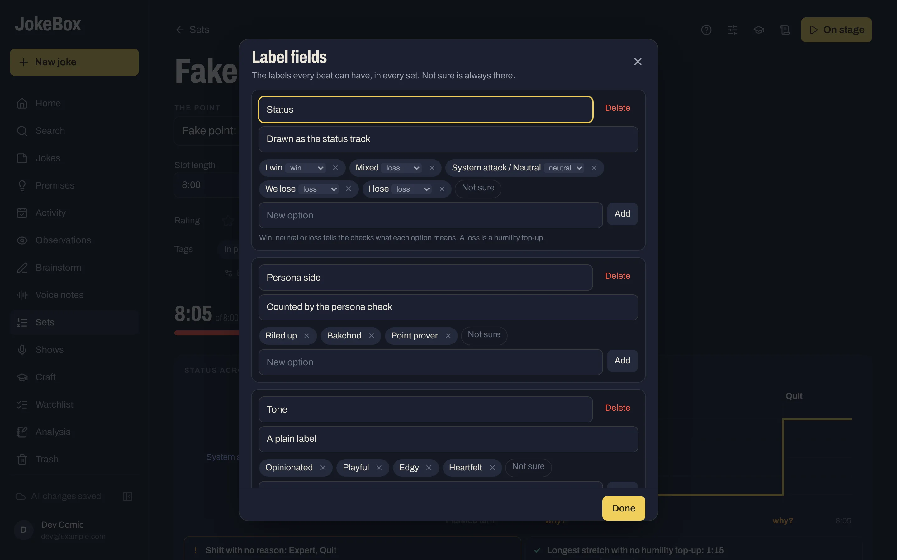

## On stage: `/sets/:setId/stage`

[StageView.tsx](../web/src/features/sets/StageView.tsx), [stageWalk.ts](../web/src/features/sets/stageWalk.ts).

A full screen with no frame, opened by **On stage**. The clock against the slot, reset and
play/pause stay pinned at the top. The clock turns amber in the last minute and red when you're
over, and the wake lock keeps the phone awake. Under the clock is a row of beat cues: tap one to
jump to it. Then the open beat: "Beat 2 of 5 · 2:30 → 3:45", its cue on tape, what it's for, and
its list. Premises appear as small headings, and crowd work in an orchid box with its questions
and replies. For each joke, the setup is dimmed and the punchline sits under it as the cue line,
coloured yellow (locked), teal (loose) or blue (gate, with a fork icon). The footer asks the
next gate in order (**It landed** / **It didn't · skip what it guards**, or **The premise before
landed**). A gate that didn't land strikes out what it guards. Tap an answered gate to take the
answer back. With no gate left to answer, the footer is **Next beat: cue**, and after the last
beat it goes back to the set. The cap icon opens **Before you go on** (your On stage notes).

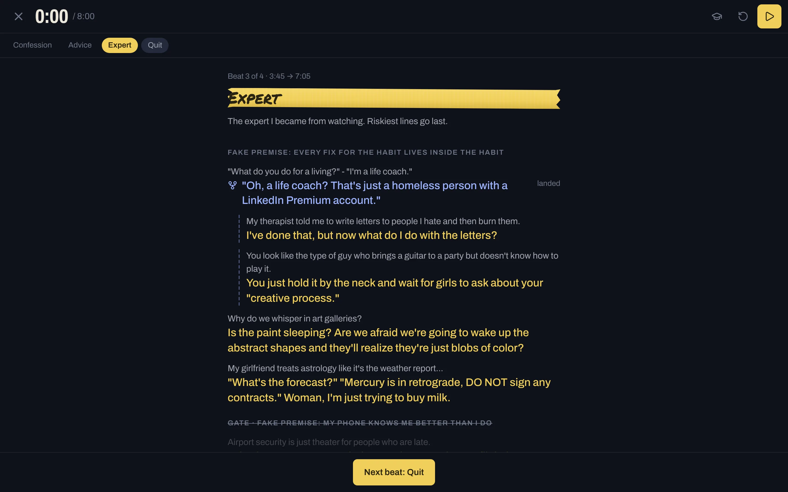
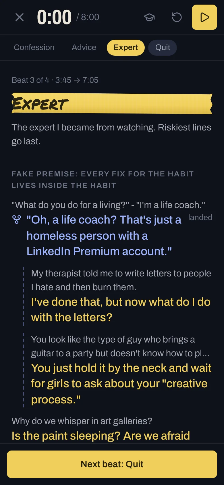

## Cue card: `/sets/:setId/print`

[PrintView.tsx](../web/src/features/sets/PrintView.tsx).

A white page to read off a phone or print. It has the set name, the beats' time and the slot, and
the point. Then each beat, numbered, with its cue in marker, its time and when it starts. Under
each beat are its premises (marked "(gate)" when gated), its jokes with no premise as
punchlines, and its crowd work. **Print** opens the browser's print dialog.

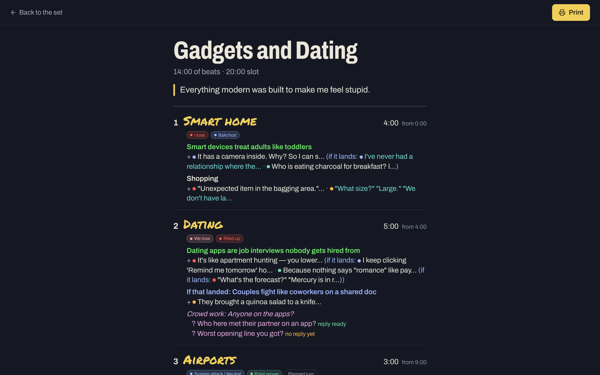

## Shows: `/shows`

[ShowsPage.tsx](../web/src/features/shows/ShowsPage.tsx), [ShowsToolbar.tsx](../web/src/features/shows/ShowsToolbar.tsx),
[ShowFilters.tsx](../web/src/features/shows/ShowFilters.tsx), [ShowStats.tsx](../web/src/features/shows/ShowStats.tsx),
[ShowsTable.tsx](../web/src/features/shows/ShowsTable.tsx), [ShowCards.tsx](../web/src/features/shows/ShowCards.tsx), [ShowDetail.tsx](../web/src/features/shows/ShowDetail.tsx),
[LogShowSheet.tsx](../web/src/features/shows/LogShowSheet.tsx), [logMath.ts](../web/src/features/shows/logMath.ts),
[logStats.ts](../web/src/features/shows/logStats.ts).

- **Toolbar:** Lifetime / This month / This week, a venue picker and **More filters** (date range,
  stars, set length band, crowd band). It wraps onto a second line on a narrow phone rather than
  scrolling sideways, so nothing hides off the edge.
- **Stage tiles** (top of the page, above the tabs and filters, once you've logged a show;
  [StageTiles.tsx](../web/src/features/shows/StageTiles.tsx)): **Streaks**, your stage streak (days
  in a row with a show, alive until you miss a day, the joke streak's rule) and your best; then
  **November so far**, shows, time on stage and mic days out of the days so far. They count every
  show whatever the filters say, which is why they sit above them. On a phone: a row of two, then
  a row of three.
- **Totals for these filters:** Shows, On stage, Avg rating (weighted by stage time) and Median
  crowd, as the same tiles ([StatTile.tsx](../web/src/features/shows/StatTile.tsx)). They always
  follow the filters. Under them, the LPM across the shows you counted laughs for (all points over
  all minutes), with its band: beast (12+), decent (9–12), poor (6–9), rough (under 6).
- **Show calendar** (top of the Shows tab, once you've logged a show;
  [calendar/ShowCalendarPanel.tsx](../web/src/features/shows/calendar/ShowCalendarPanel.tsx),
  [ShowCalendar.tsx](../web/src/features/shows/calendar/ShowCalendar.tsx),
  [ShowDayList.tsx](../web/src/features/shows/calendar/ShowDayList.tsx),
  [showMonth.ts](../web/src/features/shows/calendar/showMonth.ts)): a month laid out like the Daily
  activity calendar, in stage gold. A day you went up is tinted gold, deeper the more minutes on
  stage (up to 5, 10, 20, then more), with its minutes written on it and a dot per show (in the
  corner when the calendar is wide, above the minutes on a phone). Over it: "10 shows · 1h 32m on
  stage · up on 8 days". Arrows page through months; today is outlined in yellow. Tap a show day
  for its shows (time, venue, length, stars), and a show to open it. It takes every filter except
  the period, since its arrows pick the month (with **This week** most of the month would look like
  days off). Days don't carry the rating: the mic diary on Timeline does. Activity puts the stage on its one calendar
  instead: a gold dot per show and the month's stage time with its shows as tally marks.
- **Views** ([ViewTabs.tsx](../web/src/features/shows/ViewTabs.tsx), kept in the URL as `?view=`):
  **Shows** (the table), **Timeline** and **Insights**. The toolbar and totals scope all three.
- **Timeline** ([insights/TimelineView.tsx](../web/src/features/shows/insights/TimelineView.tsx),
  [timelineMath.ts](../web/src/features/shows/insights/timelineMath.ts)): a mic diary (one square
  per day, one row of weeks per year you performed in, brighter gold for better nights, a dot for
  two shows in a day, future days outlined), shows per month stacked by rating (empty months kept so
  gaps show), and your rating over your last 10 shows, which breaks at gaps of more than 30 days
  instead of bridging them, against a hairline for your usual.
- **Insights** ([insights/InsightsView.tsx](../web/src/features/shows/insights/InsightsView.tsx),
  [insightMath.ts](../web/src/features/shows/insights/insightMath.ts),
  [formMath.ts](../web/src/features/shows/insights/formMath.ts)), all worked out from your shows on
  every load:
  - **Recent form:** average rating, share at 4 stars or more, share at 2 or less, and average set
    length for your last 10 shows, each with a green or red arrow for how it moved against the 10
    before (set length stays grey: neither way is better).
  - **Topics over time:** a row per topic and a square per month, coloured by how it went that
    month, in the order you first did them: when a joke started, how often it ran, whether it got
    better and when you dropped it. Squares grow to fill the card; on a phone it scrolls sideways
    with the names pinned, opening on the latest months.
  - **Topics, venues, set length and time slot** (IST start): one bar each, split into rough
    (2 stars or less, blue), okay (3, grey) and great (4 or more, gold), best first, with the rating
    against your usual (weighted by stage time) and the show count beside it.
  - **7 shows minimum**, a hard rule for every grouping: anything with fewer is listed as "not
    compared yet" and never charted as better or worse.
  - The charts are hand-drawn SVG and HTML (no chart library), with colours checked for colour-blind
    safety on the dark surface ([vizColors.ts](../web/src/features/shows/insights/vizColors.ts));
    every mark shows a readout on hover or keyboard focus.
- **Table** (tablet width up): Date, Venue, On stage, Crowd, Rating, Topics and Remarks. Click a
  heading to sort and click again to flip the order. Where it's wider than the screen it scrolls
  sideways with the date pinned.
- **On a phone** the same shows are a list ([ShowCards.tsx](../web/src/features/shows/ShowCards.tsx)):
  the date and stars, then the venue, time on stage and crowd, then topics and remarks on one line.
  Tap one to open it. A **Sort** menu (Newest, Oldest, Best rated, Lowest rated, Longest on stage,
  Biggest crowd, Venue A to Z) stands in for the headings. It was a table here too until the
  rating turned out to sit off-screen, with nothing to say the table scrolled.
- **Log a show** (a sheet, also opened by `?log=1`): venue, stars and length up top (separate minutes and seconds boxes, so a 10 minute spot is just "10"). Optional: the
  sets you did (none, one or more: their topics are ticked, time on stage is left to you,
  [setPick.ts](../web/src/features/shows/setPick.ts)), date and time, crowd and remarks.
  **How particular jokes went** folds out, and ticking a set adds nothing to it: search for a joke
  you did and the best three matches come up (every word must appear in the joke; setup matches
  first). Tap one to add it, then **Bombed**, **OK** or **Killed** (tap again to clear) and a
  comment, or ✕ to take it off. Enter adds the top match
  ([ShowJokesField.tsx](../web/src/features/shows/ShowJokesField.tsx),
  [showJokes.ts](../web/src/features/shows/showJokes.ts)). Editing a show edits its jokes too.
  **Count laughs for LPM** starts at **Not counted**. Open it to record a tally or choose **I counted zero laughs**. **Mark as not counted** removes the tally. It has five counters, one per laugh score, by how much of the room
  reacted: **One or two people**, **Some of the room**, **Most of the room**, **Rolls on, or some
  applause**, **Applause break** ([the scale](set-review.md#the-laugh-scale)), with the LPM worked out as you count ([lpm.ts](../web/src/features/shows/lpm.ts),
  [LaughTally.tsx](../web/src/features/shows/LaughTally.tsx)). **What did you learn?** is a comment kept on the show, like the remarks, and comes back
  when you edit it. It used to save a Craft note in the Stage area, which piled show-specific
  notes into Craft; Craft keeps general lessons (migration `0039` moved the old ones onto their
  shows).
- **A show's detail** shows the venue, LPM, a **Laughs through the set** strip for a show
  logged from a recording (one bar per laugh, as tall as its points; applause full height; hover for the
  time and joke, [LaughTimeline.tsx](../web/src/features/shows/LaughTimeline.tsx)), how particular jokes
  went with their comments (each opens the joke; "Engine heard: …" when set-review suggested something
  else), your remarks, and what you learned there.
- **A joke's page** says how it has gone at the shows it was logged at: "Done at 3 shows: 2 killed,
  1 bombed. Last done 4 Nov 2026." Worked out in the browser from the shows, so it works offline;
  a show in the Trash doesn't count ([JokeShowRecord.tsx](../web/src/features/jokes/JokeShowRecord.tsx)).
- ⋯ → **Venues** ([VenuesSheet.tsx](../web/src/features/shows/VenuesSheet.tsx)): every venue with how
  many shows and sets use it. Delete an unused one straight away; for one in use, pick the venue its
  shows and sets move to first, which is also how to merge duplicates.
- ⋯ → **Export as CSV**. Text a spreadsheet would run as a formula (a remark starting with `-`, `=`,
  `+` or `@`, which opened as `#NAME?`) gets an apostrophe in front, so it stays text
  ([csv.ts](../web/src/lib/csv.ts)). The jokes export does the same.

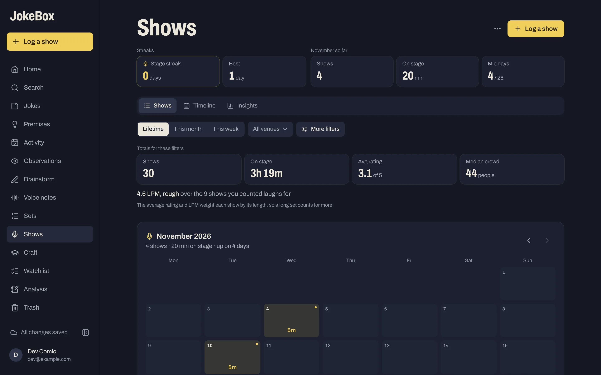
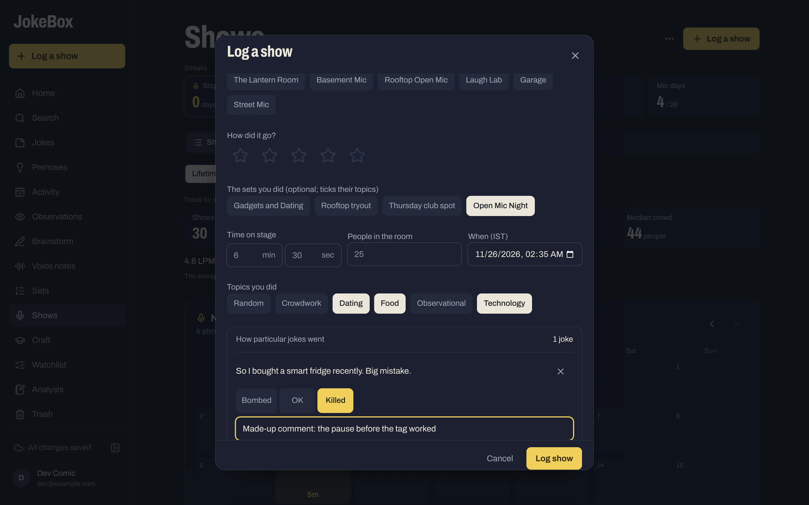
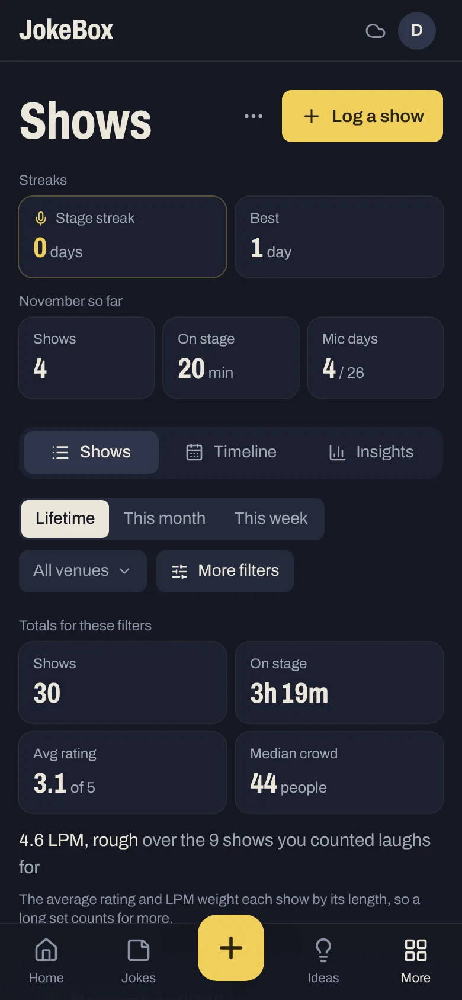

## Craft: `/craft`, `/craft/area/:areaId` and `/craft/:noteId`

[CraftPage.tsx](../web/src/features/craft/CraftPage.tsx), [AreaPage.tsx](../web/src/features/craft/AreaPage.tsx),
[CraftNotePage.tsx](../web/src/features/craft/CraftNotePage.tsx), [CraftNoteForm.tsx](../web/src/features/craft/CraftNoteForm.tsx),
[NoteCard.tsx](../web/src/features/craft/NoteCard.tsx), [PathLadder.tsx](../web/src/features/craft/PathLadder.tsx),
[TechniqueShelf.tsx](../web/src/features/craft/TechniqueShelf.tsx), [AreaFolders.tsx](../web/src/features/craft/AreaFolders.tsx),
[AreaSheet.tsx](../web/src/features/craft/AreaSheet.tsx), [ArrangeAreas.tsx](../web/src/features/craft/ArrangeAreas.tsx), [ArrangeNotes.tsx](../web/src/features/craft/ArrangeNotes.tsx), [NoteGrid.tsx](../web/src/features/craft/NoteGrid.tsx),
[NoteBody.tsx](../web/src/features/craft/NoteBody.tsx), [NoteList.tsx](../web/src/features/craft/NoteList.tsx), [NoteTable.tsx](../web/src/features/craft/NoteTable.tsx), [bodyFormat.ts](../web/src/features/craft/bodyFormat.ts),
[craftMeta.ts](../web/src/features/craft/craftMeta.ts). Editing: [NoteEditor.tsx](../web/src/features/craft/NoteEditor.tsx),
[FormatToolbar.tsx](../web/src/features/craft/FormatToolbar.tsx), [editText.ts](../web/src/features/craft/editText.ts),
[applyEdit.ts](../web/src/features/craft/applyEdit.ts), [TableEditor.tsx](../web/src/features/craft/TableEditor.tsx),
[tableText.ts](../web/src/features/craft/tableText.ts), [EditableBody.tsx](../web/src/features/craft/EditableBody.tsx),
[BlockEditor.tsx](../web/src/features/craft/BlockEditor.tsx), [AddBlockMenu.tsx](../web/src/features/craft/AddBlockMenu.tsx),
[blockEdit.ts](../web/src/features/craft/blockEdit.ts).

What you've learned about doing stand-up, kept apart from your material. The page reads top to
bottom:

- **Your path** as a staircase: one step per tick box in your first open Path note (your levels),
  done steps filled, the next outlined in tape. Below it the next step, and when it names minutes,
  your most solid material on one topic against that target. A Path note with tick boxes under
  several headings is several tracks climbed side by side (material, stage and audience, say):
  one staircase per heading, each with its own next step, side by side on wider screens and
  stacked on a phone. Its card in the area shows one bar per track. Home shows a smaller copy.
- **Write with a technique:** a sideways shelf of your techniques; tapping one opens a brainstorm
  running it.
- **Areas** as folders in their own colours, like the topic folders on Home: the count on the tab,
  the first few notes, and how many of each kind. **New area** is the last folder; **Arrange**
  lists them numbered: drag a row by its grip to reorder (it saves as you drop), or tap the
  pencil to edit one. **Kinds** lists your kinds of note: add one, rename
  it, change what it works like (a note to read, a checklist, a writing technique, a path), or
  delete it and pick where its notes go.

Areas are yours: name, a line about it, a colour (12 presets or any colour from the picker; they
can repeat, and a new area starts on the next unused one), and which screens show its notes (Rewrite, the
set builder, Stage). Deleting one asks where its notes should go. An area opens as a page of
**note cards**, numbered 01, 02… in the area's colour like a contents page and laid out in rows
(01 and 02 side by side), so the reading order is plain. **Arrange** (shown once there are two
notes) lists them numbered: drag a grip to put them in reading order, saved as you drop in one
request. Each card has a face for its kind: a checklist shows its first boxes,
a technique a prompt and **Start**, a path its progress, a reference the start of the text. Each
card's ⋯ menu moves it to another area or deletes it. Searching swaps the folders for matching
cards from every area, packed as masonry and unnumbered, since they come from many areas.

A note opens formatted: headings, lists (numbered items get a badge, indented items sit quietly under
their parent), **bold**, callouts, dividers, a line of steps joined by arrows drawn as a flow, tables
(cards on a phone, so nothing scrolls sideways; wider up, a table with more columns than fit scrolls
sideways instead of cutting off its last ones), and tick boxes you can tick straight away (the
tick is saved into the note). Its area chip at the top moves it to another area.

**Edit in place:** tap any part of the note (a paragraph, a list, a callout, a heading) and only that
part opens as a small editor, with **Save** (Cmd/Ctrl+Enter), **Cancel** (Escape), **Delete** and
**Add below**. Tapping a table opens the table editor instead. With a mouse, hovering a part shows a
pencil and a **+** that adds a block under it (text, heading, list, numbered list, tick boxes,
callout, steps, table or divider); **Add to the note** at the end adds one at the bottom. Links and
tick boxes still work as usual, and selecting text to copy doesn't open anything. If a part changed
elsewhere while it was open (on another device, say), the edit isn't placed and a toast says so.

**Edit note** switches to the form: name, kind, area, the note, where you learned it, a link and
hashtags, saved with **Save note** (offline too). The note's text box has a toolbar (heading, bold,
list, numbered list, tick boxes, callout, steps, table, divider) and **Write** / **Preview** tabs.
Enter carries a list, tick boxes or a callout on to the next line (Enter on an empty item ends it),
Tab and Shift+Tab indent list items, and Cmd/Ctrl+B bolds. Every change can be undone with Cmd+Z.
New blocks go after the cursor's line, never over selected text. With the cursor in a table, the
table button opens it as boxes: rows as cards you can drag into order (cells stack on a phone),
column names you can switch off, and columns and rows to add or remove. A "|" typed in a cell is
saved as "/", since "|" splits cells. The kind and
area menus end with **New kind…** and **New area…**; what you make there is picked straight away.
`/craft/new?area=<id>&kind=checklist` starts one with those filled in (`?screen=stage` picks the
area that shows on Stage); `?show=<id>` or
`?analysis=<id>` links it to where you learned it and fills in **Learned from**.

## Watchlist: `/watchlist`

[WatchlistPage.tsx](../web/src/features/study/WatchlistPage.tsx), [WatchRow.tsx](../web/src/features/study/WatchRow.tsx),
[AddRoutineSheet.tsx](../web/src/features/study/AddRoutineSheet.tsx), [watchMeta.ts](../web/src/features/study/watchMeta.ts).

The header shows progress ("N of M watched"), an explainer for CT, LD and HP (Contrast, Logic
Density, Has a Point), a search box, and
All / To watch / Watched. Routines are grouped by category, each group with its own count. Each
row has a watched circle, its number, title, comedian, description and score chips, plus open,
analyse and delete. **Add routine** adds one; with nothing added yet, the empty list offers the same button.

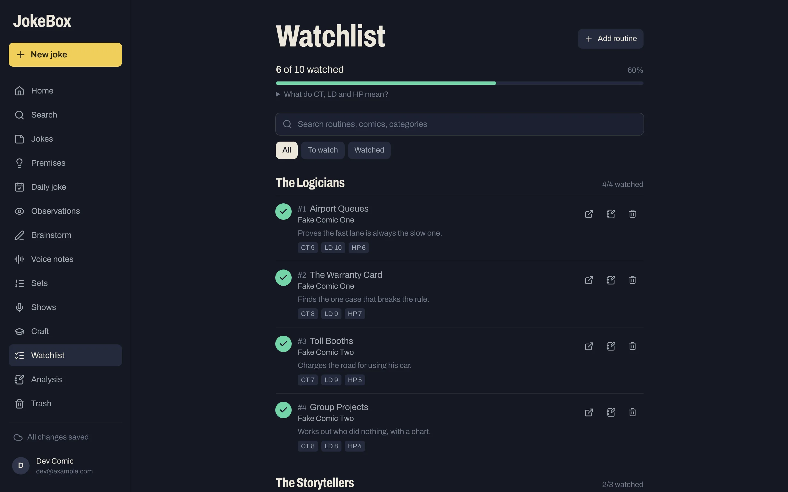

## Analysis: `/analysis` and `/analysis/:analysisId`

[AnalysisPage.tsx](../web/src/features/study/AnalysisPage.tsx), [AnalysisEditor.tsx](../web/src/features/study/AnalysisEditor.tsx).

The list is searchable, with the most recently edited first; each row shows the title, a preview
and the link's domain. The editor has a name, a link and the write-up, saved with **Save analysis**
(offline too; it syncs later).
`/analysis/new?watch=<id>` starts one prefilled from a watchlist routine. A saved analysis lists its
**Takeaways** (craft notes learned from it) with **Save a takeaway**.

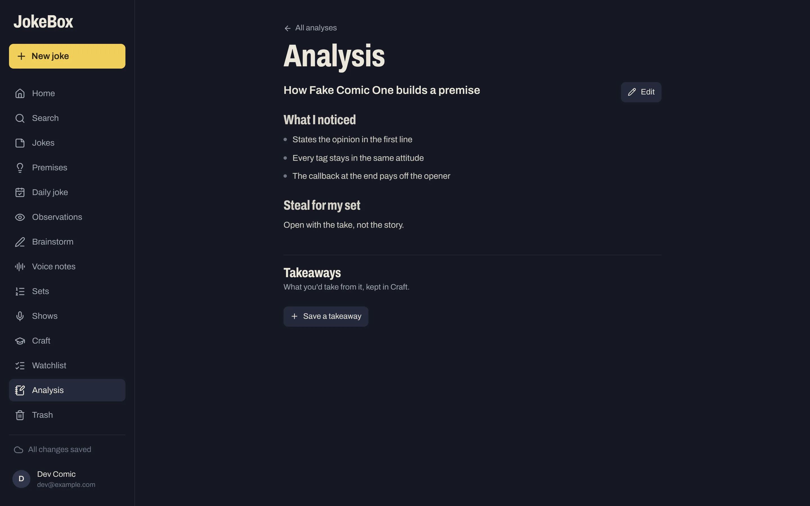

## Import: `/import`

[ImportPage.tsx](../web/src/features/import/ImportPage.tsx), [bundle.ts](../web/src/features/import/bundle.ts),
[runImport.ts](../web/src/features/import/runImport.ts).

Not in the navigation: open it from the avatar menu → **Import**, on a laptop (phones can't pick
folders). Choose a prepared import folder holding `import.json` and an `audio/` folder. The page
lists what's new (jokes, with any topics it will create, observations, voice notes and craft notes) and what it
will skip, then **Import** uploads them one by one with a progress bar and lists any failures.

- Every item has a fixed id, so importing the same folder twice adds nothing. Jokes and observations
  whose words are already in JokeBox are skipped too.
- Original dates are kept. A joke with no topic (or the topic "Random") goes to Random; topics named in the folder are
  matched by name (any case) or created. Jokes can carry types (the WhatsApp import uses
  "To review" to flag everything that still needs a look).
- `craft_notes` is optional in `import.json`; craft notes whose name is already in JokeBox are
  skipped, and new ones sort after the ones you have.
- The folder is made on a laptop from an export (the WhatsApp self-chat, for one). It holds real
  material, so it stays in `~/Downloads` and `.gitignore` covers WhatsApp exports.

## Trash: `/trash`

Like a Mac's Trash. A line says things wait 30 days. Chips filter by kind (All, Jokes, Rewrites,
Premises, Observations, Brainstorms, Voice notes, Sets, Shows, Analyses, Watchlist, Craft notes),
each with its count; All shows a heading per kind. Each row: the title (a show adds its date), a detail line
(a joke's rewrites, a rewrite's joke, a routine's comic, a voice note's tags), "Deleted 22 Oct
2026, 27 days left", **Put back** and a ✕ to delete now. **Empty Trash** sits top right while
anything's there. Empty: "Trash is empty".
