# Screens

Every screen: what it's for, how it's laid out on a phone and on desktop, which files build it,
and where its data comes from. Screenshots show the demo account (`uv run python -m app.seed`),
never real material.

Routes live in [App.tsx](../web/src/App.tsx). Every screen except Home loads lazily on first
visit, so the app opens fast on a phone.

## The frame

**Files:** [AppShell.tsx](../web/src/layout/AppShell.tsx), [BottomBar.tsx](../web/src/layout/BottomBar.tsx),
[nav.ts](../web/src/layout/nav.ts), [SyncLight.tsx](../web/src/layout/SyncLight.tsx),
[UpdatePrompt.tsx](../web/src/layout/UpdatePrompt.tsx), [AccountMenu.tsx](../web/src/layout/AccountMenu.tsx).

- **Desktop (≥1024 px):** a fixed left rail. It holds the wordmark, a yellow **New joke** button,
  every screen in `NAV` order, the sync light with its label, and your avatar and email.
- **Phone:** a slim header (wordmark, sync icon, avatar) and a bottom bar laid out as
  **Home · Jokes · + · Shows · More**. The **+** opens the New joke sheet. **More** opens a
  bottom sheet that groups every other screen: **Write** (Voice notes, Observations,
  Brainstorm), **Perform** (Sets), **Study** (Watchlist, Analysis) and **Deleted**
  (Trash). While
  you're on one of those screens, the More tab shows as the current one.
- One list in `nav.ts` feeds both the rail and the bar, so they can't drift apart.
- **Sync light:** "All changes saved", "Saving…", or "Offline, N waiting to sync". It counts
  queued saves plus recordings still to upload, and reads whether the server can be reached
  (not just whether the phone has signal).
- **Sync light** also says "Sign in to sync N waiting" when the sign-in ran out.
- **Couldn't sync strip:** above every page while any save failed for good. **Review** opens the
  list: what it was, when, why, the text you wrote, and **Retry** (or **Keep mine** for a clash
  with another device's edit), **Copy** and **Discard**; **Retry all** skips clashes.
- **Update banner:** "A new version of JokeBox is ready", with **Update now** and **Later**.
- **Avatar menu:** Sign out (asks first if changes haven't synced), plus **Reset to demo data**
  when running locally.
- **Another tab:** a tab that stepped aside shows "Open in another tab" with **Use it here** and **Keep both open** (allows several tabs; switch it off under **Several tabs** in the account menu).

  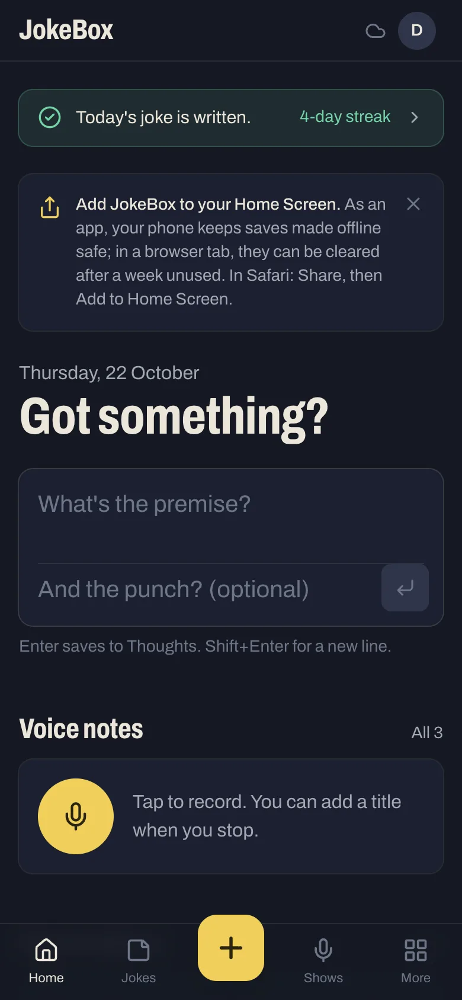
  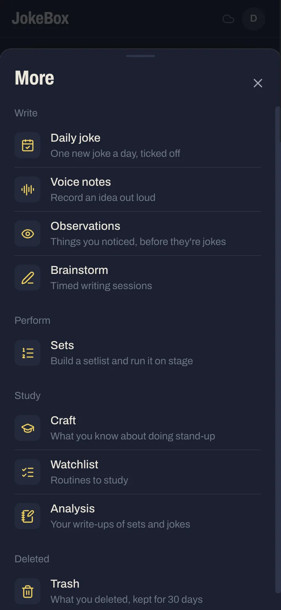
  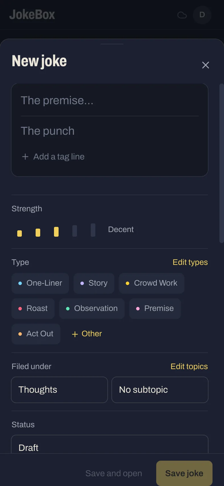

## Sign in: `/login`

[LoginPage.tsx](../web/src/features/auth/LoginPage.tsx) and
[RequireAuth.tsx](../web/src/features/auth/RequireAuth.tsx).

The page has the wordmark, three tape strips ("Write it down / Tape it to the floor / Kill") and
**Sign in with Google**. The "Sign in as the local test account" link appears only on localhost,
and the route behind it (`/auth/dev-login`) answers 404 unless `APP_ENV=local`.
`?error=not_invited` and `?error=failed` show a message.

`RequireAuth` guards every other route. It shows "Opening JokeBox…" while `/api/me` loads,
redirects to `/login` on a 401, and offers Retry when the server can't be reached. When
offline, it uses the cached profile, so the app still opens.

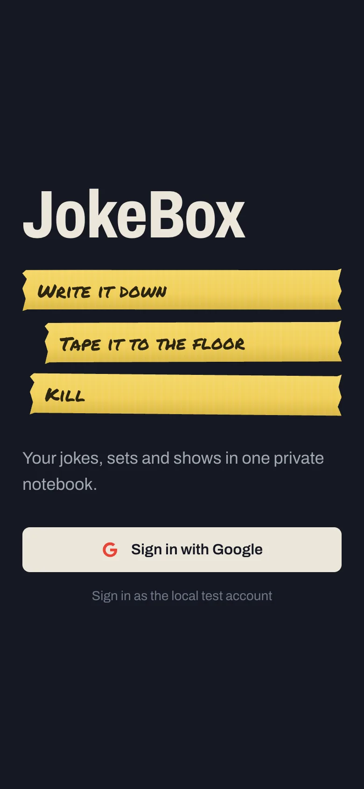

## Home: `/`

[TodayPage.tsx](../web/src/features/today/TodayPage.tsx) and its siblings in `features/today/`.

The page is one column, at most 672 px wide. It opens with the daily joke nudge, then today's date
in IST and the headline **"Got something?"**, followed by these sections from top to bottom:

| Section | File | Notes |
|---|---|---|
| Daily joke nudge | `daily/DailyBanner.tsx` | Days since your last new joke: today written, a small green line with your streak; 1 or 2 days, yellow **Write a joke today**; 3 to 7, red **N days without a joke**; over a week, a dark, spooky card (a drifting ghost, a cobweb, a flickering line; still under reduced motion). Waits for the jokes to load so it never flashes the wrong state. Links to Daily joke |
| Quick capture | `QuickCapture.tsx` | Setup and punchline in one box. Enter saves to Thoughts; Shift+Enter adds a new line |
| Voice notes | `TodayVoice.tsx` | The same recorder as the Voice screen, plus "All N" |
| Observations | `TodayObservations.tsx` | The observation box and the last few logged |
| Brainstorm | `TodayBrainstorm.tsx` | Start a session, or pick up the last one |
| Craft | `TodayCraft.tsx`, `craft/PathLadder.tsx` | **Path:** a small copy of the Craft staircase: the first Path note with tick boxes still open, how many are done, and the next step. When the step names minutes, it shows your most solid material on one topic (Strong and Killer jokes, by runtime) against that target. Below it, a box to save a lesson to one of your areas (chips in their colours) |
| Study | `TodayStudy.tsx` | Craft notes, watchlist progress, analyses |
| Topics | `TopicFolders.tsx` | Topics as folders with live counts; tap through to a subtopic |
| Next up | (inline) | The soonest upcoming set (or the latest), its first three strips, the light bar and **Rehearse** |
| Needs work | (inline) | Up to five jokes with strength ≤ 2 or an unfinished status, weakest first |
| Last show | (inline) | Venue, date, time on stage, crowd and stars, plus **Log a show** |

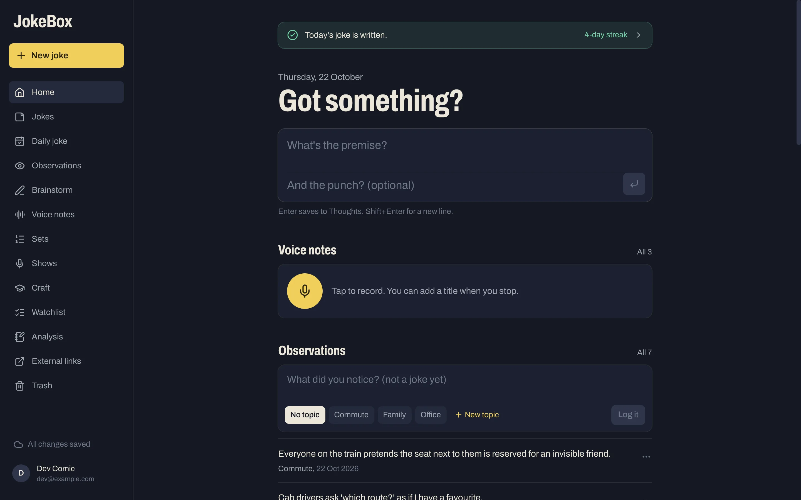

## Daily joke: `/daily`

[DailyPage.tsx](../web/src/features/daily/DailyPage.tsx), [dailyMath.ts](../web/src/features/daily/dailyMath.ts),
[MonthCalendar.tsx](../web/src/features/daily/MonthCalendar.tsx).

The habit of writing at least one new joke a day. A day counts when any joke was added to JokeBox
that day (IST), however it got there, imports included with their original dates; it's read from
the jokes' created dates, so there's no separate log to fall out of step.

- **The nudge** (the same one as Home); its button focuses the box below.
- **Today's joke:** the quick capture box. Saving puts the joke in Thoughts and ticks today at once.
- **Streaks:** current (ending today, or yesterday while today is still open), longest, and days
  this month.
- **Calendar:** a month at a time, Monday first. Days with a new joke get a green tick and a count
  when there were several; today is outlined in yellow; days to come are dimmed. Arrows move
  between months. Tap a day to list its jokes, each linking to the joke.

## Jokes: `/jokes`, `/jokes/map` and `/jokes/:jokeId`

[JokesLayout.tsx](../web/src/features/jokes/JokesLayout.tsx), [JokeFilters.tsx](../web/src/features/jokes/JokeFilters.tsx),
[useJokeFilters.ts](../web/src/features/jokes/useJokeFilters.ts), [JokePage.tsx](../web/src/features/jokes/JokePage.tsx),
[JokeDetails.tsx](../web/src/features/jokes/JokeDetails.tsx), [DetailControls.tsx](../web/src/features/jokes/DetailControls.tsx),
[TagLines.tsx](../web/src/features/jokes/TagLines.tsx), [JokeExtras.tsx](../web/src/features/jokes/JokeExtras.tsx),
[useAutosaveJoke.ts](../web/src/features/jokes/useAutosaveJoke.ts), [TopicManager.tsx](../web/src/features/jokes/TopicManager.tsx),
[TypeManager.tsx](../web/src/features/jokes/TypeManager.tsx). The map: [map/](../web/src/features/jokes/map/) ([mapLayout.ts](../web/src/features/jokes/map/mapLayout.ts),
[JokeMap.tsx](../web/src/features/jokes/map/JokeMap.tsx), [MapCanvas.tsx](../web/src/features/jokes/map/MapCanvas.tsx), [MapPeek.tsx](../web/src/features/jokes/map/MapPeek.tsx)).

- **List:** a search box ("Search words, tags, notes") and menus: Topic, then Subtopic once a topic with subtopics is picked, Type,
  Status, and Sort (Newest, Oldest, Recently edited, Strongest, Weakest, Longest). Each row shows the
  setup, the start of the punchline, strength ticks, type dots, the topic, the date it was added (or
  last edited, under Recently edited) and the runtime. Sorted by a date, the list is grouped into
  months under pinned headings, with the time scrubber down its side ([JokeList.tsx](../web/src/features/jokes/JokeList.tsx)).
  A joke brought in with an older date (an import) counts as last edited then, not on the day it
  arrived. The ⋯ menu has **Export as CSV** (with Created At and Edited At).
- **Layout:** like a mail app. On desktop the selected joke opens in a pane beside the list; on a
  phone it opens as its own page with a back link.
- **The joke map:** with no joke open, the desktop pane shows the jokes the list is showing (same
  filters) as a map. The map button in the Jokes header opens it as its own page, `/jokes/map`,
  which is how a phone gets to it.
  - **Chains** are drawn left to right as boxes, with an arrow from each joke to the joke that
    follows it. Branches stack, with the joke before them level with their middle. Chains come in
    the order their jokes appear in the list.
  - A chain is drawn whole: jokes the filters hide come back dimmed, with dashed edges and arrows,
    so a chain never has a gap.
  - **On their own:** jokes in no chain, in a grid under the map.
  - **Tap a box** to read the joke in a panel beside the map (above the bottom bar on a phone):
    its setup, punchline, tag lines, strength and types, **Comes after** and **Followed by**
    (tap one to walk along the chain; the map scrolls to it) and **Open joke**. The joke's chain
    lights up and the others step back; hovering a box does the same. Escape closes the panel.
  - **Move around** by scrolling, or with a mouse by dragging the map (a drag that ends on a box
    doesn't open it). Zoom out, zoom in and **Fit to width**; a phone starts at 70%.
- **The joke board** (the **Board** tab beside **Map**, remembered on the device;
  [boardLayout.ts](../web/src/features/jokes/map/boardLayout.ts), [JokeBoard.tsx](../web/src/features/jokes/map/JokeBoard.tsx),
  [BoardCanvas.tsx](../web/src/features/jokes/map/BoardCanvas.tsx), [useBoxDrag.ts](../web/src/features/jokes/map/useBoxDrag.ts)):
  the same jokes as cards scattered over topic islands, like a corkboard.
  - **Islands:** one per topic, in your topic order, wrapping to the width on screen (at least two
    cards wide). Cards sit on a loose grid with a small nudge and tilt worked out from each joke's
    id, so they look hand-placed, never overlap, and land in the same place every time.
  - **Chains** stay together in their first joke's island, with arrows; dimmed cards are jokes the
    filters hide, kept so a chain isn't broken.
  - **Move a card:** drag it with a mouse, or on a phone hold it a moment and then drag; the arrow
    keys move a focused card (Shift for bigger steps). It stays where you put it, relative to its
    island, and the grid makes room. The save waits offline like any other. **Tidy up** (after
    asking) puts the moved cards back.
  - **Read a card:** tap it for the same panel as the map. Drag the background to move around.
  - **Lots of jokes:** zoomed to 55% or less, cards show their first few words in big type, and
    island names grow. Past 300 cards, only those near the screen are drawn. A phone starts at
    55%.
- **The joke page:** the setup and punchline (in tape yellow) are edited in place, followed by tag
  lines. Below them, a row of details: Strength, Type (with Edit types), Filed under (topic and
  subtopic, with Edit topics), Status, Runs for (type it, or step it a second at a time with −
  and +), Clean rating, Language (Hinglish, Hindi or English) and Hashtags, followed by a Notes box. Then
  **Rewrites** (earlier sessions and **Start a rewrite**), **In sets** (with Add to a set), and
  **Delete joke**, which asks for confirmation first.
- **State:** the filters live in the URL (`?topic=&sub=&type=&status=&q=&sort=`). Filtering runs in
  the browser, so it works offline. Edits go into a local draft and save about a moment after you
  stop typing, through the offline-safe joke save.
- **Topic and type managers** are sheets for renaming and deleting across every joke. Deleting a
  topic moves its jokes to Thoughts. Renaming a type onto an existing one merges the two.

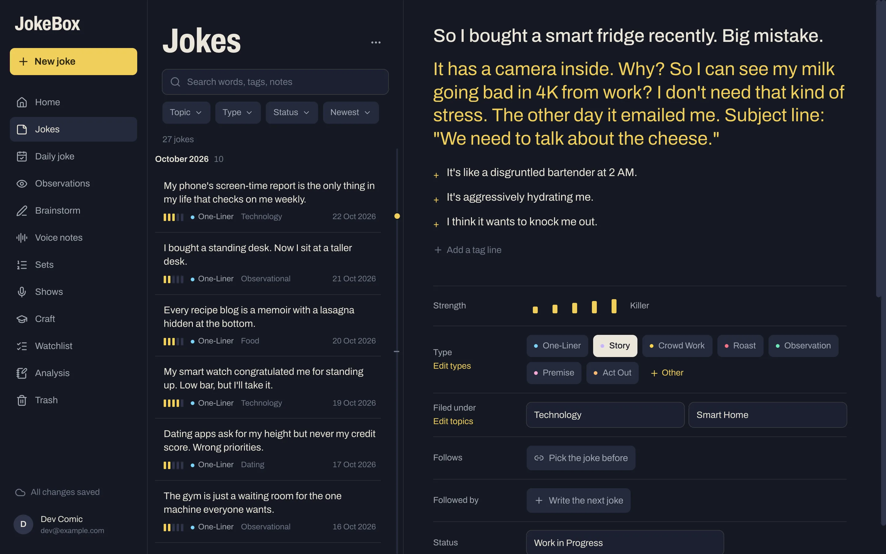

  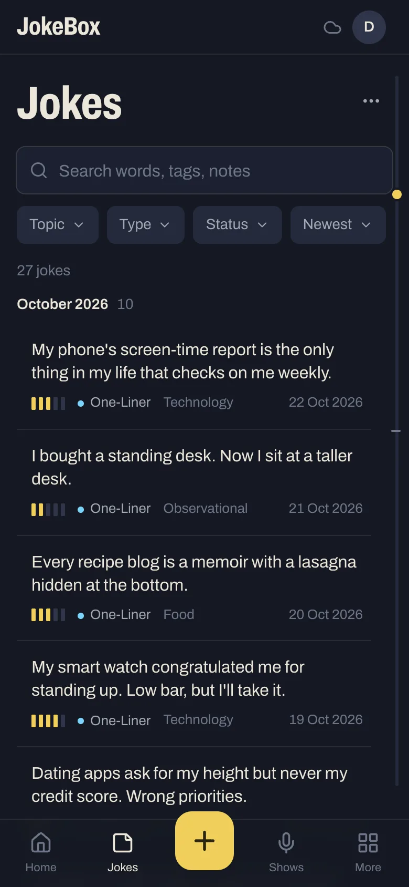
  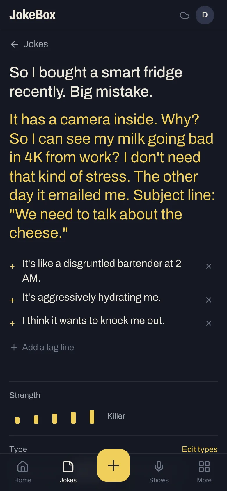

## New joke sheet

[CaptureProvider.tsx](../web/src/features/capture/CaptureProvider.tsx), [NewJokeForm.tsx](../web/src/features/capture/NewJokeForm.tsx),
[newJoke.ts](../web/src/features/capture/newJoke.ts).

The sheet is opened by **+**, by **New joke**, or by "Turn into a joke" on an observation. It
renders the same `JokeDetails` controls as the joke page, but owns its own draft: one set of
controls with two owners of the state, so the two screens can't drift apart. Its buttons are
**Save and open** and **Save joke**. A new joke starts as Incomplete, 15 seconds, Clean and in
Hinglish. It's a bottom sheet on phones and a centred panel on desktop
(see `Modal`).

## Rewrite: `/jokes/:jokeId/rewrite`

[RewritePage.tsx](../web/src/features/jokes/RewritePage.tsx), [RewriteHistory.tsx](../web/src/features/jokes/RewriteHistory.tsx),
[useTimer.ts](../web/src/features/jokes/useTimer.ts).

A full screen with no app frame. The top bar holds close, the timer (start, pause, reset), a word
count, **Checklists**, **+** for a new session and **Save version**. The original joke is pinned at the top, under
it an optional session name and a free-writing area. On the right are **This session** (its saved
versions) and **Earlier sessions**. `?session=<id>` reopens a past session.

**Checklists** opens the craft checklists from the areas set to show on Rewrite, in a sheet
([CraftSheet.tsx](../web/src/features/craft/CraftSheet.tsx)). Pick one from the row at the top and
tick through it; the ticks count up and don't change the note, so the next rewrite starts fresh.

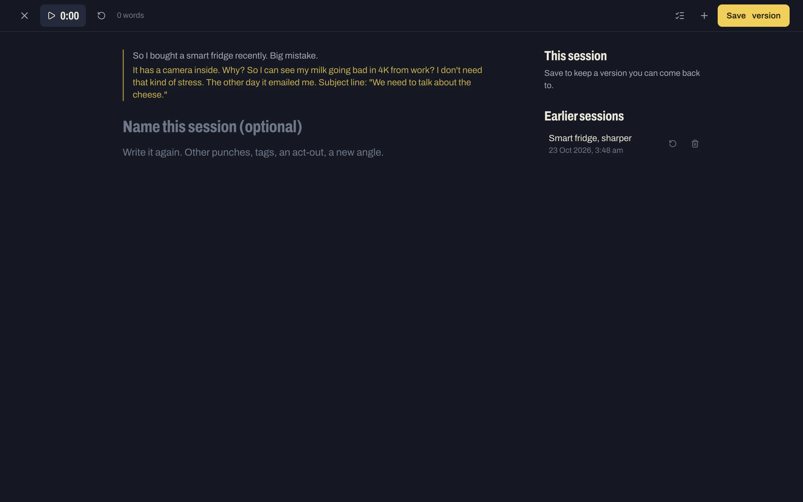

## Observations: `/observations`

[ObservationsPage.tsx](../web/src/features/observations/ObservationsPage.tsx), [ObservationBox.tsx](../web/src/features/observations/ObservationBox.tsx),
[ObservationList.tsx](../web/src/features/observations/ObservationList.tsx), [ObservationSheet.tsx](../web/src/features/observations/ObservationSheet.tsx),
[ObservationTopicManager.tsx](../web/src/features/observations/ObservationTopicManager.tsx).

The page has a box with topic chips and **Log it**. Below it are filter tabs (All, each topic with
its count, No topic), then the list by month under pinned headings, **Newest first** or **Oldest first** (`?order=old`),
with the time scrubber down the right edge. Each row's ⋯ menu offers Edit, **Turn into a joke** and
Delete. A **Topics** button manages the observation topics, which are
separate from joke topics: drag the grips to reorder them; deleting one keeps its observations. The filter is `?topic=` in the URL.

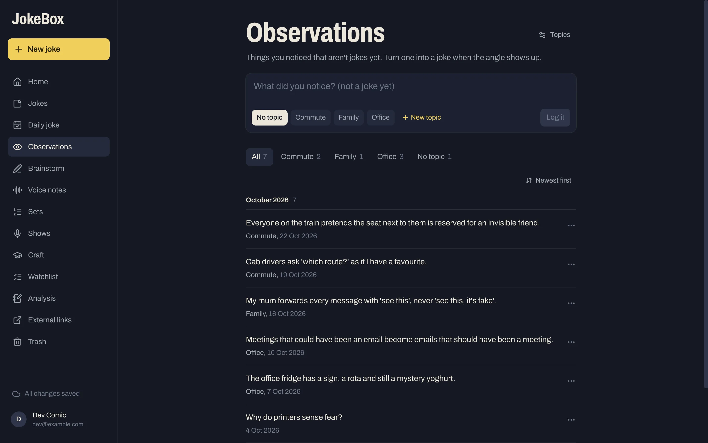

## Brainstorm: `/brainstorm` and `/brainstorm/:sessionId`

[BrainstormPage.tsx](../web/src/features/brainstorm/BrainstormPage.tsx), [SessionPage.tsx](../web/src/features/brainstorm/SessionPage.tsx),
[InkCanvas.tsx](../web/src/features/brainstorm/InkCanvas.tsx), [InkToolbar.tsx](../web/src/features/brainstorm/InkToolbar.tsx),
[ink.ts](../web/src/features/brainstorm/ink.ts), [LinkPicker.tsx](../web/src/features/brainstorm/LinkPicker.tsx),
[SessionLinks.tsx](../web/src/features/brainstorm/SessionLinks.tsx), [useSessionAutosave.ts](../web/src/features/brainstorm/useSessionAutosave.ts).

- **List:** sessions newest first, each with its date, time spent and a summary (words,
  handwriting, links), plus **New session**. **Start with a technique** lists your Craft techniques;
  tapping one opens a new session running it.
- **Session (full screen):** the timer, and a **Type / Handwrite** toggle (both are kept). Below
  them, the title, **Link jokes or observations** (shown as small cards you can open or unlink), and
  the page itself.
- **Technique** ([TechniquePanel.tsx](../web/src/features/brainstorm/TechniquePanel.tsx)): a
  session can run one of your Craft techniques. Its prompts (the list under a "Prompts" heading in
  the note) show one at a time with **Next prompt** and **Any prompt**, and **How it works** folds
  out the whole note. Without one, **Use a technique** picks one. The session keeps its technique.
- **Handwriting:** strokes are kept as points on a page 1000 units wide with A4 proportions, so they
  stay sharp at any size and redraw to fit a phone, an iPad or a laptop. Pointer Events handle the
  pen, touch and mouse with one set of handlers. Pencil pressure sets the line width. Up to 20 pages.
- **Saving:** the session autosaves a moment after you stop, and again when you leave. Nothing is
  saved until the session has some content.

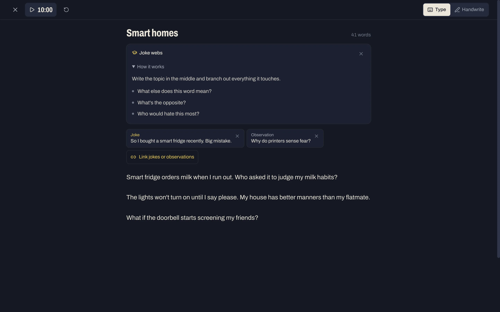

## Voice notes: `/voice`

[VoicePage.tsx](../web/src/features/voice/VoicePage.tsx), [Recorder.tsx](../web/src/features/voice/Recorder.tsx),
[useRecorder.ts](../web/src/features/voice/useRecorder.ts), [loudness.ts](../web/src/features/voice/loudness.ts),
[NewNoteCard.tsx](../web/src/features/voice/NewNoteCard.tsx), [VoiceNoteRow.tsx](../web/src/features/voice/VoiceNoteRow.tsx),
[PlayButton.tsx](../web/src/features/voice/PlayButton.tsx), [usePlayer.ts](../web/src/features/voice/usePlayer.ts),
[outbox.ts](../web/src/features/voice/outbox.ts), [audioCache.ts](../web/src/features/voice/audioCache.ts),
[useVoiceLibrary.ts](../web/src/features/voice/useVoiceLibrary.ts).

- **Recorder:** a big yellow mic. While recording, it shows the elapsed time, a 7-bar level
  meter scrolling left, and "Screen stays on" once the phone agrees to keep the screen awake. If it
  refuses (an iPhone before iOS 18.4 from the Home Screen, a browser without the Wake Lock API), it
  says "Screen may lock: tap it now and then" in amber instead. If the phone takes the mic, a toast
  says so and the card opens with what was recorded.
- **New voice note card:** appears as soon as you stop. It has play and scrub controls, a title, and
  hashtags, while the recording uploads in the background. **Done** files the note and
  **Delete** throws it away.
- **Library:** a search box over labels and hashtags, hashtag chips with their counts, and one row
  per note (play, label, length, date, hashtags, edit, delete), grouped by month under pinned
  headings, **Newest first** or **Oldest first** (`?order=old`), with the time scrubber down the
  right edge.
- **Storage bar:** how much of the 1 GB of free Blob storage the recordings use.

How recording, the meter, the outbox and playback work is covered in
[frontend.md](frontend.md#voice-notes-pipeline).

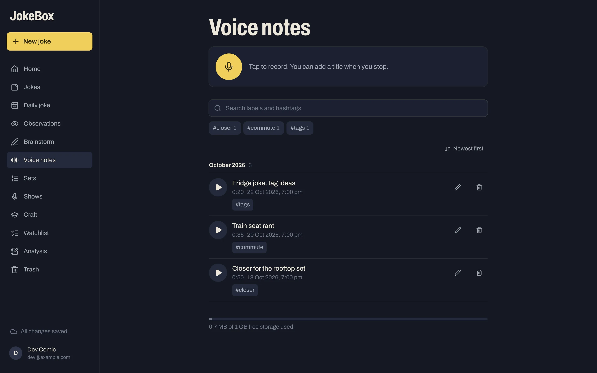

## Perform and study screens

Sets, Stage, Print, Shows, Watchlist and Analysis are in
[screens-perform.md](screens-perform.md).
