# Screens

Every screen: what it's for, how it's laid out on a phone and on desktop, which files build it,
and where its data comes from. Screenshots show the demo account (`uv run python -m app.seed`),
never real material.

Routes live in [App.tsx](../web/src/App.tsx). Every screen except Home loads lazily on first
visit, so the app opens fast on a phone.

## The frame

**Files:** [AppShell.tsx](../web/src/layout/AppShell.tsx), [Rail.tsx](../web/src/layout/Rail.tsx), [useRail.ts](../web/src/layout/useRail.ts), [BottomBar.tsx](../web/src/layout/BottomBar.tsx),
[nav.ts](../web/src/layout/nav.ts), [SyncLight.tsx](../web/src/layout/SyncLight.tsx),
[UpdatePrompt.tsx](../web/src/layout/UpdatePrompt.tsx), [AccountMenu.tsx](../web/src/layout/AccountMenu.tsx).

- **Desktop (≥1024 px):** a fixed left rail. It holds the wordmark, a yellow **New joke** button,
  every screen in `NAV` order, the sync light with its label, and your avatar and email. The
  wordmark and **New joke** stay pinned at the top and the sync light and account at the bottom;
  only the list of screens scrolls when the window is too short (an iPad in landscape). The rail
  and the pages start below the iPad's status bar, where iPadOS blurs whatever sits under it.
  Below 1280 px (an iPad in landscape) the rail is **compact**: icons only, named on hover, with
  the JokeBox icon, a square **+**, the sync icon and your avatar. The toggle beside the sync light
  (**Hide screen names** / **Show screen names**) switches it on this device; switching back to what
  the width would pick returns it to automatic.
- **Phone:** a slim header (wordmark, sync icon, avatar) and a bottom bar laid out as
  **Home · Jokes · + · Premises · More**.
  The **+** adds whatever the screen holds ([useAddAction.ts](../web/src/layout/useAddAction.ts)):
  a premise on Premises, a show on Shows, a set on the list of Sets, an observation on
  Observations, and a New joke anywhere else (inside a set you're building too). **More** opens a bottom sheet that groups every other screen: **Find**
  (Search), **Write** (Daily joke, Voice notes, Observations, Brainstorm), **Perform** (Sets, Shows), **Study**
  (Craft, Watchlist, Analysis) and **Deleted** (Trash). While you're on one of those screens,
  the More tab shows as the current one.
- One list in `nav.ts` feeds both the rail and the bar, so they can't drift apart.
- **Sync light:** "All changes saved", "Saving…", or "Offline, N waiting to sync". It counts
  queued saves plus recordings still to upload, and reads whether the server can be reached
  (not just whether the phone has signal).
- **Sync light** also says "Sign in to sync N waiting" when the sign-in ran out.
- **Couldn't sync strip:** above every page while any save failed for good. **Review** opens the
  list: what it was, when, why, the text you wrote, and **Retry** (or **Keep mine** for a clash
  with another device's edit), **Copy** and **Discard**; **Retry all** skips clashes.
- **Update banner:** "A new version of JokeBox is ready", with **Update now** and **Later**.
- **Avatar menu:** Sign out (asks first if changes haven't synced), plus **Reset to demo data**
  when running locally.
- **Another tab:** a tab that stepped aside shows "Open in another tab" with **Use it here** and **Keep both open** (allows several tabs; switch it off under **Several tabs** in the account menu).

  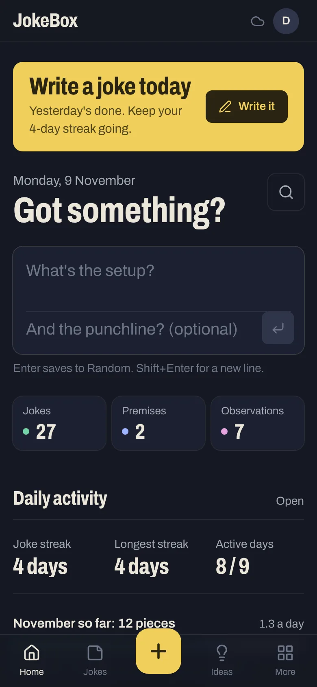
  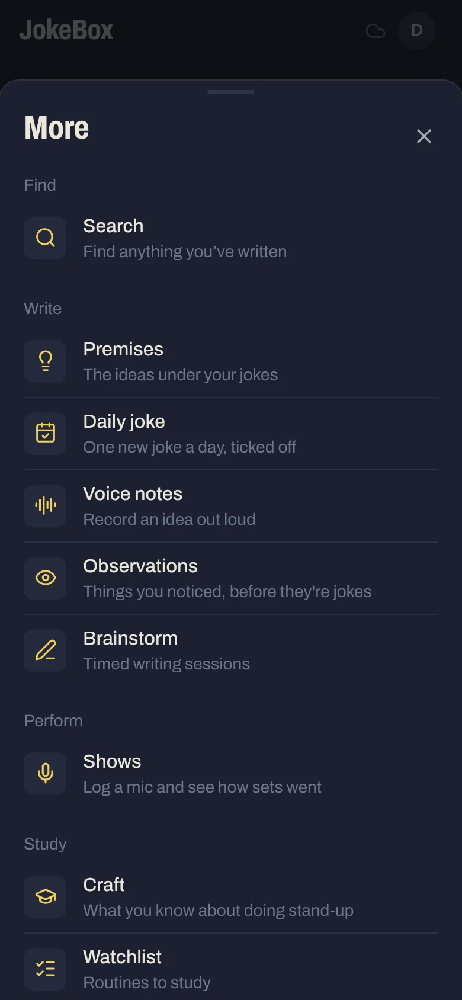
  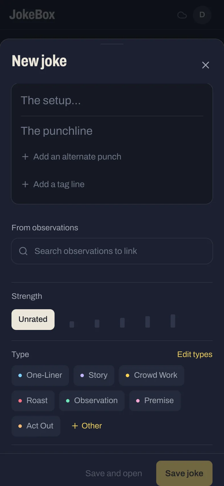

## Sign in: `/login`

[LoginPage.tsx](../web/src/features/auth/LoginPage.tsx) and
[RequireAuth.tsx](../web/src/features/auth/RequireAuth.tsx).

The page has the wordmark, three tape strips ("Write it down / Tape it to the floor / Kill") and
**Sign in with Google**. The "Sign in as the local test account" link appears only on localhost,
and the route behind it (`/auth/dev-login`) answers 404 unless `APP_ENV=local`.
`?error=not_invited` and `?error=failed` show a message.

`RequireAuth` guards every other route. It shows "Opening JokeBox…" while `/api/me` loads,
redirects to `/login` on a 401, and offers Retry when the server can't be reached. When
offline, it uses the cached profile, so the app still opens.

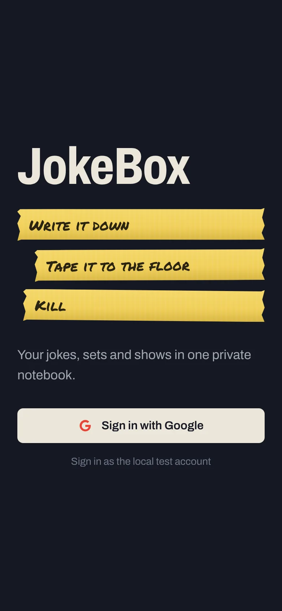

## Home: `/`

[TodayPage.tsx](../web/src/features/today/TodayPage.tsx) and its siblings in `features/today/`.

The page is one column, at most 672 px wide. It opens with the daily joke nudge, then today's date
in IST and the headline **"Got something?"** with a search button beside it (it opens
[Search](#search-search)), followed by these sections from top to bottom:

| Section | File | Notes |
|---|---|---|
| Daily joke nudge | `daily/DailyBanner.tsx` | Days since your last new joke: today written, a small green line with your streak; 1 or 2 days, yellow **Write a joke today**; 3 to 7, red **N days without a joke**; over a week, a dark, spooky card (a drifting ghost, a cobweb, a flickering line; still under reduced motion). Waits for the jokes to load so it never flashes the wrong state. Links to Daily joke |
| Quick capture | `QuickCapture.tsx` | Setup and punchline in one box. Enter saves to Random; Shift+Enter adds a new line |
| Voice notes | `TodayVoice.tsx` | The same recorder as the Voice screen, plus "All N" |
| Observations | `TodayObservations.tsx` | The observation box and the last few logged |
| Brainstorm | `TodayBrainstorm.tsx` | Start a session, or pick up the last one |
| Craft | `TodayCraft.tsx`, `craft/PathLadder.tsx` | **Path:** a small copy of the Craft staircase: the first Path note with tick boxes still open, how many are done, and the next step. When the step names minutes, it shows your most solid material on one topic (Strong and Killer jokes, by runtime) against that target. Below it, a box to save a lesson to one of your areas (chips in their colours) |
| Study | `TodayStudy.tsx` | Craft notes, watchlist progress, analyses |
| Topics | `TopicFolders.tsx` | Topics as folders with live counts; tap through to a subtopic |
| Your latest set | (inline) | The set you edited last, its joke count and slot, its first three strips, the light bar and **Rehearse** |
| Last show | (inline) | Venue, date, time on stage, crowd and stars, plus **Log a show** |

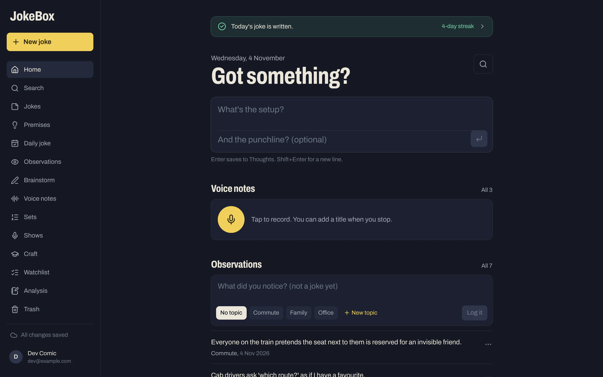

## Daily joke: `/daily`

[DailyPage.tsx](../web/src/features/daily/DailyPage.tsx), [dailyMath.ts](../web/src/features/daily/dailyMath.ts),
[MonthCalendar.tsx](../web/src/features/daily/MonthCalendar.tsx).

The habit of writing at least one new joke a day. A day counts when any joke was added to JokeBox
that day (IST), however it got there, imports included with their original dates; it's read from
the jokes' created dates, so there's no separate log to fall out of step.

- **The nudge** (the same one as Home); its button focuses the box below.
- **Today's joke:** the quick capture box. Saving puts the joke in Random and ticks today at once.
- **Streaks:** current (ending today, or yesterday while today is still open), longest, and days
  this month.
- **Calendar:** a month at a time, Monday first. Days with a new joke get a green tick and a count
  when there were several; today is outlined in yellow; days to come are dimmed. Arrows move
  between months. Tap a day to list its jokes, each linking to the joke.

## Jokes: `/jokes`, `/jokes/map`, `/jokes/web` and `/jokes/:jokeId`

[JokesLayout.tsx](../web/src/features/jokes/JokesLayout.tsx), [JokeFilters.tsx](../web/src/features/jokes/JokeFilters.tsx),
[useJokeFilters.ts](../web/src/features/jokes/useJokeFilters.ts), [JokePage.tsx](../web/src/features/jokes/JokePage.tsx),
[JokeDetails.tsx](../web/src/features/jokes/JokeDetails.tsx), [DetailControls.tsx](../web/src/features/jokes/DetailControls.tsx),
[TagLines.tsx](../web/src/features/jokes/TagLines.tsx), [JokeExtras.tsx](../web/src/features/jokes/JokeExtras.tsx),
[useAutosaveJoke.ts](../web/src/features/jokes/useAutosaveJoke.ts), [TopicManager.tsx](../web/src/features/jokes/TopicManager.tsx),
[TypeManager.tsx](../web/src/features/jokes/TypeManager.tsx), [ViewSwitch.tsx](../web/src/features/jokes/ViewSwitch.tsx),
[SplitView.tsx](../web/src/components/ui/SplitView.tsx), [ChipRow.tsx](../web/src/components/ui/ChipRow.tsx). The map: [map/](../web/src/features/jokes/map/) ([mapLayout.ts](../web/src/features/jokes/map/mapLayout.ts),
[JokeMap.tsx](../web/src/features/jokes/map/JokeMap.tsx), [MapCanvas.tsx](../web/src/features/jokes/map/MapCanvas.tsx), [MapPeek.tsx](../web/src/features/jokes/map/MapPeek.tsx)).

- **List, Map, Web:** a switch in the Jokes header shows the same jokes, with the same filters,
  as a list, the joke map (`/jokes/map`) or the premise web (`/jokes/web`). Map and Web take the
  whole screen under the header and filters, on every device. Beside an open joke the switch is
  three icons.
- **List:** a search box ("Search words, tags, notes") and menus in one row that scrolls sideways: Topic, then Subtopic once a topic with subtopics is picked, Premise, Type,
  Status, and Sort (Newest, Oldest, Recently edited, Strongest, Weakest, Longest). Each row shows the
  setup, the start of the punchline, strength ticks (or a faint "Unrated"), type dots, the topic, the date it was added (or
  last edited, under Recently edited) and the runtime. Sorted by a date, the list is grouped into
  months under pinned headings, with the time scrubber down its side ([JokeList.tsx](../web/src/features/jokes/JokeList.tsx)).
  A joke brought in with an older date (an import) counts as last edited then, not on the day it
  arrived. The ⋯ menu has **Export as CSV** (with Created At and Edited At).
- **Layout** ([SplitView.tsx](../web/src/components/ui/SplitView.tsx)), like Mail on an iPad:
  - **Phone and iPad upright:** the list, or the open joke as its own page with a back link. With
    the list to itself from 768 px, the rows go two across.
  - **iPad landscape and small laptops (1024–1279 px):** the list fills the screen, two across,
    until you open a joke; then it narrows to a column and the joke sits beside it.
  - **1280 px and wider:** the list is a column; with no joke open, the map or web you used last
    sits beside it, with a button to open it full size.
  - An open joke has two buttons at its top right: **Read the joke full width** (hides the list
    until you bring it back) and **Close the joke** (back to the list, filters kept).
- **The joke map:** the jokes the list is showing (same filters), as a map.
  - **Chains** are drawn left to right as boxes, with an arrow from each joke to the joke that
    follows it. Branches stack, with the joke before them level with their middle. Chains come in
    the order their jokes appear in the list.
  - A chain is drawn whole: jokes the filters hide come back dimmed, with dashed edges and arrows,
    so a chain never has a gap.
  - **On their own:** jokes in no chain, in a grid under the map.
  - **Tap a box** to read the joke in a panel beside the map (above the bottom bar on a phone):
    its setup, punchline, tag lines, strength and types, **Comes after** and **Followed by**
    (tap one to walk along the chain; the map scrolls to it) and **Open joke**. The joke's chain
    lights up and the others step back; hovering a box does the same. Escape closes the panel.
  - **Move around** by scrolling, or with a mouse by dragging the map (a drag that ends on a box
    doesn't open it). Zoom out, zoom in and **Fit to width**; a phone starts at 70%.
- **The premise web** (the **Web** tab, [JokeWeb.tsx](../web/src/features/jokes/map/JokeWeb.tsx)):
  each premise in the middle of the jokes resting on it, whatever topic they're from. Jokes on no
  premise aren't drawn; a link lists them so you can sort them in. Tap a joke for the same panel
  as the map.
- **The joke page:** the setup and punchline (in tape yellow) are edited in place, followed by tag
  lines. Below them, a row of details: Strength (**Unrated**, then five bars; tap the lit bar again
  to clear it), Type (with Edit types), Filed under (topic and
  subtopic, with Edit topics), Premise, Follows (the joke this one comes after in a chain),
  Followed by (with a button to write the next one), Status, Runs for (type it, or step it five
  seconds at a time with − and +), Clean rating, Language (Hinglish, Hindi or English) and
  Hashtags, followed by a Notes box, then **Observations**: the ones it came from, and a search to link more (see [Observations on a premise or joke](#observations-on-a-premise-or-joke)). Then **Rewrites** (earlier sessions and **Start a rewrite**),
  **In sets** (with Add to a set), the show record once the joke has been logged at a show
  ("Done at 3 shows: 2 killed, 1 ok. Last done 12 Oct", [JokeShowRecord.tsx](../web/src/features/jokes/JokeShowRecord.tsx)),
  and **Delete joke**, which asks first and sends it to the Trash.
- **State:** the filters live in the URL (`?topic=&sub=&type=&status=&q=&sort=`). Filtering runs in
  the browser, so it works offline. Edits go into a local draft and save about a moment after you
  stop typing, through the offline-safe joke save.
- **Remembered filters** ([rememberFilters.ts](../web/src/features/jokes/rememberFilters.ts)): come
  back to Jokes with no filters in the link (the nav, a joke opened from Home) and the last ones
  return. They're kept per tab or app window and lapse after an hour away; Clear forgets them.
  **New joke** opened while the list is filtered to a topic (and subtopic) starts filed there.
- **New topic** leads the Topic menu, so you can add a topic without scrolling past the others or
  writing a joke first; the list then filters to it. **Manage topics…** stays at the bottom.
- **Topic and type managers** are sheets for renaming and deleting across every joke. Jokes and
  premises share one topic list. Deleting a topic moves its jokes, premises and logged shows to
  Random, and the confirmation counts all three. The number beside a topic counts its jokes and
  premises. Renaming a type onto an existing one merges the two.

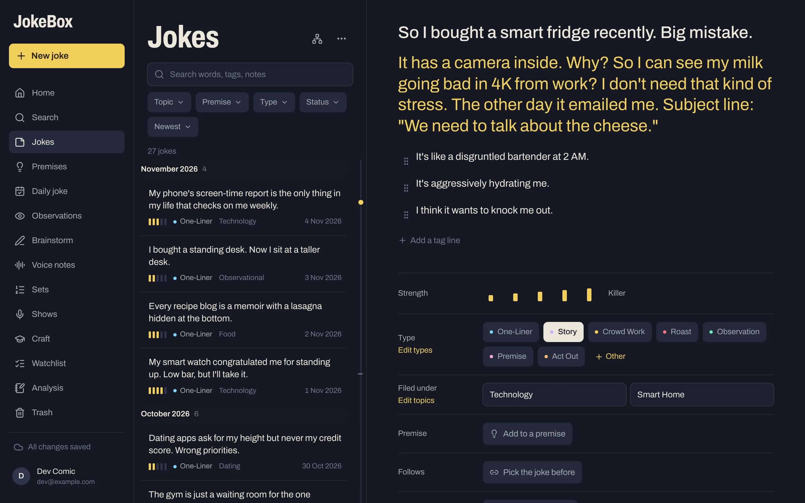

  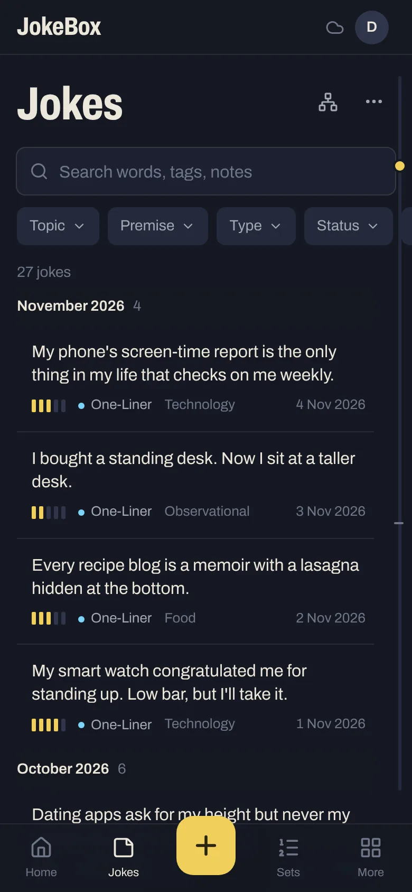
  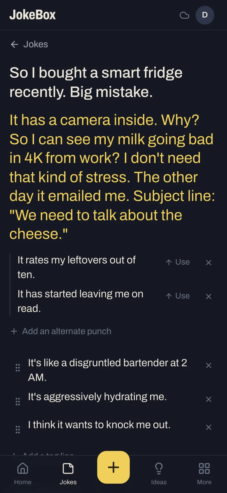

## Premises: `/premises` and `/premises/:premiseId`

[PremisesLayout.tsx](../web/src/features/premises/PremisesLayout.tsx), [usePremiseFilters.ts](../web/src/features/premises/usePremiseFilters.ts),
[PremisePage.tsx](../web/src/features/premises/PremisePage.tsx), [usePremiseDraft.ts](../web/src/features/premises/usePremiseDraft.ts),
[NewPremiseDialog.tsx](../web/src/features/premises/NewPremiseDialog.tsx), [AddJokesDialog.tsx](../web/src/features/premises/AddJokesDialog.tsx),
[PremiseField.tsx](../web/src/features/premises/PremiseField.tsx), [PremiseJokes.tsx](../web/src/features/premises/PremiseJokes.tsx),
[PremiseWeb.tsx](../web/src/features/premises/PremiseWeb.tsx).

The ideas under your jokes ("X is Y, because Z"). Laid out like Jokes (see its **Layout**): on an
iPad the list fills the screen, two across, until you open a premise, which then sits beside it
with the same **full width** and **close** buttons; from 1280 px, with none open, the guide to
writing a premise sits beside the list; on a phone the list gives way to the premise you open.

- **List:** a search box ("Search takes and notes"), then a Topic menu and a sort in one row (By topic, Newest,
  Most jokes, Fewest jokes). The Topic menu is the one Jokes has: **New topic** at the top,
  **Manage topics…** at the bottom, both working on the shared topic list. The Topic pickers in
  **New premise** and on a premise end with **New topic…**. Sorted by topic, a small heading starts each topic's run. Each row
  shows the take and how many jokes rest on it.
- **A premise:** the take and its notes (why it's true) are edited in place and save on their own.
  A short guide ([PremiseGuide.tsx](../web/src/features/premises/PremiseGuide.tsx)) opens while the
  premise has no notes and no jokes. Below, **Jokes on it**: every joke resting on it in reading
  order, chains kept together, with **Write a joke on it** and **Add jokes you’ve written** (from
  any topic). Once it has a joke, a **List / Web** switch shows the same jokes as this premise's
  web: the drawing the premise web on Jokes uses, for this premise alone, fitted to the width
  until you zoom. Tap a joke for the same reading panel. The device remembers which you used last;
  jokes come off the premise from the List. **Delete premise**
  asks first and sends it to the Trash; its jokes stay where they are, just not on a premise,
  until you put it back.
- **On a joke:** the Premise row on the joke page picks one, or starts a new one.
- **+** on this screen opens **New premise** (`?new=1`).
- **Observations:** the observations it came from (see below).

### Observations on a premise or joke

[ObservationsOn.tsx](../web/src/features/observations/ObservationsOn.tsx), [LinkSearch.tsx](../web/src/features/observations/LinkSearch.tsx),
[LinkedRows.tsx](../web/src/features/observations/LinkedRows.tsx).

A premise (below **Jokes on it**) and a joke (below Notes) have an **Observations** section: the
observations it came from, each opening its own page, with × to unlink. Under them, **Search
observations to link**: type and the three best matches show (every word has to appear; focused
and empty, it suggests three, same topic first). Tap one to link it; the box clears for the next,
so you can link as many as you like. Enter links the first match. It's the same box everywhere
something gets linked, as linking a page works in Notion.

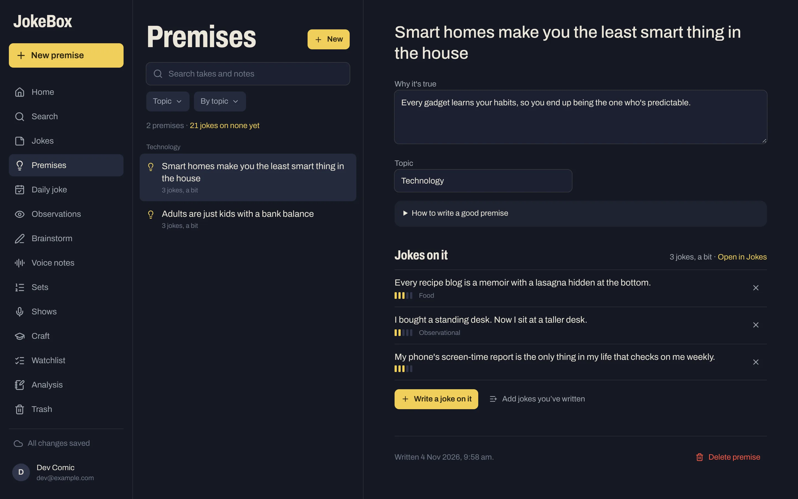

## New joke sheet

[CaptureProvider.tsx](../web/src/features/capture/CaptureProvider.tsx), [NewJokeForm.tsx](../web/src/features/capture/NewJokeForm.tsx),
[newJoke.ts](../web/src/features/capture/newJoke.ts).

The sheet is opened by **+** (on screens other than Premises, Shows and Observations), by **New
joke**, or by "Turn into a joke" on an observation, a voice note or a brainstorm session. It
renders the same `JokeDetails` controls as the joke page, but owns its own draft: one set of
controls with two owners of the state, so the two screens can't drift apart. Its buttons are
**Save and open** and **Save joke**. A new joke starts as Draft, 15 seconds, Clean and in
Hinglish. It's a bottom sheet on phones and a centred panel on desktop
(see `Modal`).

Closing it without saving (Escape, a tap on the dimmed area, the X) never loses the joke: what
you typed is kept on the device as you type ([keptDraft.ts](../web/src/features/capture/keptDraft.ts)),
a toast says "Unsaved joke kept for next time" with **Discard**, and the next **+** picks it up
with "Picked up the joke you didn't save" and **Start fresh**. It survives a reload or the
phone closing the app, and goes on sign-out. There's one kept joke: a sheet opened for something
else (from an observation, or after a joke) while one is waiting leaves it alone, and asks
"Discard changes?" before closing with typing of its own instead.

Other sheets that hold typing you haven't saved (Log a show, New premise, Edit observation, Add a
routine, a Craft table, area or kind) ask "Discard changes?" the same way. Their own **Cancel**
button still closes at once.

## Rewrite: `/jokes/:jokeId/rewrite`

[RewritePage.tsx](../web/src/features/jokes/RewritePage.tsx), [RewriteHistory.tsx](../web/src/features/jokes/RewriteHistory.tsx),
[useTimer.ts](../web/src/features/jokes/useTimer.ts).

A full screen with no app frame. The top bar holds close, the timer (start, pause, reset), a word
count, **Checklists**, **+** for a new session and **Save version**. The original joke is pinned at the top, under
it an optional session name and a free-writing area. On the right are **This session** (its saved
versions) and **Earlier sessions**. `?session=<id>` reopens a past session.

**Checklists** opens the craft checklists from the areas set to show on Rewrite, in a sheet
([CraftSheet.tsx](../web/src/features/craft/CraftSheet.tsx)). Pick one from the row at the top and
tick through it; the ticks count up and don't change the note, so the next rewrite starts fresh.

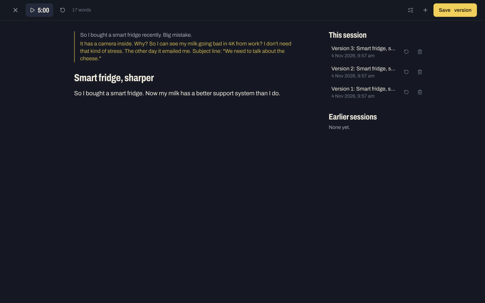

## Search: `/search`

[SearchPage.tsx](../web/src/features/search/SearchPage.tsx), [searchIndex.ts](../web/src/features/search/searchIndex.ts),
[search.ts](../web/src/lib/search.ts).

One box over everything: jokes (setup, punchline, tag lines, notes, hashtags), premises,
observations, brainstorms (title and typed words; handwriting can't be searched), rewrites, voice
notes (label and hashtags), sets, shows (venue and notes), Craft notes, analyses and the watchlist.
Every word has to appear, in any order; `#name` and `name` both find a hashtag. It runs in the
browser over the lists already on the device, so it works offline, and fetches any list not loaded
yet. Results come grouped by kind in that order, eight each with **Show all**, and each opens where
the item lives (an observation or voice note opens its page searched for the same words). The
query is `?q=` in the URL. It's in the rail under Home, in More under **Find**, and on Home.

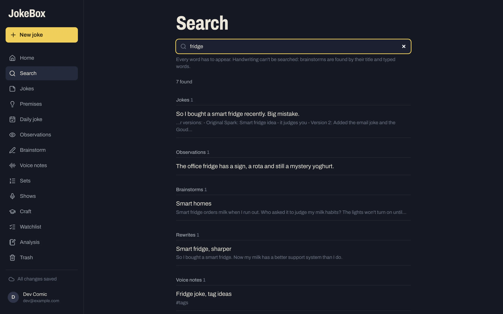

## Observations: `/observations` and `/observations/:observationId`

[ObservationsLayout.tsx](../web/src/features/observations/ObservationsLayout.tsx), [ObservationPage.tsx](../web/src/features/observations/ObservationPage.tsx),
[ObservationUses.tsx](../web/src/features/observations/ObservationUses.tsx), [NewObservationDialog.tsx](../web/src/features/observations/NewObservationDialog.tsx),
[useObservationDraft.ts](../web/src/features/observations/useObservationDraft.ts), [ObservationMenus.tsx](../web/src/features/observations/ObservationMenus.tsx),
[ObservationSorter.tsx](../web/src/features/observations/ObservationSorter.tsx), [KindManager.tsx](../web/src/features/observations/KindManager.tsx),
[ObservationBox.tsx](../web/src/features/observations/ObservationBox.tsx) (Home), [observationMeta.ts](../web/src/features/observations/observationMeta.ts).

An observation has an optional **topic**, from the same list as jokes and premises (none:
**Not sorted**), and an optional **kind**: what sort of note it is, like "Set ideas" or "Questions".
Most need no kind and are plain observations. It works like Premises: the list, with the one you
open beside it on an iPad in landscape or a laptop, or as its own page on a phone (see SplitView).

- **The list:** **New** opens New observation (`?new=1`; the + button opens it too): the words,
  **Topic (optional)** and **Kind (optional)**, then Save opens its page. Below are a search box
  (`?q=`), and **Topic**, **Kind** and **Not used yet** (`?unused=1`) in a row that scrolls
  sideways; each choice counts within the other filters. Then how many there are and, while some
  have no topic, **Sort N into topics**. Each row: the words (three lines), then its topic, kind,
  what came from it ("1 joke · 1 premise" or "Not used yet") and the date.
- **An observation:** the words, edited in place and saved on their own; **Topic (optional)** and
  **Kind (optional)**, each ending in New topic… / New kind…; **Write a joke from it** (New joke
  with it as the setup, on its topic) and **Write a premise from it** (New premise with it as "why
  it's true"); either new one is linked back. Then **Jokes from it** and **Premises from it**: what's
  linked, each opening its page, × to unlink, and a search to link ones you've written (the three
  best matches, same topic first). **Delete observation** asks first; what came from it stays.
- **Sort N into topics** goes through the ones with no topic, one at a time, newest first, in a
  sheet: the observation, its **Kind** chips, then every topic as a chip. Tapping a topic files it
  and shows the next; **Skip** leaves it under Not sorted, **Back** returns. At the end it says how
  many were sorted and skipped.
- **Kinds:** **Manage kinds…** ends the Kind menu: drag to reorder, rename, or delete one (its
  observations become plain).
- **Home** keeps a quick box (words, Topic and Kind menus, **Log it**) and the last three, each
  opening its page.

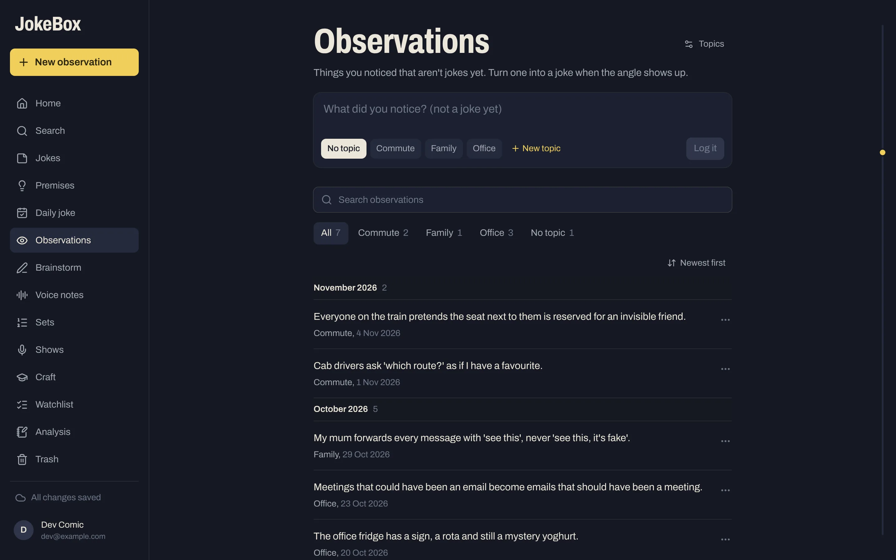

## Brainstorm: `/brainstorm` and `/brainstorm/:sessionId`

[BrainstormPage.tsx](../web/src/features/brainstorm/BrainstormPage.tsx), [SessionPage.tsx](../web/src/features/brainstorm/SessionPage.tsx),
[InkCanvas.tsx](../web/src/features/brainstorm/InkCanvas.tsx), [InkToolbar.tsx](../web/src/features/brainstorm/InkToolbar.tsx),
[ink.ts](../web/src/features/brainstorm/ink.ts), [LinkPicker.tsx](../web/src/features/brainstorm/LinkPicker.tsx),
[SessionLinks.tsx](../web/src/features/brainstorm/SessionLinks.tsx), [useSessionAutosave.ts](../web/src/features/brainstorm/useSessionAutosave.ts).

- **List:** sessions newest first, each with its date, time spent and a summary (words,
  handwriting, links), plus **New session**. A search box finds sessions by title and typed words
  (`?q=`); handwriting can't be searched. **Start with a technique** lists your Craft techniques;
  tapping one opens a new session running it.
- **Session (full screen):** the timer, and a **Type / Handwrite** toggle (both are kept). Below
  them, the title, **Link jokes or observations** (shown as small cards you can open or unlink),
  **Turn into a joke** (opens New joke with the session's first typed paragraph, and links the joke
  to the session as it's saved), and the page itself.
- **Technique** ([TechniquePanel.tsx](../web/src/features/brainstorm/TechniquePanel.tsx)): a
  session can run one of your Craft techniques. Its prompts (the list under a "Prompts" heading in
  the note) show one at a time with **Next prompt** and **Any prompt**, and **How it works** folds
  out the whole note. Without one, **Use a technique** picks one. The session keeps its technique.
- **Handwriting:** strokes are kept as points, with the screen's width as 1000 units, so they stay
  sharp at any size and redraw to fit a phone, an iPad or a laptop. A page is two screens wide
  (2000 units) and as tall as an A4 sheet one screen wide: it opens on its left half. Handwriting
  uses the whole width of the screen (up to 1440 px); typing stays a readable column. Pointer Events handle the pen, touch and mouse with
  one set of handlers. Pencil pressure sets the line width. Up to 8 pages (a session from before
  that cap keeps its extra pages).
  - **Pencil only** ([fingerDraw.ts](../web/src/features/brainstorm/fingerDraw.ts)): fingers draw
    until this device first sees a Pencil; from then on only the Pencil (or a mouse) draws. The
    hand button switches finger drawing on or off, remembered per device. Fingers that land while
    the Pencil is down (a resting palm) are ignored. A touch landing on the page is cancelled, so
    iPadOS can't read a resting Pencil as a long-press (which selected the nearest text and cut
    the stroke off), and nothing but the title can be selected while handwriting.
  - **Full screen** ([prefs.ts](../web/src/features/brainstorm/prefs.ts)): the last toolbar button
    hides the timer, title, technique and links, leaving the tools and the page, so an iPad works
    like a notebook. Remembered per device. The page keeps its width, so the ink doesn't resize.
  - **Pan bar** ([PageNav.tsx](../web/src/features/brainstorm/PageNav.tsx)): floats at the bottom of
    the screen, always in reach. Its thumb shows which part of the page is on screen; drag it, or
    tap where to go. It holds the **250% · Fit** button too. Turning the iPad keeps the same part
    of the page in view.
  - **Pan and zoom** ([useTouchView.ts](../web/src/features/brainstorm/useTouchView.ts)): one finger
    pans (sideways too), and so do two moving together. Two fingers zoom only once the gap
    between them clearly changes ([gestures.ts](../web/src/features/brainstorm/gestures.ts)), so a
    two-finger scroll never zooms by accident, and a pinch ending within 8% of fit snaps to it.
    A dragging finger scrolls the page once a frame in whole pixels, carrying the fractions over:
    Safari scrolls only whole pixels, so a slow drag otherwise stuck and jumped. Pinch zooms up to 2.5x around the fingers, or out to 50%, where the whole double-width page fits on screen. A trackpad's sideways
    swipe pans as well. During the pinch the canvas is only
    stretched (CSS transform); when the fingers lift it is redrawn sharp at the new size, capped
    at 12 million pixels to stay under Safari's canvas limit. A flick keeps the page gliding,
    slowing like iOS scrolling ([glide.ts](../web/src/features/brainstorm/glide.ts)); touching the
    page stops it.
  - **Smooth ink** ([usePagePaint.ts](../web/src/features/brainstorm/usePagePaint.ts)): the canvas
    draws only what's new. A finished stroke adds itself; an unrelated re-render (the timer, the
    "Saving…" label) draws nothing, so the stroke being written never flickers away. Only an
    erase, an undo, a page change or a new size redraws the whole page, and the canvas is rebuilt
    only when its size changes. A second finger mid-stroke turns the stroke into a pinch.
  - **Pens** ([PenStyle.tsx](../web/src/features/brainstorm/PenStyle.tsx)): on a tablet or laptop,
    five everyday colours and three thicknesses (Fine, Medium, Thick) sit on the toolbar; the
    menu holds the full twelve colours, and is all a phone shows.
- **Saving:** the session autosaves a moment after you stop (1.2 s typing, 3 s handwriting, with
  no "Saving…" label so it doesn't catch the eye mid-word), and again when you leave. Nothing is
  saved until the session has some content.

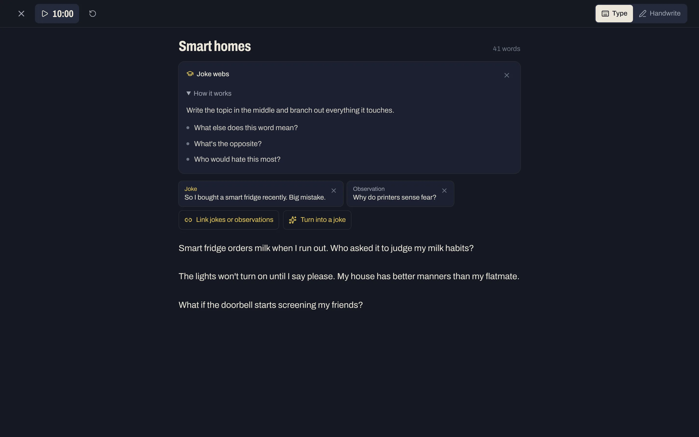

## Voice notes: `/voice`

[VoicePage.tsx](../web/src/features/voice/VoicePage.tsx), [Recorder.tsx](../web/src/features/voice/Recorder.tsx),
[useRecorder.ts](../web/src/features/voice/useRecorder.ts), [loudness.ts](../web/src/features/voice/loudness.ts),
[NewNoteCard.tsx](../web/src/features/voice/NewNoteCard.tsx), [VoiceNoteRow.tsx](../web/src/features/voice/VoiceNoteRow.tsx),
[PlayButton.tsx](../web/src/features/voice/PlayButton.tsx), [usePlayer.ts](../web/src/features/voice/usePlayer.ts),
[outbox.ts](../web/src/features/voice/outbox.ts), [audioCache.ts](../web/src/features/voice/audioCache.ts),
[useVoiceLibrary.ts](../web/src/features/voice/useVoiceLibrary.ts).

- **Recorder:** a big yellow mic. While recording, it shows the elapsed time, a 7-bar level
  meter scrolling left, and "Screen stays on" once the phone agrees to keep the screen awake. If it
  refuses (an iPhone before iOS 18.4 from the Home Screen, a browser without the Wake Lock API), it
  says "Screen may lock: tap it now and then" in amber instead. If the phone takes the mic, a toast
  says so and the card opens with what was recorded.
- **New voice note card:** appears as soon as you stop. It has play and scrub controls, a title, and
  hashtags, while the recording uploads in the background. **Done** files the note and
  **Delete** throws it away.
- **Library:** a search box over labels and hashtags, hashtag chips with their counts, and one row
  per note (play, label, length, date, hashtags, **Turn into a joke**, edit, delete; Turn into a
  joke opens New joke with the label and hashtags), grouped by month under pinned
  headings, **Newest first** or **Oldest first** (`?order=old`), with the time scrubber down the
  right edge.
- **Storage bar:** how much of the 1 GB of free Blob storage the recordings use.

How recording, the meter, the outbox and playback work is covered in
[frontend.md](frontend.md#voice-notes-pipeline).

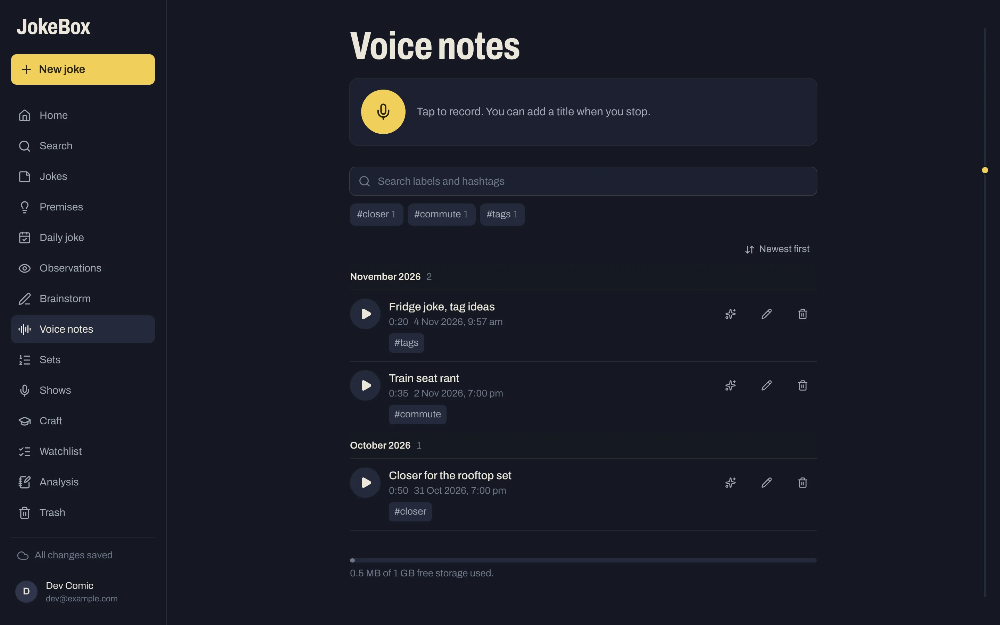

## Perform and study screens

Sets, Stage, Print, Shows, Watchlist and Analysis are in
[screens-perform.md](screens-perform.md).
