# Screens

Every screen: what it's for, how it's laid out on a phone and on desktop, which files build it,
and where its data comes from. Screenshots show the demo account (`uv run python -m app.seed`),
never real material.

Routes live in [App.tsx](../web/src/App.tsx). Every screen except Home loads lazily on first
visit, so the app opens fast on a phone.

## The frame

**Files:** [AppShell.tsx](../web/src/layout/AppShell.tsx), [Rail.tsx](../web/src/layout/Rail.tsx), [useRail.ts](../web/src/layout/useRail.ts), [BottomBar.tsx](../web/src/layout/BottomBar.tsx),
[nav.ts](../web/src/layout/nav.ts), [SyncLight.tsx](../web/src/layout/SyncLight.tsx),
[UpdatePrompt.tsx](../web/src/layout/UpdatePrompt.tsx), [AccountMenu.tsx](../web/src/layout/AccountMenu.tsx),
[Refresh.tsx](../web/src/layout/Refresh.tsx).

- **Desktop (≥1024 px):** a fixed left rail. It holds the wordmark, a yellow **New joke** button,
  every screen in `NAV` order, the sync light with its label, and your avatar and email. The
  wordmark and **New joke** stay pinned at the top and the sync light and account at the bottom;
  only the list of screens scrolls when the window is too short (an iPad in landscape). The rail
  and the pages start below the iPad's status bar, where iPadOS blurs whatever sits under it.
  Below 1280 px (an iPad in landscape) the rail is **compact**: icons only, named on hover, with
  the JokeBox icon, a square **+**, the sync icon and your avatar. The toggle beside the sync light
  (**Hide screen names** / **Show screen names**) switches it on this device; switching back to what
  the width would pick returns it to automatic.
- **Pull to refresh** (everywhere): at the very top of any screen, pull down with a finger (phone,
  iPad) or keep swiping down with two fingers on a laptop's trackpad. A round arrow comes down from
  the top, turns yellow once letting go will refresh, then spins while the lists reload, as in iOS
  Mail. There's no button on screen; the arrow shows only while you pull. A pull doesn't start
  while you're typing, drawing, in a dialog or menu, or inside a box that has scrolled, and a
  trackpad flick that scrolls up and hits the top never counts. Offline, it says so and keeps
  what's on the device.
- **Phone:** a slim header (wordmark, sync icon, avatar) and a bottom bar laid out as
  **Home · Jokes · + · Ideas · More**.
  **Ideas** ([ideas.ts](../web/src/layout/ideas.ts)) opens Premises or Observations, whichever
  you used last on this device (Premises the first time, or when storage is blocked), and stays lit on both. A
  **Observations | Premises** switch with their counts ([IdeasSwitch.tsx](../web/src/layout/IdeasSwitch.tsx))
  sits at the top of both lists wherever the bottom bar shows (phones and an upright iPad); from
  1024 px the rail lists both screens, so the switch hides.
  The **+** adds whatever the screen holds ([useAddAction.ts](../web/src/layout/useAddAction.ts)):
  a premise on Premises, a show on Shows, a set on the list of Sets, an observation on
  Observations, and a New joke anywhere else (inside a set you're building too). **More** opens a bottom sheet that groups every other screen: **Find**
  (Search), **Write** (Activity, Voice notes, Brainstorm), **Perform** (Sets, Shows), **Study**
  (Craft, Watchlist, Analysis) and **Deleted** (Trash). While you're on one of those screens,
  the More tab shows as the current one.
- One list in `nav.ts` feeds both the rail and the bar, so they can't drift apart.
- **Sync light:** "All changes saved", "Saving…", or "Offline, N waiting to sync". It counts
  queued saves plus recordings still to upload, and reads whether the server can be reached
  (not just whether the phone has signal).
- **Sync light** also says "Sign in to sync N waiting" when the sign-in ran out.
- **Couldn't sync strip:** above every page while any save failed for good. **Review** opens the
  list: what it was, when, why, the text you wrote, and **Retry** (or **Keep mine** for a clash
  with another device's edit), **Copy** and **Discard**; **Retry all** skips clashes.
- **Update banner:** "A new version of JokeBox is ready", with **Update now** and **Later**.
- **Avatar menu:** **Import** (Bit Vault data), **Download everything** (a zip of all your
  material and recordings), **Claude connector** (how to connect Claude, and what it can read),
  **Several tabs** (a tick: allow the app open in more than one tab), and **Sign out** (asks first
  if changes haven't synced). Running locally, **Reset to demo data** comes first.
- **Another tab:** a tab that stepped aside shows "Open in another tab" with **Use it here** and **Keep both open** (allows several tabs; switch it off under **Several tabs** in the account menu).

  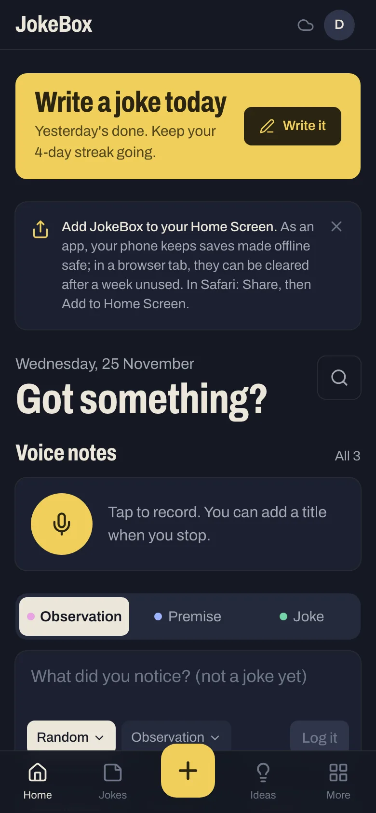
  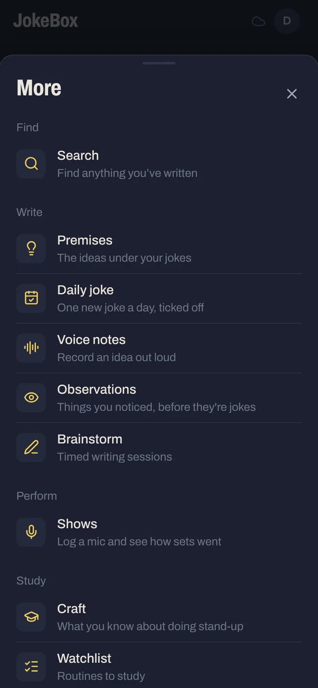
  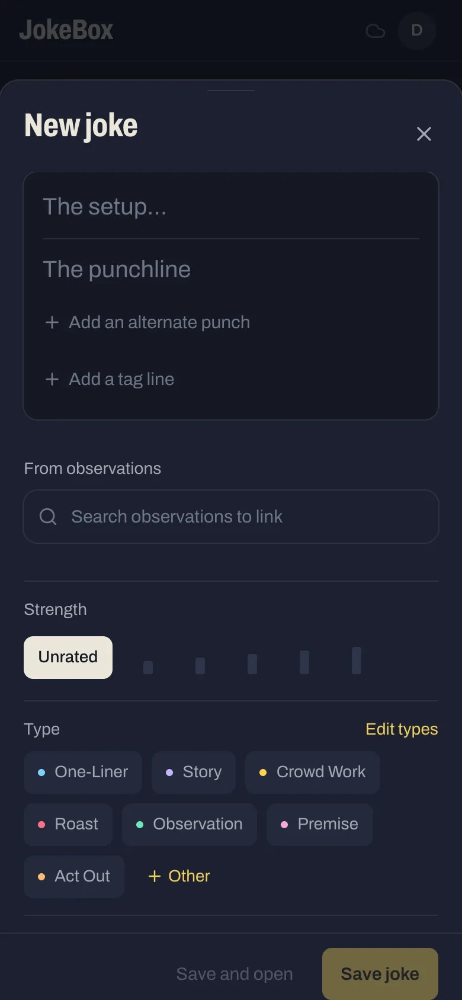

## Sign in: `/login`

[LoginPage.tsx](../web/src/features/auth/LoginPage.tsx) and
[RequireAuth.tsx](../web/src/features/auth/RequireAuth.tsx).

The page has the wordmark, three tape strips ("Write it down / Tape it to the floor / Kill") and
**Sign in with Google**. The "Sign in as the local test account" link appears only on localhost,
and the route behind it (`/auth/dev-login`) answers 404 unless `APP_ENV=local`.
`?error=not_invited` and `?error=failed` show a message.

`RequireAuth` guards every other route. It shows "Opening JokeBox…" while `/api/me` loads,
redirects to `/login` on a 401, and offers Retry when the server can't be reached. When
offline, it uses the cached profile, so the app still opens.

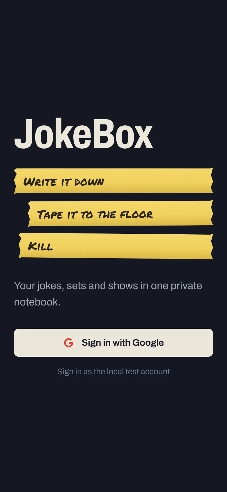

## Home: `/`

[TodayPage.tsx](../web/src/features/today/TodayPage.tsx) and its siblings in `features/today/`.

The page is one column, at most 672 px wide. It opens with the daily joke nudge, then today's date
in IST and the headline **"Got something?"** with a search button beside it (it opens
[Search](#search-search)), followed by these sections from top to bottom. On Home the nudge's button opens the Joke tab below:

| Section | File | Notes |
|---|---|---|
| Daily joke nudge | `daily/DailyBanner.tsx` | Days since your last new joke: today written, a small green line with your streak; 1 or 2 days, yellow **Write a joke today**; 3 to 7, red **N days without a joke**; over a week, a dark, spooky card (a drifting ghost, a cobweb, a flickering line; still under reduced motion). Waits for the jokes to load so it never flashes the wrong state. On Home its button opens the Joke tab |
| Voice notes | `TodayVoice.tsx` | The same recorder as the Voice screen, plus "All N" |
| Write | `CaptureTabs.tsx` | Three tabs, **Observation** (picked when Home opens), **Premise** and **Joke**, each with its own box; the words stay on this device through a tab switch or reload until you submit or erase them. Observation: `ObservationBox` (text, Topic, Kind, **Log it**). Premise: `premises/PremiseBox.tsx` (the take, "Because…", Topic, **Add premise**; the toast's **Open** goes to it). Joke: `QuickCapture.tsx` (setup and punchline; Enter saves to Random). The nudge's **Write it** switches to Joke and puts the cursor in the setup |
| Your material | `LibraryTiles.tsx` | Three tiles, **Observations**, **Premises** and **Jokes** (the tabs' order), each with its count and its Activity colour; a tap opens that list |
| Activity | `TodayActivity.tsx`, `daily/ActivityPanel.tsx` | The same streak cards, calendar card and Today box as [Activity](#activity-activity), plus **Open**. The pulse, highlights and year review are on Activity only |
| Brainstorm | `TodayBrainstorm.tsx` | Start a session, or pick up the last one |
| Craft | `TodayCraft.tsx`, `craft/PathLadder.tsx` | **Path:** a small copy of the Craft staircase: the first Path note with tick boxes still open, how many are done, and the next step (one small staircase per heading when the note has tracks). When the step names minutes, it shows your most solid material on one topic (Strong and Killer jokes, by runtime) against that target. Below it, a box to save a lesson to one of your areas (chips in their colours) |
| Study | `TodayStudy.tsx` | Craft notes, watchlist progress, analyses |
| Topics | `TopicFolders.tsx` | Topics as folders with live counts; tap through to a subtopic |
| Your latest set | (inline) | The set you edited last, its beat and joke count and slot, its first three beat cues on tape with their times, the light bar (the beats' time) and **On stage** |
| Last show | (inline) | Venue, date, time on stage, crowd and stars, plus **Log a show** |

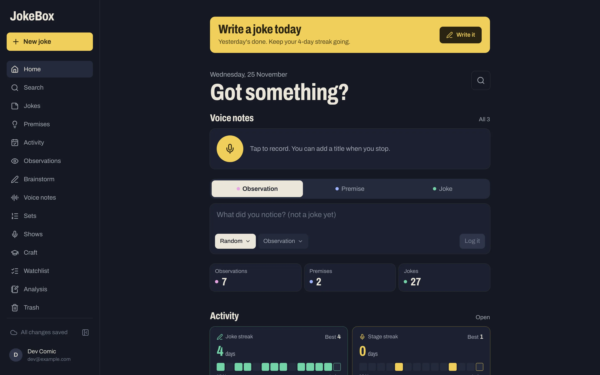

## Activity: `/activity`

[ActivityPage.tsx](../web/src/features/daily/ActivityPage.tsx), [activity.ts](../web/src/features/daily/activity.ts),
[dailyMath.ts](../web/src/features/daily/dailyMath.ts), [ActivityPanel.tsx](../web/src/features/daily/ActivityPanel.tsx)
(streaks to the picked day, shared with Home), [MonthCalendar.tsx](../web/src/features/daily/MonthCalendar.tsx),
[MonthMix.tsx](../web/src/features/daily/MonthMix.tsx), [Tally.tsx](../web/src/features/daily/Tally.tsx),
[DayDetail.tsx](../web/src/features/daily/DayDetail.tsx); the pulse: [WritingPulse.tsx](../web/src/features/daily/WritingPulse.tsx),
[pulse.ts](../web/src/features/daily/pulse.ts), [pulseTrends.ts](../web/src/features/daily/pulseTrends.ts),
[pulseNotes.ts](../web/src/features/daily/pulseNotes.ts), [pulseCards/](../web/src/features/daily/pulseCards/);
[highlights/](../web/src/features/daily/highlights/); the year review: [year/](../web/src/features/daily/year/).
`/daily`, its old address, still opens it.

How the writing and the stage are going. Nothing is written here (that's Home's job: no nudge, no
joke box), and nothing is listed: counts only. Observations, premises and jokes keep that order
everywhere (raw material first, as in the writing box), then the stage in gold. A day's writing is
read from the created dates (IST) of the three lists already cached, imports included with their
original dates; a day's stage time from the shows logged that day. Items in the Trash don't count.
From the top:

- **Streak cards** (below).
- **Calendar card** (on Home too): the month and its arrows, "22 of 24 days active · jokes on 15",
  and the month's **stage time** big in gold with its **shows as tally marks** (four strokes and a
  fifth across, the way a comic keeps count) and the number. On a phone it sits under the month as
  one line; from tablet width, on the right. Under them the month's writing: pieces written, a day's
  average, one bar split by kind, and the key: observations, premises, jokes and **mic nights**.
  Then the days: a box gets brighter the more you wrote, with a dot per kind written (orchid,
  periwinkle, green) and **a gold dot per show** (up to three). Where the calendar is wide enough
  (laptop, iPad) each dot carries its count and the gold ones the minutes on stage ("12m").
  Joke days have a brighter date; today is outlined in yellow. The separate show calendar that used
  to sit here is on Shows only.
- **Today** (or the day you tapped; tap it again to go back): four counts, observations, premises,
  jokes and minutes on stage (with the day's shows as tally marks). 2 by 2 on a phone, 4 across
  from 480 px.
- **Writing pulse:** how the writing is going, worked out from what's saved, so there is nothing to
  log. With fewer than 5 pieces in all it says to write a few more. Otherwise:
  - **The narrowest step**, said in one line on tape ("Your ideas stall at premise to joke"), with
    the list that holds them; it waits until a step has 5 ideas in it. Under it, the sentences
    worth knowing: a kind with nothing new in 21 days, and the topic with the biggest pile of
    unused observations (at least 5, 3 unused).
  - **Where everything stands:** a bar per kind split by status. Observations and premises: Draft,
    Work in Progress, Stage Ready, Discarded. Jokes: your statuses in your order (Draft grey, Work
    in Progress periwinkle, Stage Ready green, Discarded faded red, any other a shade of paper).
  - **How far ideas got**, of what you wrote in the last 90 days: observations that led somewhere
    (a joke, premise or brainstorm, the same test as **Not used yet**), premises with a joke on
    them, jokes marked Stage Ready. The narrowest is red.
  - **Month on month**, the last six months: pieces written and how many went on at each of those
    three steps, as counts (a share would call one observation that led somewhere "100%"), each
    month counted on what was written that month. No status history is kept, so a month can only be
    judged by where its writing stands now: months that ended under 30 days ago are faded as still
    settling (for pieces written, only this month), and the arrow compares this month with last month. Above the streak cards, six all-time counts sit in two rows of three.
  - **When you write:** the last 90 days as a punch card, weekdays down, morning to night across,
    the busiest in gold ("Mostly Tuesday nights"), from 10 pieces.
  - **Sitting idle** (all of it, not just recent): unused observations, premises with no joke,
    Drafts untouched for 30 days, as chips that open the list holding them.
  Claude reads the same numbers through the connector's `writing_pulse` tool
  ([pulse.py](../app/connector/pulse.py)). The screen works them out in the browser so it works
  offline, so the rules exist twice: change both together.
- **Highlights:** six **best months**, all-time (jokes, observations, premises, all writing, shows,
  stage time), as tiles, 3 across on a phone and 6 on a wider screen (like Strava's best efforts).
  A tile is also the switch for the chart under it: that measure over the last 12 months, the
  record month lit, this month outlined, with its pace; months read Dec, Jan, Feb (the 12 ending
  this one, rolling). Then the last 12 months as a grid of days across the full width (like
  GitHub's), greener the more you wrote, the three biggest days gold. Under it **Big days** (like
  Garmin's records), two columns from tablet width:
  the biggest writing day, the most jokes in a day, the longest night on stage, your top-rated
  shows (how many got your highest rating, and how many you rated 4★ and up) and the longest joke streak, each beside a small calendar day. Ties go to the earliest, so a record moves only when it's beaten.
- **Year review** (like Spotify Wrapped): a card with "2026 so far" on tape, how far through the
  year you are, and every past year with anything in it ("2025 wrapped"). This year stays "so
  far" until 31 December is over. A year opens as full-screen cards on a phone (a tall card in the
  middle on an iPad or laptop), each year in its own look, taken in turn
  ([themes.ts](../web/src/features/daily/year/themes.ts), [wrapped.css](../web/src/features/daily/year/wrapped.css)):
  2026 a **spray-painted brick wall** (the year as a tag with drips, stickers), 2025 a **photocopied
  gig flyer** (halftone paper, shaded block letters, a red stamp, tear-off tabs) and 2024 a
  **comedy-club marquee** (a frame of bulbs, letterboards, a neon sign), then round again. Every
  card fills to its edges with a chart or grid. The cards: the cover (the year, pieces written and
  their split, the year month by month as stacked bars, the year's best bits as stickers or tabs),
  the best month (with every month as bars), the biggest day (with its month as a calendar), the
  longest joke streak (with the year as rows of days, joke days lit), the top topics, when you
  write (a punch card), the year on stage (its shows as tally marks; well-rated shows, 4★ and up,
  and shows at your top rating; the busiest month and longest set; no LPM) and from notebook to
  stage. A card with nothing to say is left out. Tap the right to go on and the
  left to go back (arrow keys on a keyboard); bars along the top show where you are; Escape or the
  X closes.
- **Streak cards** ([StreakCards.tsx](../web/src/features/daily/StreakCards.tsx),
  [StreakCard.tsx](../web/src/features/daily/StreakCard.tsx), on Home too): two matching boxes side
  by side on every screen size. Each has its name and **Best** (the longest streak ever) on top,
  the current streak big, the **last 14 days as squares** (filled on days that counted, today
  outlined until it does, so the run and its gaps are visible), and this month along the bottom
  as big figures. **Joke streak** (green): days in a row with a new joke, ending today or yesterday
  while today is still open; the month is "15 / 21 days active" (days with anything written, out
  of the days so far). **Stage streak** (gold, opens Shows): days in a row with a show, by the
  same rule; the month is shows, time on stage and (from tablet width) mic days. Streaks run across
  months; only the bottom is the month. There's no nudge to go on stage, and no audience total
  (crowd sizes are guesses, so a sum would mislead). Chosen over a bar towards your best and a
  grid of equal tiles, because the squares show the rhythm, not only a number. Earlier the stats
  were a loose row of three numbers with a gold "on stage" strip on Home that read as a
  notification.
- **Milestones** ([milestones.ts](../web/src/features/daily/milestones.ts),
  [MilestoneWatcher.tsx](../web/src/features/daily/MilestoneWatcher.tsx), on every screen): when
  the joke or stage streak reaches 7, 30, 60, 90 or 180 days, a year, or each year after, about
  three seconds of confetti in the app's colours (green and mixed for jokes, gold for the stage)
  and a toast: "30-day stage streak. A month of mics!". It fires on the save that gets there, or
  when you next open the app if it got there elsewhere (a show logged from set-review). Each
  milestone celebrates once per streak per device; a new streak earns them again. Under reduced
  motion it's the toast alone. Nothing on the page moves, and taps go through the confetti.
- **The month's total:** how many pieces, how many a day, and one bar split by kind. Its labels
  are the colour key: orchid observations (`orchid`), periwinkle premises (`sky`), green jokes
  (`ok`). It follows the month the calendar shows.
- **Calendar:** a month at a time, Monday first. A day's box gets brighter the more you wrote
  (1, 2 to 3, 4 to 6, 7 or more), with a dot for each kind written that day. Where the calendar
  is at least 512 px wide (desktop, iPad) each dot carries its count, wrapping to a second line
  if three double-digit counts don't fit; on a phone it's dots only. Joke days have a bright,
  bold date. Today is outlined in yellow, the picked day in paper; days to come are dimmed.
  Hovering a day shows "8 Nov 2026: 7 observations, 6 premises, 12 jokes"; screen readers hear
  the same. Arrows move between months.
- **The picked day** (today when the page opens): its three counts in a strip, then what you
  wrote, grouped by kind, each linking to its joke, premise or observation. This is where a phone
  shows the counts.

## Jokes: `/jokes`, `/jokes/map`, `/jokes/web`, `/jokes/:jokeId` and `/jokes/c/:clusterId`

[JokesLayout.tsx](../web/src/features/jokes/JokesLayout.tsx), [JokeFilters.tsx](../web/src/features/jokes/JokeFilters.tsx),
[useJokeFilters.ts](../web/src/features/jokes/useJokeFilters.ts), [JokePage.tsx](../web/src/features/jokes/JokePage.tsx),
[JokeDetails.tsx](../web/src/features/jokes/JokeDetails.tsx), [DetailControls.tsx](../web/src/features/jokes/DetailControls.tsx),
[PunchAlternates.tsx](../web/src/features/jokes/PunchAlternates.tsx), [TagLines.tsx](../web/src/features/jokes/TagLines.tsx), [JokeExtras.tsx](../web/src/features/jokes/JokeExtras.tsx),
[useAutosaveJoke.ts](../web/src/features/jokes/useAutosaveJoke.ts), [TopicManager.tsx](../web/src/features/jokes/TopicManager.tsx),
[TypeManager.tsx](../web/src/features/jokes/TypeManager.tsx), [StatusManager.tsx](../web/src/features/jokes/StatusManager.tsx), [ViewSwitch.tsx](../web/src/features/jokes/ViewSwitch.tsx),
[SplitView.tsx](../web/src/components/ui/SplitView.tsx), [ChipRow.tsx](../web/src/components/ui/ChipRow.tsx). The map: [map/](../web/src/features/jokes/map/) ([mapLayout.ts](../web/src/features/jokes/map/mapLayout.ts),
[JokeMap.tsx](../web/src/features/jokes/map/JokeMap.tsx), [MapCanvas.tsx](../web/src/features/jokes/map/MapCanvas.tsx), [MapPeek.tsx](../web/src/features/jokes/map/MapPeek.tsx)).

- **List, Map, Web:** a switch in the Jokes header shows the same jokes, with the same filters,
  as a list, the joke map (`/jokes/map`) or the premise web (`/jokes/web`). Map and Web take the
  whole screen under the header and filters, on every device. Beside an open joke the switch is
  three icons.
- **List:** a search box ("Search words, tags, notes") and menus in one row that scrolls sideways (a wheel over the row slides it; one over an open menu scrolls only the menu): Topic, then Subtopic once a topic is picked, Premise, Type,
  Status (with **Manage statuses…**), Persona (each side, Not sure, and **Edit sides…**), and Sort (Newest, Oldest, Recently edited, Strongest, Weakest, Longest). Each row shows the
  setup and the punchline (two lines each), strength ticks (or a faint "Unrated"), type dots, the topic, the date it was added (or
  last edited, under Recently edited) and the runtime. Sorted by a date, the list is grouped into
  months under pinned headings, with the time scrubber down its side ([JokeList.tsx](../web/src/features/jokes/JokeList.tsx)).
  A joke brought in with an older date (an import) counts as last edited then, not on the day it
  arrived. The ⋯ menu has **Export as CSV** (with Created At, Edited At and Persona).
- **Clusters** ([cluster/](../web/src/features/jokes/cluster/)): versions of one joke kept
  together, each still a whole joke. Like Google Photos stacking similar shots, the list shows a
  cluster as one row with a tape-yellow **3 versions** badge
  ([stacks.ts](../web/src/features/jokes/cluster/stacks.ts)). With **⋯ → Show cluster names** checked (the default), the row shows the cluster
  name (or the lead's setup if unnamed) in place of the words, and under it the version count and
  the lead's details line, the same one a joke row has: strength, type dots, topic, date and runtime.
  They're always the lead's, the version you'd do tonight, even when a filter matched another
  version. Uncheck it to read the lead's setup and punchline. A standalone joke shows its setup and punchline in both views.
  Search matches cluster names as well as joke text. If only another version matches a filter, the row
  sits where that version sorts, counts the matches (e.g. "1 of 3 versions"), and shows that version
  in the joke-text view. A fully discarded cluster hides with discarded jokes and says "discarded" when shown.
  Export as CSV adds Cluster and Lead columns.

  

    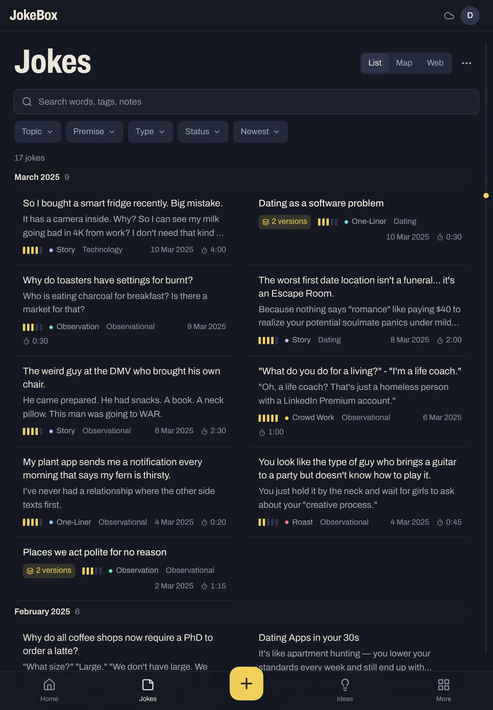
    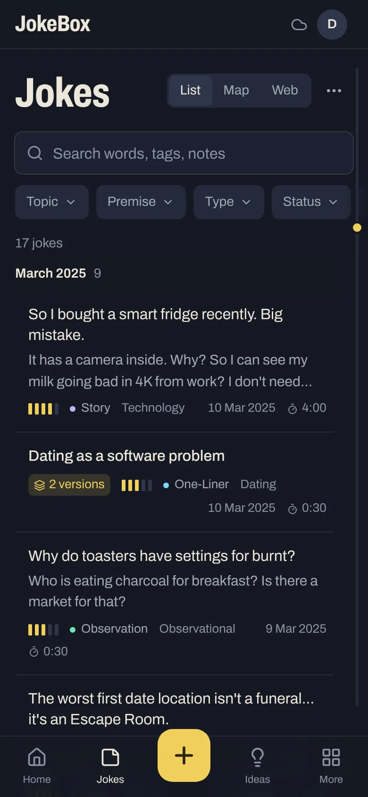
  

- **A cluster** ([ClusterPage.tsx](../web/src/features/jokes/cluster/ClusterPage.tsx)) opens
  beside the list like a joke, with the same full-width and close buttons, and on a phone as its
  own page. At the top, where it's filed and how many versions, then what the versions share
  (the title, edited in place; empty, the lead's setup shows) and notes. ⋯ → **Dissolve cluster**
  asks first, frees every version and offers Undo. Below, the versions as boxes
  ([VersionCard.tsx](../web/src/features/jokes/cluster/VersionCard.tsx)), lead first in a tape-yellow
  outline, then newest first; three across on a wide screen, two on a laptop, stacked on a phone.
  Each box edits its setup and punchline in place and shows status, strength, runtime, its show
  record and **Open** (the joke page, which then has **Back to cluster** above the setup). Every
  active version that isn't the lead has a **Make lead** button. Its ⋯: Make lead, Duplicate as a
  new version, Discard (or Bring back), Take out of cluster, Delete joke. Discarding, taking out or
  deleting the lead says which version leads now
  ([useClusterActions.ts](../web/src/features/jokes/cluster/useClusterActions.ts)). Under the boxes,
  **Write a version** (New joke filed like the lead, on its premise and from its observations;
  Follows starts blank), **Add jokes you've written** and "1 discarded hidden **Show**".
- **Add versions** ([AddVersionsDialog.tsx](../web/src/features/jokes/cluster/AddVersionsDialog.tsx)),
  the joke picker sheet (see [Picker sheets](#picker-sheets)): the lead pinned at the top to compare against, then the Jokes
  list's own search and filter row ([JokeFilters.tsx](../web/src/features/jokes/JokeFilters.tsx):
  Topic, Subtopic, Premise, Type, Status, Persona, Sort), starting on the lead's topic and subtopic and
  Recently edited ([useJokePickFilters.ts](../web/src/features/pickers/useJokePickFilters.ts);
  kept in the sheet, so the list's filters behind it don't change). A count line with discarded
  jokes hidden behind **Show** and **Clear filters**. Rows look like the list's
  ([JokeRowBody.tsx](../web/src/features/jokes/JokeRowBody.tsx)): setup, punchline, strength,
  status, subtopic, runtime; a tap ticks one (yellow edge and tick). A joke in another cluster is
  greyed out at the bottom and can't be ticked: "In "…" · take it out there first" (the count line
  says how many). The bar at the bottom says how many are picked, with **Clear** and
  **Add 2 versions**. Jokes already in this cluster aren't listed.
- **The lead:** the version you'd do tonight. While only one version is active, it leads. When the
  lead is discarded, trashed or taken out, the strongest active version takes over (the most
  recently edited on a tie) and keeps the lead after the old one comes back. With every version
  discarded the lead stays put ([lead.ts](../web/src/features/jokes/cluster/lead.ts), the same
  rules as the server's).
- **Discarded jokes** ([discarded.ts](../web/src/features/jokes/discarded.ts)) are hidden from the
  list, map and web by default, like completed tasks in Todoist. The count line under the filters
  says so ("40 of 324 jokes · 6 discarded hidden **Show**"); **Show** brings them in ("6 discarded
  shown **Hide**"), and the choice is remembered with the filters. A joke is discarded when its
  status is called Discarded (any case). Picking a status in the Status menu, Discarded included,
  shows exactly that status, so the switch steps aside. Clear leaves the switch as it is. Export as
  CSV exports what's showing.
- **Layout** ([SplitView.tsx](../web/src/components/ui/SplitView.tsx)), like Mail on an iPad:
  - **Phone and iPad upright:** the list, or the open joke as its own page with a back link. With
    the list to itself from 768 px, the rows go two across.
  - **iPad landscape and small laptops (1024–1279 px):** the list fills the screen, two across,
    until you open a joke; then it narrows to a column and the joke sits beside it.
  - **1280 px and wider:** the list is a column; with no joke open, the map or web you used last
    sits beside it, with a button to open it full size. The line between them drags
    ([SplitDivider.tsx](../web/src/components/ui/SplitDivider.tsx)), like the divider in Apple Mail:
    the list can take the empty margins beside the open joke, never the joke's own width
    ([splitWidth.ts](../web/src/components/ui/splitWidth.ts)). It starts with half of them, so on a
    big monitor the list starts wider. Double-click puts it back, and the arrow keys move it once
    it has focus. Each device remembers its own width for each list. With under 2rem to spare (a
    small laptop) there's no divider. Premises and Observations work the same way.
  - An open joke has two buttons at its top right: **Read the joke full width** (hides the list
    until you bring it back) and **Close the joke** (back to the list, filters kept).
- **The joke map:** the jokes the list is showing (same filters), as a map.
  - **Chains** are drawn left to right as boxes, with an arrow from each joke to the joke that
    follows it. Branches stack, with the joke before them level with their middle. Chains come in
    the order their jokes appear in the list.
  - A chain is drawn whole: jokes the filters hide come back dimmed, with dashed edges and arrows,
    so a chain never has a gap.
  - **On their own:** jokes in no chain, in a grid under the map.
  - **Tap a box** to read the joke in a panel beside the map (above the bottom bar on a phone):
    its setup, punchline, tag lines, strength and types, **Comes after** and **Followed by**
    (tap one to walk along the chain; the map scrolls to it), "A version in: …" for a joke in a
    cluster (opens it) and **Open joke**. The joke's chain
    lights up and the others step back; hovering a box does the same. Escape closes the panel.
  - **Move around** by scrolling, or with a mouse by dragging the map (a drag that ends on a box
    doesn't open it). Zoom out, zoom in and **Fit to width**; a phone starts at 70%.
- **The premise web** (the **Web** tab, [JokeWeb.tsx](../web/src/features/jokes/map/JokeWeb.tsx)):
  each premise in the middle of the jokes resting on it, whatever topic they're from. Jokes on no
  premise aren't drawn; a link lists them so you can sort them in. Tap a joke for the same panel
  as the map. The panel ends with where the joke came from (its observations, and voice notes
  you can play), as does the reading panel in a set ([JokeOrigins.tsx](../web/src/features/jokes/JokeOrigins.tsx)).
- **The joke page:** the setup and punchline (in tape yellow) are edited in place, followed by
  alternate punches and then tag lines. **Alternate punches** ([PunchAlternates.tsx](../web/src/features/jokes/PunchAlternates.tsx))
  are other endings for the same setup, as many as you like, set off by a rule on the left: **Add
  an alternate punch** adds a row and puts the cursor in it, **Use** makes that row the punchline
  and puts the old punchline in its row (so Use again swaps back), × removes one. A row left
  empty stays on screen but isn't saved. They show only here and in New joke, never on stage, in
  print or in a peek, and search finds them. Under the tag lines, **Cluster** comes first, above
  where the joke came from, since it's the first thing to know about a joke with versions
  ([ClusterField.tsx](../web/src/features/jokes/cluster/ClusterField.tsx)): one line, "Version of:
  …" with Lead and the number of versions, which opens the cluster, and × on the same line to
  take it out (a long name is cut short so the × never drops below it); or **Add to a cluster**,
  to start one from this joke or join one. A cluster lives where its lead is filed, so the list
  only offers clusters in the joke's topic and subtopic ("Clusters in Dating › Apps"; no subtopic
  and Subtopic unknown count as one place, [place.ts](../web/src/features/jokes/cluster/place.ts)).
  To join a cluster filed elsewhere, file the joke there first. New joke has it in the same place. Then where the joke
  came from, and below the words, a row of details: Strength (**Unrated**, then five bars; tap the lit bar again
  to clear it), Type (with Edit types), Filed under (topic and
  subtopic, with Edit topics; with no subtopic picked, the topic's **Subtopic unknown**), Premise (the premise sheet), Follows (the joke this one comes after in a chain, from the joke sheet),
  Followed by (**Write the next joke**, or **Pick jokes that follow** from the joke sheet; a joke already following another says "Now follows: …" and moves here), Status (with Edit statuses: the **Statuses** sheet lists every status with its joke count, Draft first as the default that can't be renamed or deleted; drag the rest into order, rename one (onto a name you have, it asks to merge) or delete it, and its jokes go back to Draft; **Add status**), Persona (the side of you the joke shows: Riled up, Bakchod, Point prover or Not sure, from the same list as a set beat's Dominant persona side; **Edit sides** opens Label fields, see [sets.md](sets.md#a-jokes-persona)), Runs for (type it, or step it five
  seconds at a time with − and +), Clean rating, Language (Hinglish, Hindi or English) and
  Hashtags, followed by a Notes box. Then **Rewrites** (earlier sessions and **Start a rewrite**),
  **In sets** (with Add to a set), the show record once the joke has been logged at a show
  ("Done at 3 shows: 2 killed, 1 ok. Last done 12 Oct", [JokeShowRecord.tsx](../web/src/features/jokes/JokeShowRecord.tsx)),
  and **Delete joke**, which asks first and sends it to the Trash.
- **State:** the filters live in the URL (`?topic=&sub=&premise=&type=&status=&q=&sort=&discarded=&versions=`). Filtering runs in
  the browser, so it works offline. Edits go into a local draft and save about a moment after you
  stop typing, through the offline-safe joke save.
- **Remembered filters** ([useRememberedParams.ts](../web/src/lib/useRememberedParams.ts)): come
  back to Jokes with no filters in the link (the nav, a joke opened from Home) and the last ones
  return. They're kept per tab or app window and lapse after an hour away; Clear forgets them.
  Premises and Observations remember theirs the same way, each list on its own.
  **New joke** opened while the list is filtered to a topic (and subtopic) starts filed there.
- **New topic** leads the Topic menu, so you can add a topic without scrolling past the others or
  writing a joke first; the list then filters to it. **Manage topics…** stays at the bottom.
- **The Subtopic menu** works the same way for the picked topic: **New subtopic** first (the list
  then filters to it), **Manage subtopics…** last. That opens a sheet for that topic's subtopics
  alone ([SubtopicManager.tsx](../web/src/features/jokes/SubtopicManager.tsx)): rename, delete,
  drag into order, add, with each one's joke count. A joke's Subtopic picker ends with the same
  **Manage subtopics…**. Jokes hold a subtopic by its id, so a rename leaves them as they are;
  deleting one moves its jokes to the topic's **Subtopic unknown**.
- **Subtopic unknown:** every topic has one, Random included, made with the topic. A joke filed
  under a topic with no subtopic picked goes there (New joke, a quick capture, moving a joke to
  another topic), so "no subtopic" and "unknown" are never two buckets. It's protected like
  Random: it sorts last in every subtopic list, and in Manage subtopics it sits apart below the
  rest with a lock, its joke count and "where jokes with no subtopic go", with no rename, delete
  or drag.
- **Topic and type managers** are sheets for renaming and deleting across every joke. Jokes and
  premises share one topic list. Deleting a topic moves its jokes, premises and logged shows to
  Random, and the confirmation counts all three. The number beside a topic counts its jokes and
  premises. Renaming a type onto an existing one merges the two.

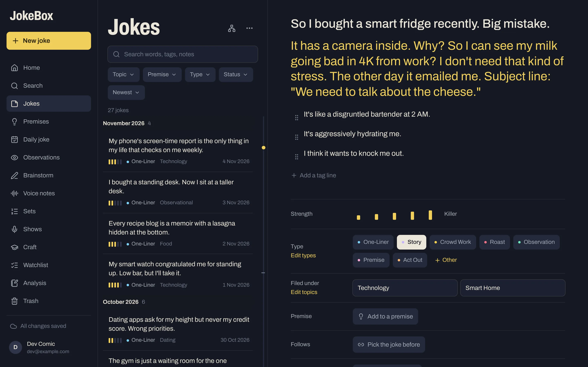

  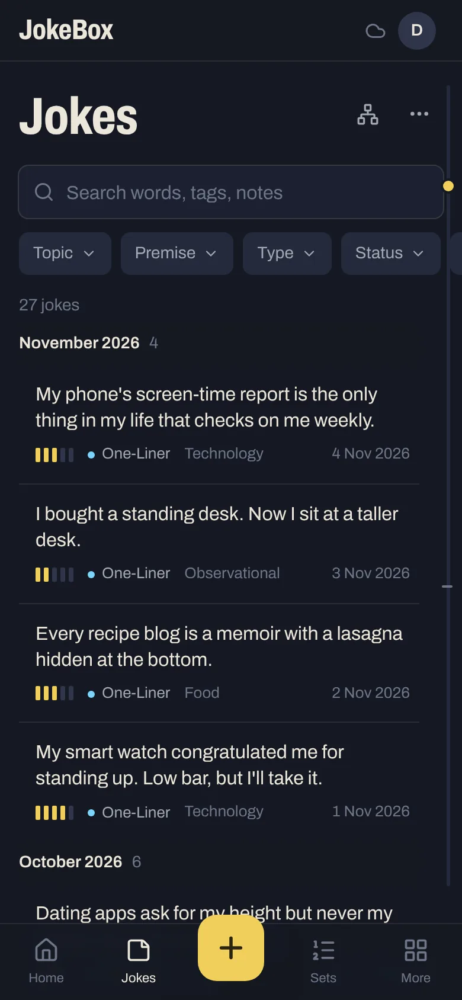
  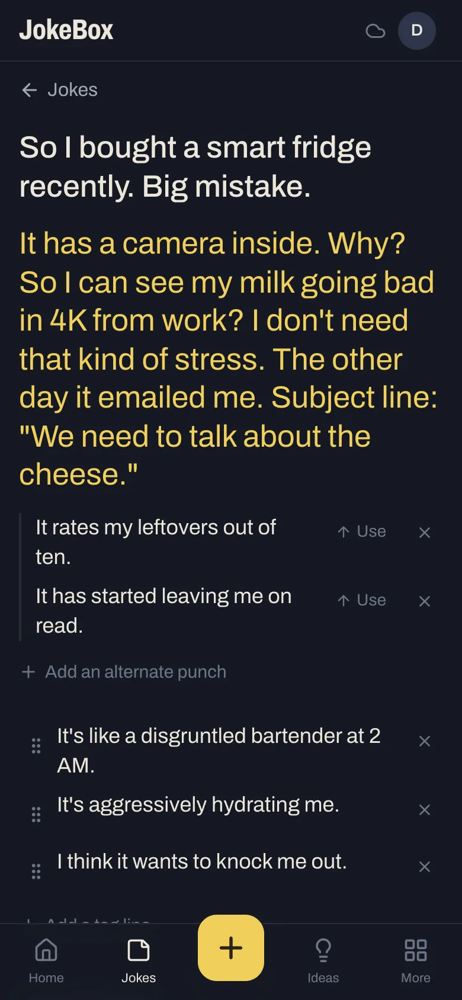

## Premises: `/premises` and `/premises/:premiseId`

[PremisesLayout.tsx](../web/src/features/premises/PremisesLayout.tsx), [usePremiseFilters.ts](../web/src/features/premises/usePremiseFilters.ts),
[PremisePage.tsx](../web/src/features/premises/PremisePage.tsx), [usePremiseDraft.ts](../web/src/features/premises/usePremiseDraft.ts),
[NewPremiseDialog.tsx](../web/src/features/premises/NewPremiseDialog.tsx), [AddJokesDialog.tsx](../web/src/features/premises/AddJokesDialog.tsx),
[PremiseField.tsx](../web/src/features/premises/PremiseField.tsx), [PremiseJokes.tsx](../web/src/features/premises/PremiseJokes.tsx),
[PremiseWeb.tsx](../web/src/features/premises/PremiseWeb.tsx).

The ideas under your jokes ("X is Y, because Z"). Laid out like Jokes (see its **Layout**): on an
iPad the list fills the screen, two across, until you open a premise, which then sits beside it
with the same **full width** and **close** buttons; from 1280 px, with none open, the guide to
writing a premise sits beside the list; on a phone the list gives way to the premise you open.

- **Ideas switch:** on a phone or an upright iPad, **Observations | Premises** at the top of the list (see The frame).
- **List:** a search box ("Search takes and notes"), then a Topic menu, a Status menu and a sort in one row
  (Newest, the default, then Oldest, By topic, Strongest, Weakest, Most jokes, Fewest jokes;
  [premiseSort.ts](../web/src/features/premises/premiseSort.ts)). The Topic menu is the one Jokes has: **New topic** at the top,
  **Manage topics…** at the bottom, both working on the shared topic list. The Topic pickers in
  **New premise** and on a premise end with **New topic…**. Sorted by topic, a small heading starts each topic's run. Each row
  shows the take, how many jokes rest on it, its strength ticks and its status (none for a Draft).
  Discarded premises are hidden like discarded jokes: the count line says how many, with **Show**
  and **Hide**, and picking a status in the Status menu shows what you picked. The search, topic, status and sort are remembered for an
  hour like Jokes' filters, so the tab bar brings you back to them; **Clear** forgets them.
- **A premise:** the take and its notes (why it's true) are edited in place and save on their own.
  Under them, **Strength** (Unrated, or Weak to Killer, the picker jokes use:
  [StrengthPicker.tsx](../web/src/components/ui/StrengthPicker.tsx)) and **Status**: Draft (every
  premise starts there), Work in Progress, Stage Ready or Discarded
  ([PremiseStatusPicker.tsx](../web/src/features/premises/PremiseStatusPicker.tsx)). The status is
  the premise's own: discarding it leaves its jokes, and their statuses, as they are.
  A short guide ([PremiseGuide.tsx](../web/src/features/premises/PremiseGuide.tsx)) opens while the
  premise has no notes and no jokes: what a premise is, one premise and many setups, four checks
  (the four failures in the Craft note "What's a faulty premise?") and links to the Craft notes on
  premises, found by title. Below, **Notes**: an empty box for anything else about it,
  growing as you write up to about half the screen (24rem at most), then scrolling inside, and saving on its own ([NotesBox.tsx](../web/src/components/ui/NotesBox.tsx)).
  Then **Jokes on it**: every joke resting on it in reading
  order, chains kept together, with **Write a joke on it** and **Add jokes you’ve written** (the
  joke sheet, starting on the premise's topic; a joke on another premise says "Moves from: …"). Once it has a joke, a **List / Web** switch shows the same jokes as this premise's
  web: the drawing the premise web on Jokes uses, for this premise alone, fitted to the width
  until you zoom. Tap a joke for the same reading panel. The device remembers which you used last;
  jokes come off the premise from the List. **Delete premise**
  asks first and sends it to the Trash; its jokes stay where they are, just not on a premise,
  until you put it back.
- **On a joke:** the Premise row on the joke page picks one from the premise sheet (starting on
  the joke's topic, the current one marked), or starts a new one with **New premise** at its foot.
- **+** on this screen opens **New premise** (`?new=1`): Topic, Your take, Why it's true (the
  because), From observations and Notes (anything else), the premise page's own fields, with the
  guide folded at the bottom.
- **Observations:** the observations it came from (see below).

### Picker sheets

[pickers/](../web/src/features/pickers/): [PickSheet.tsx](../web/src/features/pickers/PickSheet.tsx),
[JokePickSheet.tsx](../web/src/features/pickers/JokePickSheet.tsx),
[PremisePickSheet.tsx](../web/src/features/pickers/PremisePickSheet.tsx),
[ObservationPickSheet.tsx](../web/src/features/pickers/ObservationPickSheet.tsx).

Everywhere you link something you've already written, one kind of sheet opens (full height on a
phone, wide on a computer): the tab's own search and filter row, a count line (discarded ones
hidden behind **Show**, **Clear filters**), and rows that look like that tab's list. The filters
start where the thing on the page is filed (its topic, and for jokes its subtopic) and live in
the sheet, so the list behind it keeps its own; clear them to pick from anywhere.

| Sheet | Filters | Opened from |
|---|---|---|
| Jokes | The Jokes row: Topic, Subtopic, Premise, Type, Status, Sort | Add versions (cluster), Add jokes you've written (premise), Follows and Followed by (joke), Link jokes (observation), Add jokes (set beat, with clusters as one row: see [screens-perform.md](screens-perform.md)) |
| Premises | Topic, Status, Sort | Premise (joke), Link premises (observation), Premise and Put under a premise (set beat) |
| Observations | Topic, Kind, Not used yet, Sort | From observations (joke, premise, New joke, New premise) |

Picking many (versions, jokes on a premise, observations, jokes that follow): a tap ticks a row
(yellow edge and filled tick) and the bar at the bottom says how many, with **Clear** and
**Add 2 versions** / **Link 3 observations**. They're added in the order you ticked them, and a
tick hidden by a later filter stays picked. Picking one (a premise, the joke before): a tap
picks it and closes, and the current one is marked. A row that can't be picked is greyed at the
bottom and says why (a joke in another cluster).

### Observations on a premise or joke

[ObservationsOn.tsx](../web/src/features/observations/ObservationsOn.tsx), [ObservationPicker.tsx](../web/src/features/observations/ObservationPicker.tsx),
[LinkedRows.tsx](../web/src/features/observations/LinkedRows.tsx).

A joke (right under its words and tag lines) and a premise (right under "Why it's true") have
**From observations**, high up so it's in view without scrolling: the observations it came from,
each opening its own page, with × to unlink. The New joke and New premise sheets have the same
box under the words, so you can link while you write; the picks are linked when you save. Under them, **Link
observations** opens the observation sheet (see [Picker sheets](#picker-sheets)), starting on the
joke's or premise's topic: tick as many as you like and **Link 3 observations**. Ones already
linked aren't listed; × on a linked one unlinks it and shows **Undo** for a moment.

A joke written from a voice note also has **From voice notes** under it (on its page and in the
New joke sheet): each recording with a play button, × to unlink (with Undo)
([VoiceNotesOn.tsx](../web/src/features/voice/VoiceNotesOn.tsx)). The links are part of the
joke's own save, so they work offline like any edit, and a recording still waiting to upload
plays from the phone.

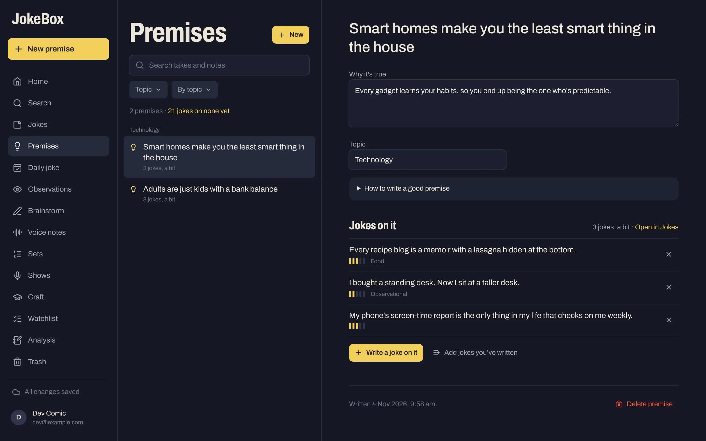

## New joke sheet

[CaptureProvider.tsx](../web/src/features/capture/CaptureProvider.tsx), [NewJokeForm.tsx](../web/src/features/capture/NewJokeForm.tsx),
[newJoke.ts](../web/src/features/capture/newJoke.ts).

The sheet is opened by **+** (on screens other than Premises, Shows and Observations), by **New
joke**, or by "Turn into a joke" on an observation, a voice note or a brainstorm session. It
has the same alternate punches and tag lines under the punchline, and
renders the same `JokeDetails` controls as the joke page, but owns its own draft: one set of
controls with two owners of the state, so the two screens can't drift apart. Its buttons are
**Save and open** and **Save joke**. A new joke starts as Draft, 15 seconds, Clean and in
Hinglish. It's a bottom sheet on phones and a centred panel on desktop
(see `Modal`).

Closing it without saving (Escape, a tap on the dimmed area, the X) never loses the joke: what
you typed is kept on the device as you type ([keptDraft.ts](../web/src/features/capture/keptDraft.ts)),
a toast says "Unsaved joke kept for next time" with **Discard**, and the next **+** picks it up
with "Picked up the joke you didn't save" and **Start fresh**. It survives a reload or the
phone closing the app, and goes on sign-out. There's one kept joke: a sheet opened for something
else (from an observation, or after a joke) while one is waiting leaves it alone, and asks
"Discard changes?" before closing with typing of its own instead.

Other sheets that hold typing you haven't saved (Log a show, New premise, Edit observation, Add a
routine, a Craft table, area or kind) ask "Discard changes?" the same way. Their own **Cancel**
button still closes at once.

## Rewrite: `/jokes/:jokeId/rewrite`

[RewritePage.tsx](../web/src/features/jokes/RewritePage.tsx), [RewriteHistory.tsx](../web/src/features/jokes/RewriteHistory.tsx),
[useTimer.ts](../web/src/features/jokes/useTimer.ts).

A full screen with no app frame. The top bar holds close, the timer (start, pause, reset), a word
count, **Checklists**, **+** for a new session and **Save version**. On a phone the bar keeps
close, the timer, reset and **Save**; Checklists, New session and History sit behind **⋯**, so
nothing runs off the screen. The original joke is pinned at the top,
with **Where it came from** folded under it when it has any (its observations, and voice notes
you can play), then an optional session name and a free-writing area. On the right are **This session** (its saved
versions) and **Earlier sessions**. Search opens the matching session with `?session=<id>`. Unsaved words return when you reopen that rewrite on this device. **Discard draft** drops those edits. **Save version** adds them to History.

**Checklists** opens the craft checklists from the areas set to show on Rewrite, in a sheet
([CraftSheet.tsx](../web/src/features/craft/CraftSheet.tsx)). Pick one from the row at the top and
tick through it; the ticks count up and don't change the note, so the next rewrite starts fresh.

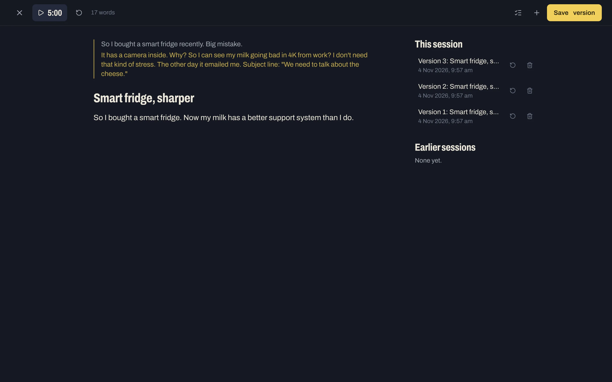

## Search: `/search`

[SearchPage.tsx](../web/src/features/search/SearchPage.tsx), [searchIndex.ts](../web/src/features/search/searchIndex.ts),
[search.ts](../web/src/lib/search.ts).

One box over everything: jokes (setup, punchline, alternate punches, tag lines, notes, hashtags), premises,
observations, brainstorms (title and typed words; handwriting can't be searched), rewrites, voice
notes (label and hashtags), sets, shows (venue and notes), Craft notes, analyses and the watchlist.
Every word has to appear, in any order; `#name` and `name` both find a hashtag. It runs in the
browser over the lists already on the device, so it works offline, and fetches any list not loaded
yet. Results come grouped by kind in that order, eight each with **Show all**, and each opens where
the item lives (an observation or voice note opens its page searched for the same words). The
query is `?q=` in the URL. It's in the rail under Home, in More under **Find**, and on Home.

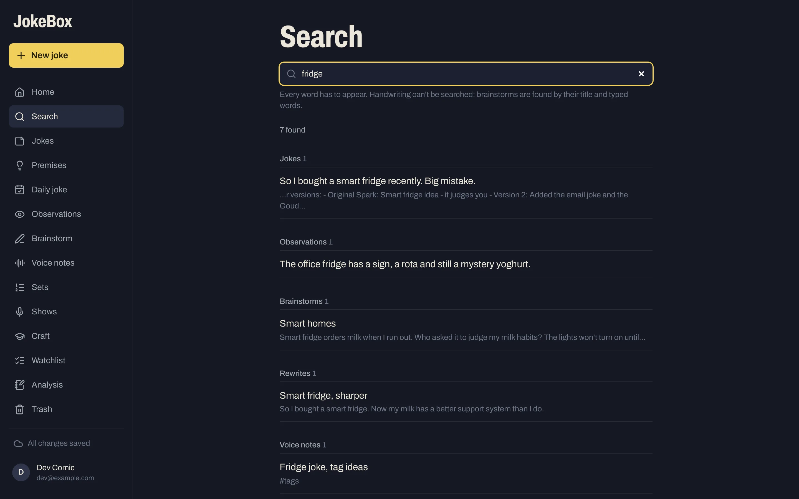

## Observations: `/observations` and `/observations/:observationId`

[ObservationsLayout.tsx](../web/src/features/observations/ObservationsLayout.tsx), [ObservationPage.tsx](../web/src/features/observations/ObservationPage.tsx),
[ObservationUses.tsx](../web/src/features/observations/ObservationUses.tsx), [NewObservationDialog.tsx](../web/src/features/observations/NewObservationDialog.tsx),
[useObservationDraft.ts](../web/src/features/observations/useObservationDraft.ts), [ObservationMenus.tsx](../web/src/features/observations/ObservationMenus.tsx),
[KindManager.tsx](../web/src/features/observations/KindManager.tsx),
[ObservationBox.tsx](../web/src/features/observations/ObservationBox.tsx) (Home), [observationMeta.ts](../web/src/features/observations/observationMeta.ts).

An observation always has a **topic**, from the same list as jokes and premises (Random until
you pick another), and an optional **kind**: what sort of note it is, like "Set ideas" or "Questions".
Most need no kind and are plain observations. It works like Premises: the list, with the one you
open beside it on an iPad in landscape or a laptop, or as its own page on a phone (see SplitView). On a phone it's the other half of the **Ideas** tab, with the same **Observations | Premises** switch on top.

- **The list:** **New** opens New observation (`?new=1`; the + button opens it too): the words,
  **Topic** (Random, or the one you're filtered to) and **Kind (optional)**, then Save opens its page. Below are a search box
  (`?q=`), and **Topic**, **Kind**, **Status** (`?status=`) and **Not used yet** (`?unused=1`) in a row that scrolls
  sideways, then a sort (Newest, the default, Oldest, Strongest, Weakest; `?sort=`); each choice
  counts within the other filters, and **Clear** ends the row while any filter is set. They're remembered for an hour like Jokes' filters, so the tab bar brings you back to them
  (an open New sheet isn't). Then how many there are; discarded observations are hidden, as on Premises and Jokes, with "· 3 discarded hidden **Show**" on that line (`?discarded=show`; **Hide** puts them away), and picking a status shows exactly that status. Each row: the words (three lines), then its topic, kind,
  what came from it ("1 joke · 1 premise · 1 brainstorm" or "Not used yet"), the date, its strength ticks and its status (none for a Draft).
- **An observation:** the words, edited in place and saved on their own; **Topic** and
  **Kind (optional)**, each ending in New topic… / New kind…; **Strength**, Unrated until you rate it, as on a joke; **Status**, the same four chips as a premise's (Draft to start); **Write a joke from it** and **Write a premise from it**
  open New joke or New premise on its topic with the setup (or take) empty and this observation
  already under **From observations**, so you write your own words with it in view; either new
  one is linked back when saved. A new joke also starts on the premise this observation already
  led to, when there's exactly one. Then **Notes** (the same box as on a premise), and **Jokes from it** and **Premises from it**: what's
  linked, each opening its page, × to unlink (with **Undo**), and **Link jokes** / **Link
  premises**, which open the joke and premise sheets on the observation's topic. Then **Brainstorms with it**: the sessions
  it's linked to, each opening the session (the session holds that link, so it's changed there). **Delete observation** asks first; what came from it stays.
- **Kinds:** **Manage kinds…** ends the Kind menu: drag to reorder, rename, or delete one (its
  observations become plain).
- **Home** keeps a quick box (words, Topic and Kind menus, **Log it**) and the last three, each
  opening its page.

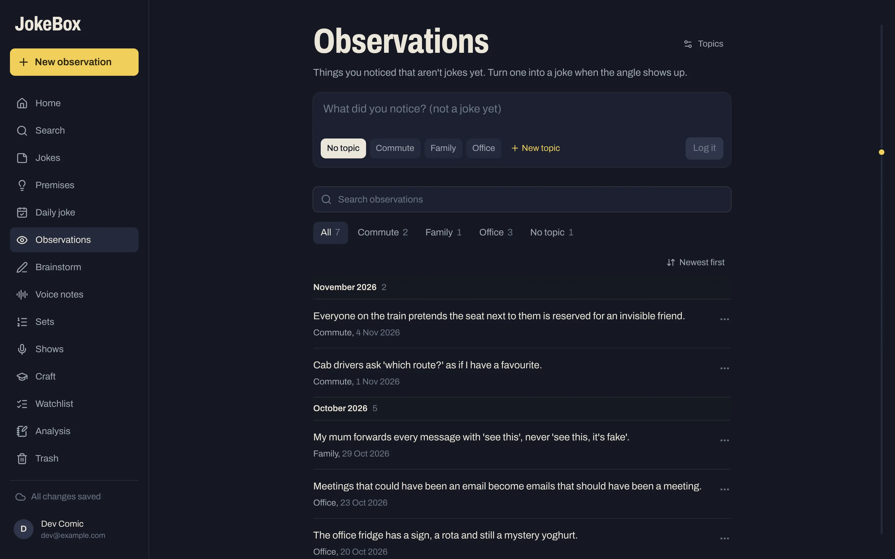

## Brainstorm: `/brainstorm` and `/brainstorm/:sessionId`

[BrainstormPage.tsx](../web/src/features/brainstorm/BrainstormPage.tsx), [SessionPage.tsx](../web/src/features/brainstorm/SessionPage.tsx),
[InkCanvas.tsx](../web/src/features/brainstorm/InkCanvas.tsx), [InkToolbar.tsx](../web/src/features/brainstorm/InkToolbar.tsx),
[ink.ts](../web/src/features/brainstorm/ink.ts),
[SessionLinks.tsx](../web/src/features/brainstorm/SessionLinks.tsx), [useSessionAutosave.ts](../web/src/features/brainstorm/useSessionAutosave.ts).

- **List:** sessions newest first, each with its date, time spent and a summary (words,
  handwriting, links), plus **New session**. A search box finds sessions by title and typed words
  (`?q=`); handwriting can't be searched. **Start with a technique** lists your Craft techniques;
  tapping one opens a new session running it.
- **Session (full screen):** the timer, and a **Type / Handwrite** toggle (both are kept). Below
  them, the title, what's linked (small cards for jokes and observations, each opening its page,
  × to unlink with **Undo**), **Link a joke or observation** (the same three-match search box as
  everywhere, over both), **Turn into a joke** (opens New joke with the session's first typed
  paragraph and the session's observations linked, and links the joke to the session as it's
  saved), and the page itself.
- **Technique** ([TechniquePanel.tsx](../web/src/features/brainstorm/TechniquePanel.tsx)): a
  session can run one of your Craft techniques. Its prompts (the list under a "Prompts" heading in
  the note) show one at a time with **Next prompt** and **Any prompt**, and **How it works** folds
  out the whole note. Without one, **Use a technique** picks one. The session keeps its technique.
- **Handwriting:** strokes are kept as points, with the screen's width as 1000 units, so they stay
  sharp at any size and redraw to fit a phone, an iPad or a laptop. A page is two screens wide
  (2000 units) and as tall as an A4 sheet one screen wide: it opens on its left half. Handwriting
  uses the whole width of the screen (up to 1440 px); typing stays a readable column. Pointer Events handle the pen, touch and mouse with
  one set of handlers. Pencil pressure sets the line width. Up to 8 pages (a session from before
  that cap keeps its extra pages).
  - **Pencil only** ([fingerDraw.ts](../web/src/features/brainstorm/fingerDraw.ts)): fingers draw
    until this device first sees a Pencil; from then on only the Pencil (or a mouse) draws. The
    hand button switches finger drawing on or off, remembered per device. Fingers that land while
    the Pencil is down (a resting palm) are ignored. A touch landing on the page is cancelled, so
    iPadOS can't read a resting Pencil as a long-press (which selected the nearest text and cut
    the stroke off), and nothing but the title can be selected while handwriting.
  - **Full screen** ([prefs.ts](../web/src/features/brainstorm/prefs.ts)): the last toolbar button
    hides the timer, title, technique and links, leaving the tools and the page, so an iPad works
    like a notebook. Remembered per device. The page keeps its width, so the ink doesn't resize.
  - **Pan bar** ([PageNav.tsx](../web/src/features/brainstorm/PageNav.tsx)): floats at the bottom of
    the screen, always in reach. Its thumb shows which part of the page is on screen; drag it, or
    tap where to go. It holds the **250% · Fit** button too. Turning the iPad keeps the same part
    of the page in view.
  - **Pan and zoom** ([useTouchView.ts](../web/src/features/brainstorm/useTouchView.ts)): one finger
    pans (sideways too), and so do two moving together. Two fingers zoom only once the gap
    between them clearly changes ([gestures.ts](../web/src/features/brainstorm/gestures.ts)), so a
    two-finger scroll never zooms by accident, and a pinch ending within 8% of fit snaps to it.
    A dragging finger scrolls the page once a frame in whole pixels, carrying the fractions over:
    Safari scrolls only whole pixels, so a slow drag otherwise stuck and jumped. Pinch zooms up to 2.5x around the fingers, or out to 50%, where the whole double-width page fits on screen. A trackpad's sideways
    swipe pans as well. During the pinch the canvas is only
    stretched (CSS transform); when the fingers lift it is redrawn sharp at the new size, capped
    at 12 million pixels to stay under Safari's canvas limit. A flick keeps the page gliding,
    slowing like iOS scrolling ([glide.ts](../web/src/features/brainstorm/glide.ts)); touching the
    page stops it.
  - **Smooth ink** ([usePagePaint.ts](../web/src/features/brainstorm/usePagePaint.ts)): the canvas
    draws only what's new. A finished stroke adds itself; an unrelated re-render (the timer, the
    "Saving…" label) draws nothing, so the stroke being written never flickers away. Only an
    erase, an undo, a page change or a new size redraws the whole page, and the canvas is rebuilt
    only when its size changes. A second finger mid-stroke turns the stroke into a pinch.
  - **Pens** ([PenStyle.tsx](../web/src/features/brainstorm/PenStyle.tsx)): on a tablet or laptop,
    five everyday colours and three thicknesses (Fine, Medium, Thick) sit on the toolbar; the
    menu holds the full twelve colours, and is all a phone shows.
- **Saving:** the session autosaves a moment after you stop (1.2 s typing, 3 s handwriting, with
  no "Saving…" label so it doesn't catch the eye mid-word), and again when you leave. Nothing is
  saved until the session has some content.

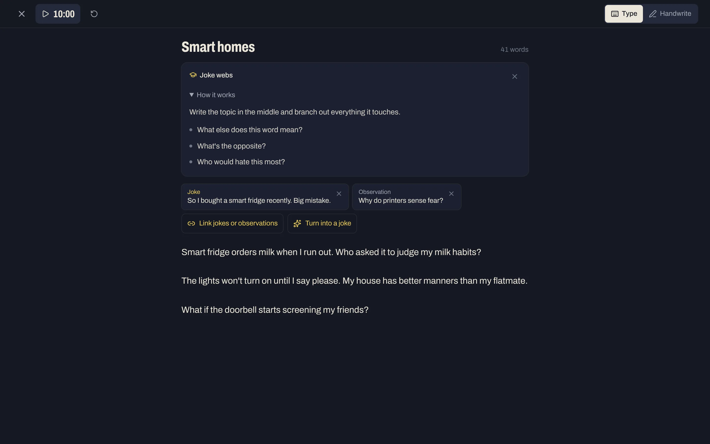

## Voice notes: `/voice`

[VoicePage.tsx](../web/src/features/voice/VoicePage.tsx), [Recorder.tsx](../web/src/features/voice/Recorder.tsx),
[useRecorder.ts](../web/src/features/voice/useRecorder.ts), [loudness.ts](../web/src/features/voice/loudness.ts),
[NewNoteCard.tsx](../web/src/features/voice/NewNoteCard.tsx), [VoiceNoteRow.tsx](../web/src/features/voice/VoiceNoteRow.tsx),
[PlayButton.tsx](../web/src/features/voice/PlayButton.tsx), [usePlayer.ts](../web/src/features/voice/usePlayer.ts),
[outbox.ts](../web/src/features/voice/outbox.ts), [audioCache.ts](../web/src/features/voice/audioCache.ts),
[useVoiceLibrary.ts](../web/src/features/voice/useVoiceLibrary.ts).

- **Recorder:** a big yellow mic. While recording, it shows the elapsed time, a 7-bar level
  meter scrolling left, and "Screen stays on" once the phone agrees to keep the screen awake. If it
  refuses (an iPhone before iOS 18.4 from the Home Screen, a browser without the Wake Lock API), it
  says "Screen may lock: tap it now and then" in amber instead. If the phone takes the mic, a toast
  says so and the card opens with what was recorded.
- **New voice note card:** appears as soon as you stop. It has play and scrub controls, a title, and
  hashtags, while the recording uploads in the background. **Done** files the note and
  **Delete** throws it away.
- **Library:** a search box over labels and hashtags, hashtag chips with their counts, and one row
  per note (play, label, length, date, hashtags, **Turn into a joke**, edit, delete, and **Jokes
  from it** once there are some; Turn into a joke opens New joke with the hashtags and the
  recording playable under the words, the setup left to you), grouped by month under pinned
  headings, **Newest first** or **Oldest first** (`?order=old`), with the time scrubber down the
  right edge.
- **Storage bar:** how much of the 1 GB of free Blob storage the recordings use.

How recording, the meter, the outbox and playback work is covered in
[frontend.md](frontend.md#voice-notes-pipeline).

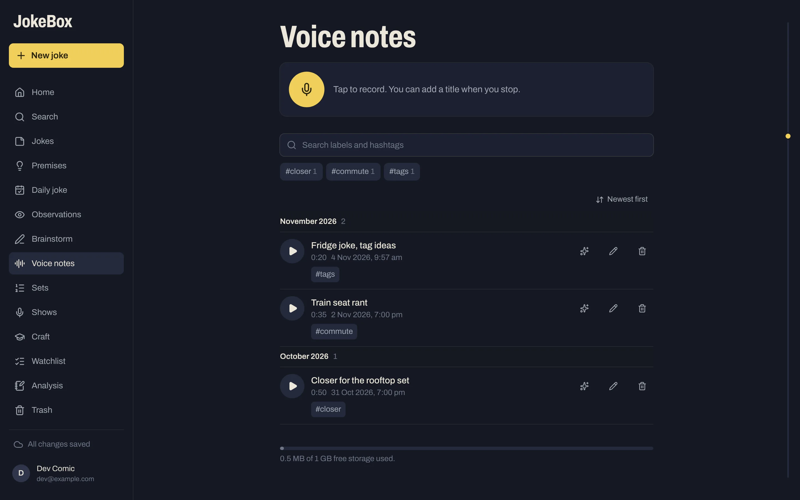

## Perform and study screens

Sets, Stage, Print, Shows, Watchlist and Analysis are in
[screens-perform.md](screens-perform.md).
