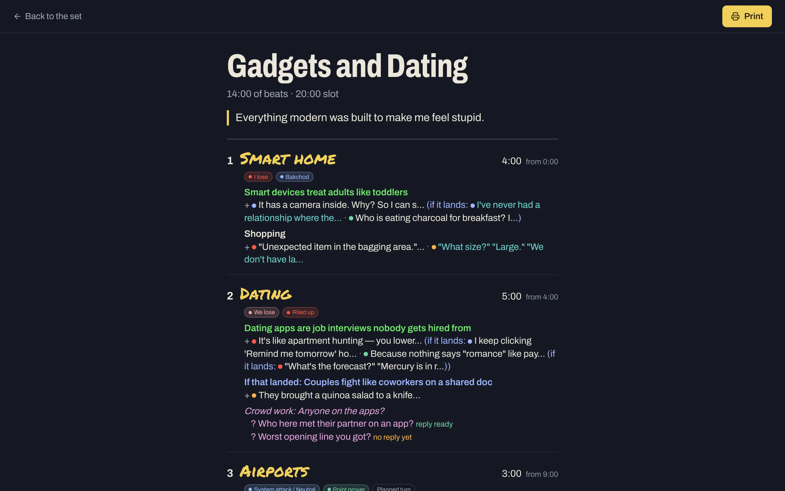

# Sets: beats, gates and labels

How a set is kept in JokeBox, what every part means, and why it's built this way. The in-app
version is **How sets work** (the ? on Sets and in the builder,
[SetGuide.tsx](../web/src/features/sets/SetGuide.tsx)). Keep the two saying the same thing. The
screens are in [screens-perform.md](screens-perform.md#sets-sets-and-setssetid), and the
storage is in [data-model.md](data-model.md).

## The idea

A set used to be one tape strip per joke in a line, with "optional" meaning only that a joke
didn't count towards the time. That's a script, and a comic doesn't remember a set as a script.
You remember a **broad sequence**. Some parts of it are fixed in order and some are loose, and a
few jokes only go in if the one before them landed. The Craft note "Hold the shape" says it in a
line: *the set list is the case, not a script*.

So a set is now a point plus a **spine of beats**. You memorise the spine (one cue word per
beat). Everything that depends on the room happens inside a beat.

## The parts

| Part | What it is | Where |
|---|---|---|
| **Point** | One sentence: what the room should think by the end | `setlists.point` |
| **Beat** | A section of the set, in a fixed order. It has a cue word, its own time, a description, labels and one ordered list | `setlists.beats[]` |
| **Cue** | The one word you remember on stage for a beat | `beat.cue` |
| **Beat time** | Set by hand, per beat. The set's length is the beats' times added up | `beat.seconds` |
| **Premise entry** | A premise from your library with the jokes that rest on it, in order | `entry.kind = "premise"` |
| **Jokes with no premise** | A list of jokes that aren't under a premise. They can sit between premises | `entry.kind = "jokes"` |
| **Crowd work** | Plain-text questions for the room. Each question has replies ("if they say X → my line") and a Have a reply / No reply yet flag | `entry.kind = "crowd"` |
| **Locked / Loose** | Locked (tape yellow): done in this place. Loose (teal): it keeps its number, but you can move it or drop it on the night | `piece.loose` |
| **Gate** | A joke the next N jokes in the same list depend on. If it doesn't land, you skip them. Sky blue | `piece.gate` (N) |
| **Premise gate** | A premise after the first in a beat that's done only if the premise before it landed | `entry.gate` |
| **Cluster version** | A joke from a cluster follows the cluster's lead unless the set pins that version | `piece.cluster_id`, `piece.pinned` |
| **Labels** | Per beat, per set: an option from each of your label fields, or Not sure | `beat.labels` |
| **Shift reason** | When the status group changes from the beat before: Top-up, Planned turn or Clash | `beat.shift_reason` |

### Label fields

Every account starts with four fields. You can rename, add and delete fields and their options
in **Fields** ([FieldsSheet.tsx](../web/src/features/sets/FieldsSheet.tsx)), stored in
`set_field_configs`.

| Field | Options | Used by |
|---|---|---|
| Status (the status track) | I win (win), Mixed (loss), System attack / Neutral (neutral), We lose (loss), I lose (loss) | The status track, the shift check, the top-up check |
| Persona side (the persona) | Riled up, Bakchod, Point prover | The persona check |
| Tone | Opinionated, Playful, Edgy, Heartfelt | Nothing: it's for you |
| Voice fit | Mine, Half, Anyone's | Nothing: it's for you |

Not sure is never stored as an option. A beat with no label for a field, or whose option was
deleted, is Not sure. That's why it's always there and can't be removed. One field at most is
the status track, and one at most the persona.

## The checks

They sit under the status track. **Each one is a rule from a Craft note, counted from your own
labels.** None of them reads the jokes or guesses anything, and each says which note it comes
from ([beats.ts](../web/src/features/sets/beats.ts) `analyse`, tested in `beats.test.ts`).

| Check | Rule | Source |
|---|---|---|
| Shift with no reason | When a beat's status group (win, neutral, loss) differs from the beat before, it needs a reason | "Shift, don't flip", My status: a flow |
| Longest stretch with no humility top-up | The longest run of beat time with no loss beat stays under your limit (4:00 to start, editable). Neutral and win add to the run, a loss ends it, and Not sure leaves it as it was | "every 2–4 minutes", My status: a flow |
| Persona sides | Every option of the persona field labels at least one beat | "The persona is the balance", My persona |
| Not sure | Counted and listed, never judged | |

## On stage and the cue card

- **On stage** ([StageView.tsx](../web/src/features/sets/StageView.tsx),
  [stageWalk.ts](../web/src/features/sets/stageWalk.ts)) walks the set one beat at a time. Each
  joke shows its punchline as the cue line, coloured as in the builder. A gate is asked when you
  reach it (It landed / It didn't). If it didn't, what it guards is struck out. A gate that is
  itself struck out is never asked, and what it guards goes too. Tap an answered gate to take the
  answer back. **Next** always goes to the next beat.
- **The cue card** ([PrintView.tsx](../web/src/features/sets/PrintView.tsx)) is what you
  memorise: the point, then each beat's cue, time and start, with its premises, its jokes with
  no premise (as punchlines) and its crowd work under it. It replaces the old printout.

  
  

## Decisions, and why

| Decision | Why | What else was tried |
|---|---|---|
| **Beats never branch.** Gates live only inside a beat | The spine is what you memorise. If beats could branch, there'd be no single order to remember | v1 had gates between beats; the comic ruled it out |
| **No fixed counts** of beats, premises or jokes | Sets differ: a story set has few beats, a one-liner set many | v1 suggested 4–6 beats per 5 minutes |
| **Time is set per beat, never summed from jokes** | A joke's runtime on paper isn't its time on stage (tags, pauses, crowd). The comic knows how long a section runs | Summing joke runtimes, as the old builder did |
| **Loose keeps its number**, it's only coloured | Loose means flexible on the night, not unordered. The order you wrote is still the plan | v3 had "pools" with no order; the comic found that wrong |
| **A gate guards the next N jokes**, set with + and − | One control on the joke itself, no extra objects to build | "Runs" and "pools" (jargon the comic didn't use) |
| **Labels live on the beat in the set, not on jokes** | The same joke can play a different status in another set. The comic asked for this explicitly | Labels on jokes |
| **Fields are the comic's own**, with Not sure always there | Labels are a thinking tool. A forced answer is worse than an honest Not sure | Fixed fields |
| **Neutral status** (System attack / Neutral) | Attacking the system together is neither a win nor a top-up | v2 had only win and loss shades |
| **"Mixed"**, not "Both" | "Both" was unclear. The comic may rename it, which is what Fields is for | |
| **Checks are deterministic and quote their note** | The comic distrusts AI-judged analysis. A rule he wrote, applied to labels he chose, can be checked by hand | v2's checks guessed from jokes and used invented thresholds |
| **No new-room / known-room toggle** | Not something he plans a set around | v2 had it |
| **Clusters follow the lead unless pinned** | Changing your lead in Jokes should update every set that plays it. Pin when a set needs one version | Copying the joke id at add time |
| **Beats are JSON on the set, `items` worked out from them** | A set is saved whole already (one `PUT`, one version). Keeping `setlist_items` means a joke's "In sets", show logging and the connector's "sets it's in" keep working unchanged | New `set_beats` and `set_entries` tables: more joins, more migrations, and the same whole-set saves |
| **Sets from before read as one beat**, with no data migration | Nothing to move, and nothing breaks if an older app is still open | Rewriting every set in the migration |
| **An older app's save keeps the beats** | A save queued offline by an app from before beats sends only `items`. Taking those over would wipe the beats | |

## Compatibility

- **Older sets** (`beats` is null) read as one beat called Set. It holds their jokes in order, with
  optional as loose, and its time is what those jokes added up to. The first save writes real beats.
- **Older apps** send `items` and no `beats` or `point`. The server keeps the stored beats and
  point, and works the items out from them. For a set that has no beats yet, it takes the items as before.
- **The connector**: `list_sets` adds `point` and `beat_count`, and its `runtime_seconds` is the
  beats' time. `get_set` adds `beats`, with label names, and keeps `running_order` with every
  field it had (`optional` is now the same as the new `loose`). See [api.md](api.md).
- **The Trash**: a joke in the Trash is hidden from its beat and keeps its place there, as it did
  in the old list.
