# Sets: beats, gates and labels

How a set is kept in JokeBox, what every part means, and why it's built this way. The in-app
version is **How sets work** (the ? on Sets and in the builder,
[SetGuide.tsx](../web/src/features/sets/SetGuide.tsx)). Keep the two saying the same thing. The
screens are in [screens-perform.md](screens-perform.md#sets-sets-and-setssetid), and the
storage is in [data-model.md](data-model.md).

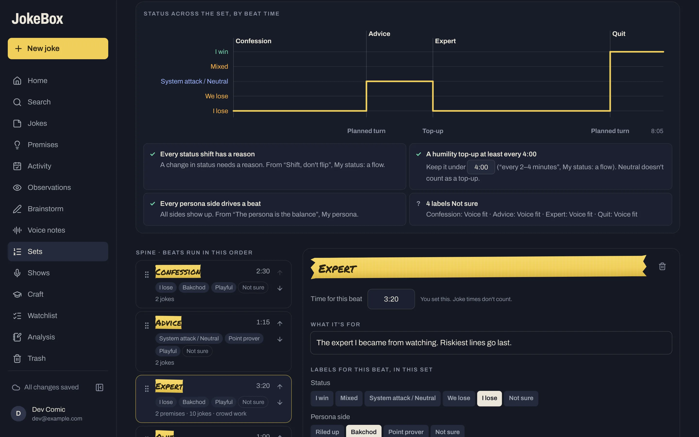

## The idea

A set used to be one tape strip per joke in a line, with "optional" meaning only that a joke
didn't count towards the time. That's a script, and a comic doesn't remember a set as a script.
You remember a **broad sequence**. Some parts of it are fixed in order and some are loose, and a
few jokes only go in if the one before them landed. The Craft note "Hold the shape" says it in a
line: *the set list is the case, not a script*.

So a set is now a point plus a **spine of beats**. You memorise the spine (one cue word per
beat). Everything that depends on the room happens inside a beat.

## The parts

| Part | What it is | Where |
|---|---|---|
| **Point** | One sentence: what the room should think by the end | `setlists.point` |
| **Status** | Where the set stands: Draft (every set starts there), Work in Progress, Stage Ready or Discarded. The same four as premises and observations. The Sets screen filters by it, and All leaves Discarded out | `setlists.status` |
| **Beat** | A section of the set, in a fixed order. It has a cue word, its own time, a description, labels and one ordered list | `setlists.beats[]` |
| **Cue** | The one word you remember on stage for a beat | `beat.cue` |
| **Beat time** | Set by hand, per beat. The set's length is the beats' times added up | `beat.seconds` |
| **Premise entry** | A premise from your library with the jokes that rest on it, in order | `entry.kind = "premise"` |
| **Jokes with no premise** | A list of jokes that aren't under a premise. They can sit between premises. Select some to put them under a premise later | `entry.kind = "jokes"` |
| **Crowd work** | Plain-text questions for the room. Each question has replies ("if they say X → my line") and a Have a reply / No reply yet flag | `entry.kind = "crowd"` |
| **Locked / Loose** | Locked (tape yellow): done in this place. Loose (teal): it keeps its number, but you can move it or drop it on the night | `piece.loose` |
| **Gate** | A box: a joke on top, and inside it the jokes you do only if it lands. If it doesn't, you skip the box. A gate can hold one gate of its own, no deeper. Sky blue | `piece.gate` (N: how many jokes after it are inside) |
| **Premise gate** | A premise after the first in a beat that's done only if the premise before it landed | `entry.gate` |
| **Cluster version** | A joke from a cluster follows the cluster's lead unless the set pins that version | `piece.cluster_id`, `piece.pinned` |
| **Labels** | Per beat, per set: an option from each of your label fields, or Not sure | `beat.labels` |
| **Shift reason** | When the status group changes from the beat before: Top-up, Planned turn or Clash | `beat.shift_reason` |

### Label fields

Every account starts with four fields. Open **Label fields** with **Edit labels** beside a
beat's labels (or the sliders at the top of the builder)
([FieldsSheet.tsx](../web/src/features/sets/FieldsSheet.tsx)), stored in `set_field_configs`.
There you add, rename and delete fields and their options: tap an option to rename it, × to
delete it. A rename keeps the option's id, so every beat and joke that has it shows the new name.

| Field | Options | Used by |
|---|---|---|
| Status (the status track) | I win (win), Mixed (loss), System attack / Neutral (neutral), We lose (loss), I lose (loss) | The status track, the shift check, the top-up check |
| Dominant persona side (the persona) | Riled up, Bakchod, Point prover | The persona check, and each joke's Persona |
| Tone | Opinionated, Playful, Edgy, Heartfelt | Nothing: it's for you |
| Voice fit | Mine, Half, Anyone's | Nothing: it's for you |

Not sure is never stored as an option. A beat with no label for a field, or whose option was
deleted, is Not sure. That's why it's always there and can't be removed. One field at most is
the status track, and one at most the persona.

**Deleting says what it touches first.** Deleting an option that's in use asks first, with the
count: "Edgy is on 3 beats in 2 sets. They'll be Not sure." For the persona it counts jokes too.
Deleting a whole field does the same, and says when the status track or the persona check goes
with it. Nothing is rewritten: the beats keep the old id, which no option has now, so they read
as Not sure everywhere (the builder, the checks, the cue card, Claude). The counts come from
[fieldUsage.ts](../web/src/features/sets/fieldUsage.ts).

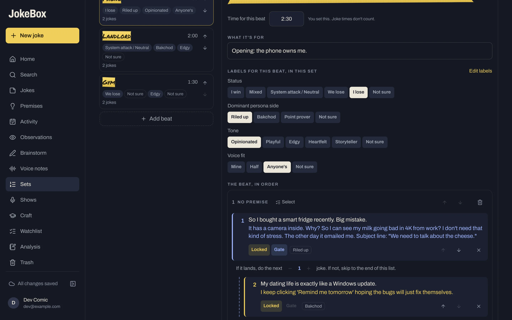
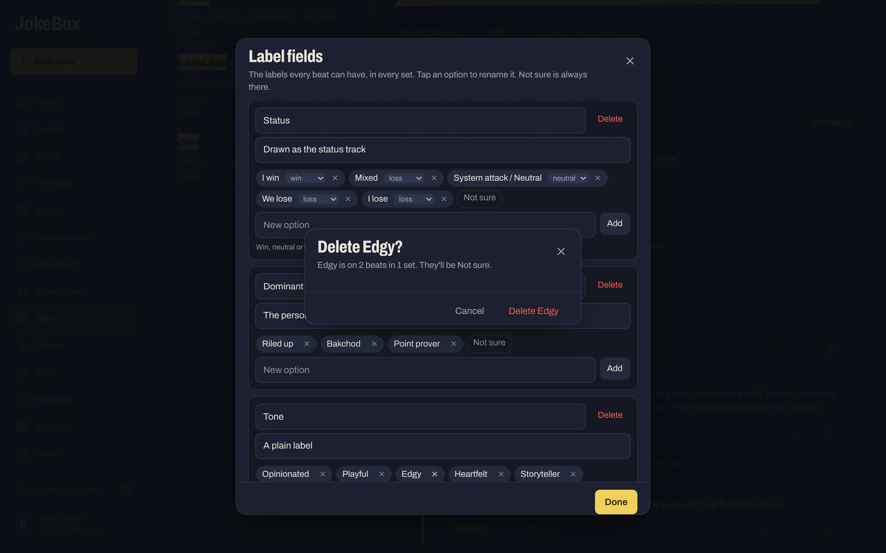

### Vibe and Generic, on jokes and premises

A beat's label is about the beat in this set. **Vibe** and **Generic** are about the material
itself, so they're saved on the joke or the premise, not the set.

- **Vibe** is which side of you it shows: Riled up, Bakchod, Point prover, or Not sure. It picks
  from the persona field's options (the ones a beat's Dominant persona side uses), so there's one
  list. Stored as `persona`, an option id; one deleted later reads as Not sure.
- **Generic** says whether anyone could do it (Generic) or it's yours (Non-generic). Every joke
  and premise should have one, but a save never waits on it: until it's answered it shows an amber
  **Generic?**, and the Generic filter on Jokes and Premises (**Generic not answered**) finds the
  rest. Stored as `generic`, true, false or null.

In a set, both sit beside a joke's Locked and Gate, and under a premise's take, as small menus:
tap to pick. Picking one saves the joke or premise right away. They're also on the joke's and the
premise's pages, in the joke peek, as filters, in the CSV export, and to Claude (`vibe` and
`generic` in `get_jokes`, `list_premises` and `get_premise`). A save that leaves either out keeps
what's stored.

  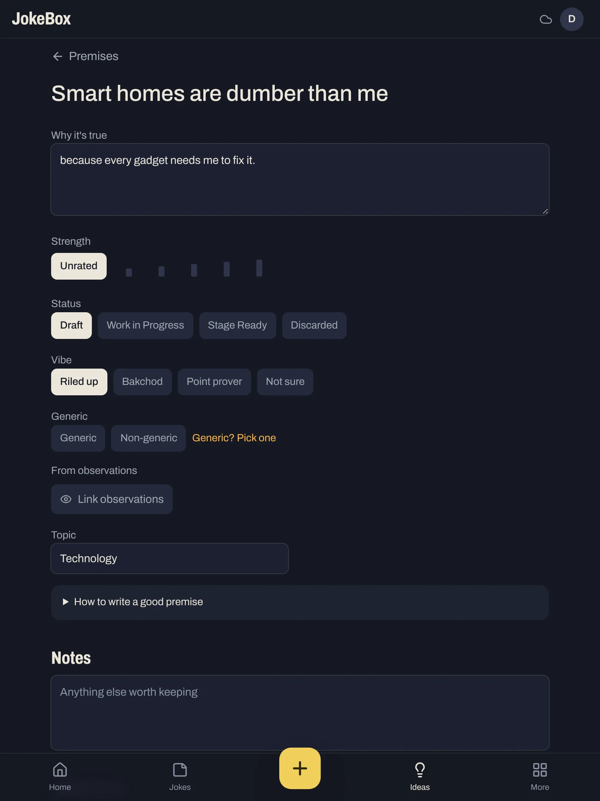
  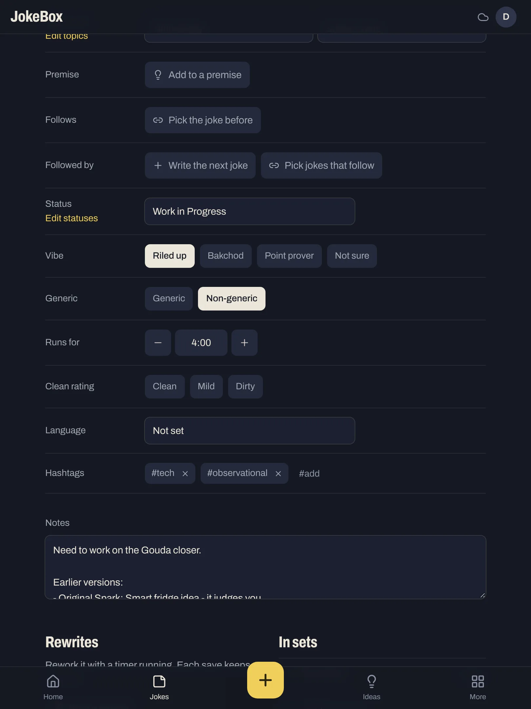
  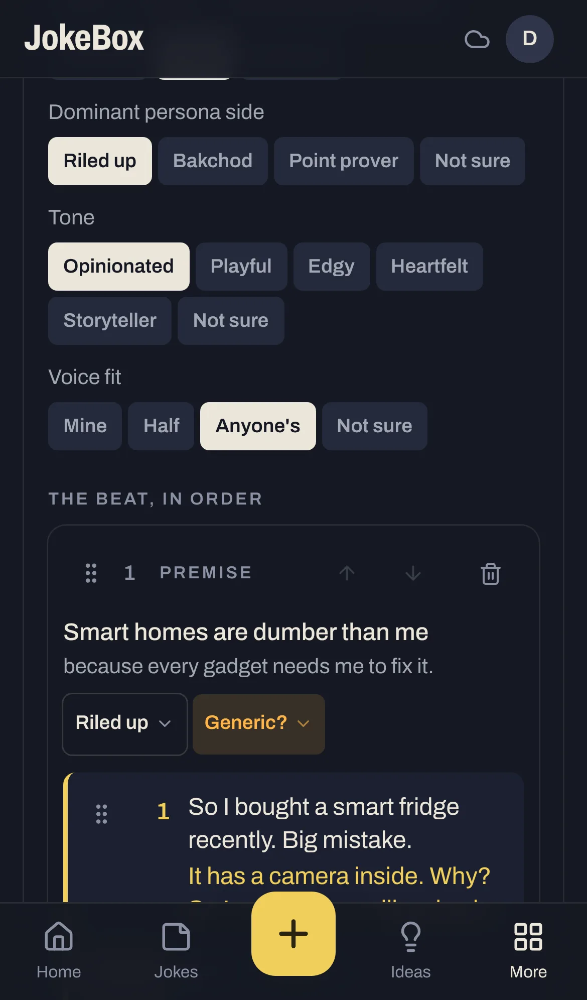

## Drag and arrows

Everything moves inside one beat; beats move in the spine. You can move a thing four ways, and
all four follow the same rules: drag it by its **grip** (⋮⋮), press its **arrows**, pick a place
from a joke's **Move** menu, or, with a keyboard, Tab to the grip, Space, the arrow keys, Space
(Escape puts it back). The logic is pure
and tested: [gateRows.ts](../web/src/features/sets/gateRows.ts) reads a list as gate boxes,
[beatMove.ts](../web/src/features/sets/beatMove.ts) moves jokes and blocks,
[gateEdit.ts](../web/src/features/sets/gateEdit.ts) makes gates and walks the arrows,
[moveTo.ts](../web/src/features/sets/moveTo.ts) is the Move menu, and
[useBeatDrag.ts](../web/src/features/sets/useBeatDrag.ts) is the dragging itself.

  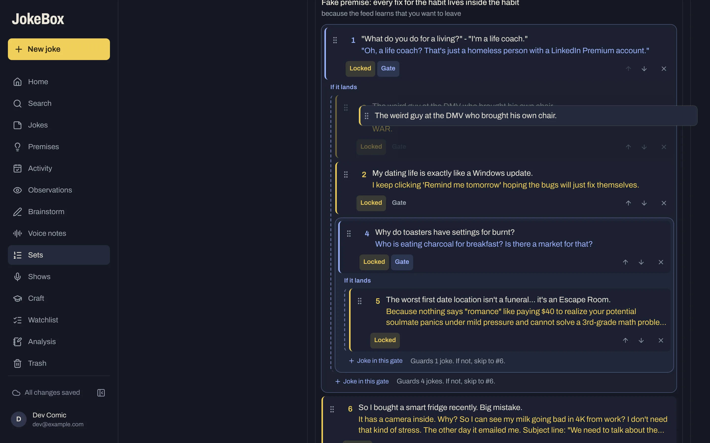
  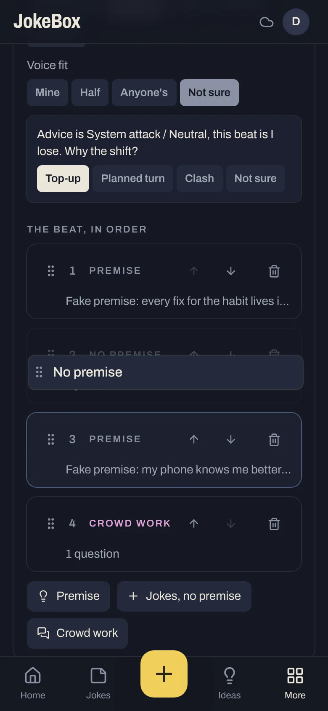

### Beats and blocks

| You move | Where | What you end up with |
|---|---|---|
| A beat | Anywhere in the spine | A new running order. Its labels, time and contents go with it; the shift flags and checks follow the new order |
| A block (premise, No premise, crowd work) | Anywhere among the blocks of its beat | Its jokes and gates come with it. While you drag, every block folds to its heading |
| A premise that becomes the beat's first | | Its premise gate turns off: there's no premise before it |
| A block into another block, or another beat | Not allowed | Blocks don't nest; take it out and add it there |

### Jokes and gates

| You drag | Drop it | What you end up with |
|---|---|---|
| A joke | Between jokes of its block | Reordered |
| A joke | Inside a gate's box (or an inner gate's) | It's done only if that gate (and the gate around it) lands |
| A joke in a gate | Outside the box | Not gated any more. A gate left with no jokes is a plain joke again |
| A gate's joke | Anywhere | The whole box moves, inner gate and all |
| A gate | Inside another gate | It becomes that gate's inner gate, if it has none of its own; a gate with an inner gate can't go in (three levels). Never into itself |
| A joke or gate | Into another premise in the beat | Each joke rests on that premise in your library. One resting on another premise asks first, and Cancel puts it back. Undo after |
| A joke or gate | Into No premise | Only the set changes |
| A joke | Into an empty block | Drop it on "No jokes here yet" |
| A joke | Into crowd work, or another beat | Not allowed |

A drop that isn't allowed is never offered: the box doesn't light up, and the joke goes back.
A No premise block that a drop leaves empty goes; an emptied premise stays, so you can add to it
or remove it.

### Move

**Move** on a joke opens a menu of where it can go, by name. It does what a drag does, without
the drag: on a phone, when the other block is far down the beat, or when it doesn't exist yet.

| Pick | What you end up with |
|---|---|
| Out of the premise | In No premise just below the premise: at the top of the one already there, else a new one. Only the set changes: in your library it still rests on that premise, and the toast says so |
| Into N · No premise, or Into N · a premise | At the end of that block (N is its number in the beat). Into a premise, it rests on it in your library, as when dragged there |
| Under another premise… | The premise sheet, with **New premise**. It goes into that premise's block if the beat has it, else into a new premise block just below. It rests on it in your library; one on another premise asks first |

A gate's joke brings its box; a joke inside a gate comes out of the gate. Every move has Undo.

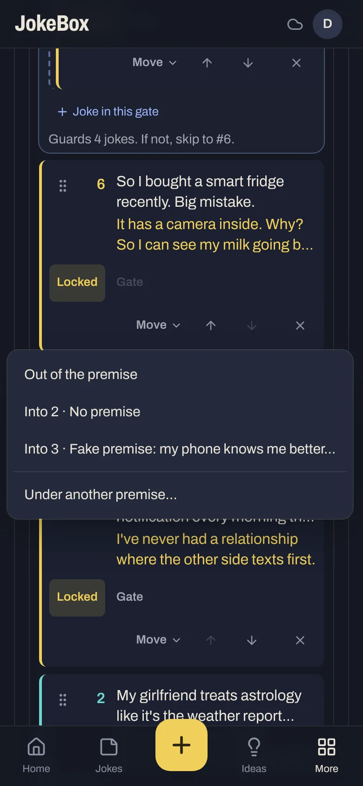

### The arrows

Each press moves a thing one place, to what you see next to it, so pressing ↑ again and again
walks a joke up through every gate on the way:

- Just below a gate's box, ↑ goes into it, last. Just above one, ↓ goes in, first.
- At the top of a box, ↑ comes out above its joke; at the bottom, ↓ comes out below the box.
- A gate goes into a neighbouring gate only if it has no inner gate; otherwise it steps past it.
- The arrows never leave the block (drag, Move, or Select and "Put under a premise", for that), and are
  greyed out at its ends.

### Making gates

- **Gate** on a joke takes in the joke under it (with that joke's own gate, if the two levels
  allow). It's greyed out when there's nothing under it or the levels are used up, and jokes inside
  an inner gate have no Gate button.
- **Gate** on a gate's joke opens the box: its jokes stay where they are, one level up.
- **+ Joke in this gate** adds from the joke picker straight into the end of the gate.
- In Select mode (ticking jokes for a premise), the grips and arrows step aside.

## The checks

They sit under the status track. **Each one is a rule from a Craft note, counted from your own
labels.** None of them reads the jokes or guesses anything, and each says which note it comes
from ([checks.ts](../web/src/features/sets/checks.ts) `setChecks`, over
[beats.ts](../web/src/features/sets/beats.ts) `analyse`, tested in `checks.test.ts` and
`beats.test.ts`). The builder and the set's card use the same results.

| Check | Rule | Applies once | Source |
|---|---|---|---|
| A status shift needs a reason | When a beat's status group (win, neutral, loss) differs from the last labelled beat before it (Not sure beats between don't hide it), it needs a reason | Two beats have a status | "Shift, don't flip", My status: a flow |
| A humility top-up at least every 4:00 | The longest run of beat time with no loss beat stays under your limit (4:00 to start, editable). Win and neutral add to the run; a loss ends it | The set is longer than the limit | "every 2–4 minutes", My status: a flow; What Indian rooms reward |
| Every persona side drives a beat | Every option of the persona field labels at least one beat | There's a beat for each side | "The persona is the balance", My persona |
| Not sure | Listed by beat, with which labels hold a check back. Not a check | | |

### When a check doesn't apply yet

A check gives one of four answers. **✓** and **!** are the rule passed or failed. The other two are
greyed out, with a tag and a line saying what's needed, because a tick there would be one the set
hasn't earned (a one-beat set used to show "Longest stretch with no top-up: 0:00 ✓"):

- **Needs more beats**: the set is too short for the rule to bite. One beat can't shift, a 2:00 set
  can't go 4:00 without a top-up, two beats can't hold three persona sides.
- **Needs labels**: the answer depends on beats left Not sure. The shift check needs two beats
  with a status. The persona check waits while a missing side could still be on a Not sure beat.
  The top-up check is worked out twice: with every Not sure beat as a top-up (if the stretch is
  still too long, it warns, and that stretch is shaded on the track) and with none of them as one
  (if it's still fine, it ticks). In between, it names the Not sure beats in the long stretch.

None of these thresholds is a number picked for the app: each follows from the rule it guards.
The one number, the 4:00 limit, is the top of "every 2–4 minutes" and is yours to change.

  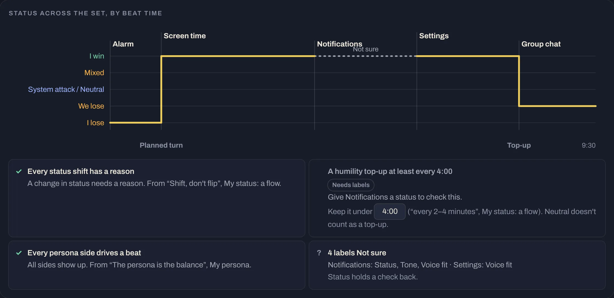
  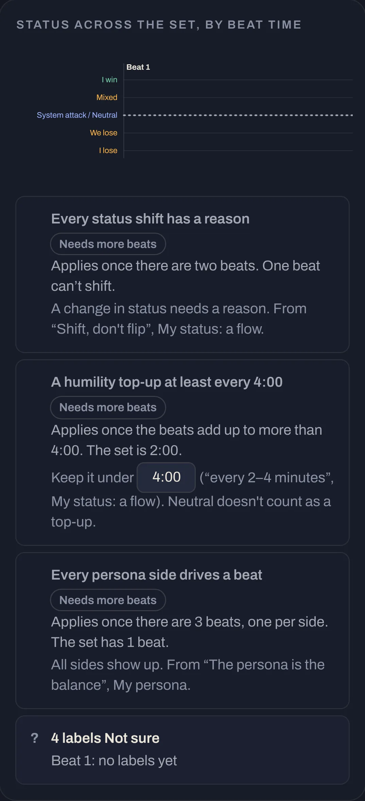

On a set's card, only ✓ and ! show as pills. Checks that don't apply yet fold into one grey pill
("2 checks need more beats").

## The Sets screen

Each set is a card ([SetCard.tsx](../web/src/features/sets/SetCard.tsx)), so you see a set's shape
without opening it: its point, its spine as yellow cue strips sized by beat time with the status
colour under each, its checks in a word each, and its length against the slot. The checks are the
builder's, from [setCard.ts](../web/src/features/sets/setCard.ts) `cardChecks`. Checks that don't
apply yet fold into one grey pill ("3 checks need more labels"). A set from before beats says
so and offers **Split into beats**. Chips filter by status. The four steps of a set sit on top
until you hide them, and **How sets work** opens the whole guide.

  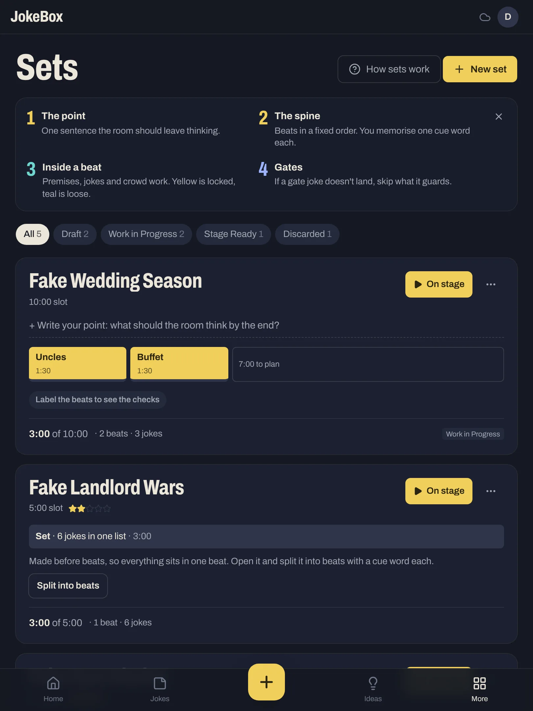
  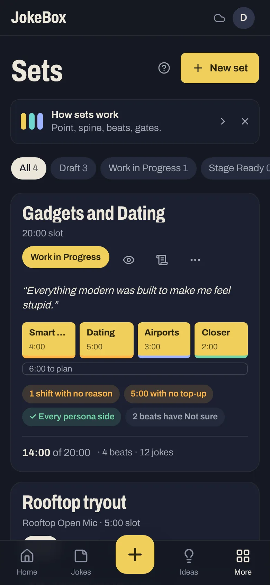

## On stage and the cue card

- **On stage** ([StageView.tsx](../web/src/features/sets/StageView.tsx),
  [stageWalk.ts](../web/src/features/sets/stageWalk.ts)) walks the set one beat at a time. Each
  joke shows its punchline as the cue line, coloured as in the builder. A gate is asked when you
  reach it (It landed / It didn't). If it didn't, what it guards is struck out. A gate that is
  itself struck out is never asked, and what it guards goes too. Tap an answered gate to take the
  answer back. **Next** always goes to the next beat.
- **The cue card** ([PrintView.tsx](../web/src/features/sets/PrintView.tsx)) is what you
  memorise: the point, then each beat's cue, time and start, with its premises, its jokes with
  no premise (as punchlines) and its crowd work under it. It replaces the old printout.

  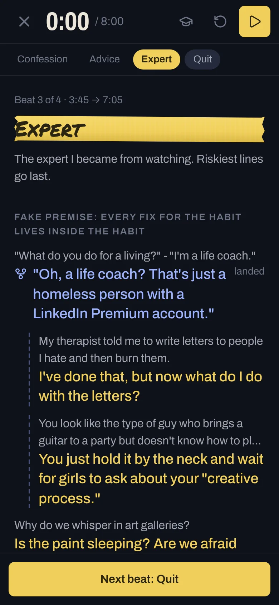
  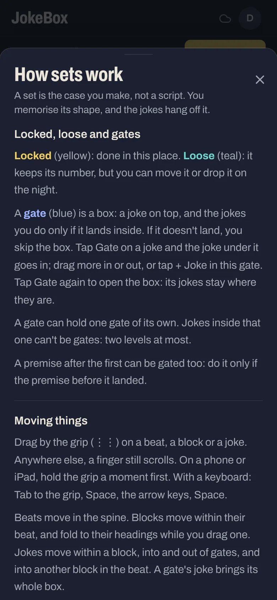

## Decisions, and why

| Decision | Why | What else was tried |
|---|---|---|
| **Beats never branch.** Gates live only inside a beat | The spine is what you memorise. If beats could branch, there'd be no single order to remember | v1 had gates between beats; the comic ruled it out |
| **No fixed counts** of beats, premises or jokes | Sets differ: a story set has few beats, a one-liner set many | v1 suggested 4–6 beats per 5 minutes |
| **Time is set per beat, never summed from jokes** | A joke's runtime on paper isn't its time on stage (tags, pauses, crowd). The comic knows how long a section runs | Summing joke runtimes, as the old builder did |
| **Loose keeps its number**, it's only coloured | Loose means flexible on the night, not unordered. The order you wrote is still the plan | v3 had "pools" with no order; the comic found that wrong |
| **A gate guards the next N jokes**, stored as N on the joke | One number on the joke itself, no extra objects to store, so older sets and apps read it as before | "Runs" and "pools" (jargon the comic didn't use) |
| **A gate is a box you drag jokes into** | Tapping + and − to stretch a gate over the jokes after it was hard to follow: what's in the box is what it guards | The + and − count |
| **Gates nest two levels, no deeper** | A gate inside a gate is useful (a joke that only works if the room took the one before it); a third level is more than a set needs and fiddly to drag on a phone. The comic set the cap | Any depth; one level |
| **Drag only from the grip** | A finger on a joke still scrolls the page and opens the joke; only the grip starts a drag, after a short hold on touch | Drag from anywhere on the row (it fights scrolling on a phone) |
| **The arrows stay, and walk through gates** | Dragging can fail (a stiff finger, a screen reader), and the arrows are exact. One place per press is predictable | Arrows removed; arrows that jump over a whole gate |
| **A joke dragged into a premise rests on it** | The same rule as adding it there: the set and the library agree. Moving one off another premise asks first | Dragging that changed only the set |
| **Move names where a joke goes** | A drag needs the other block on screen and a steady hand, and in a beat with one premise there's nowhere to drag to. A menu of the beat's blocks, plus any premise, works anywhere | Drag only; a separate "Take out of the premise" button |
| **Dragging stays inside a beat** | One beat is open at a time, and a joke between beats changes what you memorise. Take it out and add it to the other beat | Dragging onto a beat in the spine |
| **Labels live on the beat in the set, not on jokes** | The same joke can play a different status in another set. The comic asked for this explicitly | Labels on jokes |
| **Vibe is the material's own, from the same list** | A beat's labels depend on the set, but the side of you a joke or premise shows doesn't. One list (the persona field's options) means beats and material use the same three sides | A fixed list on jokes, apart from the beats' |
| **Generic is flagged, not forced** | Older material can't all be answered at once, and a forced question would slow quick capture. An amber Generic? and a filter nag without ever holding up a save. The comic chose this | Asking before a new joke saves |
| **Deleting an option asks first, and rewrites nothing** | A delete you didn't mean costs labels you chose by hand, so it says how many first. Not rewriting the beats keeps the delete one save, and Not sure is already what an unknown id reads as | Deleting silently (the first version) |
| **Fields are the comic's own**, with Not sure always there | Labels are a thinking tool. A forced answer is worse than an honest Not sure | Fixed fields |
| **Neutral status** (System attack / Neutral) | Attacking the system together is neither a win nor a top-up | v2 had only win and loss shades |
| **"Mixed"**, not "Both" | "Both" was unclear. The comic may rename it, which is what Fields is for | |
| **A check that can't apply yet says so**, greyed out, instead of ticking | A one-beat set showed ticks for rules it couldn't break ("0:00 with no top-up ✓") and a persona warning no single beat could fix. Each check now applies only once the set can break its rule, a threshold that follows from the rule itself, and never guesses Not sure | Ticks from the first beat (the comic found them meaningless) |
| **Checks are deterministic and quote their note** | The comic distrusts AI-judged analysis. A rule he wrote, applied to labels he chose, can be checked by hand | v2's checks guessed from jokes and used invented thresholds |
| **No new-room / known-room toggle** | Not something he plans a set around | v2 had it |
| **A joke under a premise in a set rests on it in your library** | A premise is the take its jokes rest on. If the set says a joke sits under a premise but the joke says it doesn't, the two disagree and one of them is wrong. Putting jokes under a premise (adding them to it, or picking loose ones and choosing a premise) saves the premise on each joke, so it shows on the joke and in the premise's jokes. A joke rests on one premise at a time, so one that moves says so first. The premise keeps its other jokes, in the set or not | A premise only in the set, leaving the library as it was |
| **The set's pickers are the library's own** | The Jokes tab's filters and the joke's premise sheet are what the comic already knows; a second set of pickers in the builder searched less and looked different | Set-only pickers with status and clean-rating chips |
| **A cluster is one row in the joke picker, adding its lead** | A cluster is one piece of material. The lead is the version you'd do tonight, so it's the default; another version is a choice, and pinned | Every version as its own row, with a warning when two went in |
| **Clusters follow the lead unless pinned** | Changing your lead in Jokes should update every set that plays it. Pin when a set needs one version | Copying the joke id at add time |
| **Beats are JSON on the set, `items` worked out from them** | A set is saved whole already (one `PUT`, one version). Keeping `setlist_items` means a joke's "In sets", show logging and the connector's "sets it's in" keep working unchanged | New `set_beats` and `set_entries` tables: more joins, more migrations, and the same whole-set saves |
| **Sets from before read as one beat**, with no data migration | Nothing to move, and nothing breaks if an older app is still open | Rewriting every set in the migration |
| **Sets are filtered by status, not tags** | A tag says what a set is; a status says where it is, which is what you look for before a show. The same four as premises and observations, so the words mean one thing everywhere. Tags stay on the card and in the builder | Chips per tag in use |
| **The set's shape is on its card** | The spine and checks are the point of a set. Hiding them behind a tap made the list look empty | Cards with counts and a time bar only |
| **An older app's save keeps the beats** | A save queued offline by an app from before beats sends only `items`. Taking those over would wipe the beats | |

## Compatibility

- **Older sets** (`beats` is null) read as one beat called Set. It holds their jokes in order, with
  optional as loose, and its time is what those jokes added up to. The first save writes real beats.
- **Older apps** send `items` and no `beats` or `point`. The server keeps the stored beats and
  point, and works the items out from them. For a set that has no beats yet, it takes the items as before.
  An older app can't change a set's jokes once it has beats: a save whose jokes differ is
  refused (409, "Reload the app"), so the change isn't dropped silently. Its other details save.
- **The connector**: `list_sets` adds `point` and `beat_count`, and its `runtime_seconds` is the
  beats' time. `get_set` adds `beats`, with label names, and keeps `running_order` with every
  field it had (`optional` is now the same as the new `loose`). See [api.md](api.md).
- **Gates that don't fit**: a gate nested three deep, or one that runs past the end of the gate it
  sits in, folds into the gate around it, so every joke that was guarded still is. The app does it
  as it reads the list ([gateRows.ts](../web/src/features/sets/gateRows.ts) `fitGates`) and the
  server as it saves ([set_beats.py](../app/services/set_beats.py) `clamp`), with the same cases in
  `gateEdit.test.ts` and `tests/test_set_gates.py`.
- **The Trash**: a joke in the Trash is hidden from its beat and keeps its place there, as it did
  in the old list. A gate counts only the jokes shown, and widens again over a guarded joke put
  back. A premise in the Trash keeps its place too. A joke erased for good drops out of `items`.
- **Clusters**: a set's `items` list what its beats play now, so a new lead shows in "In sets"
  at once. A joke clustered after it went into a set follows its cluster from the next save
  (pinned to itself unless it's the lead).
